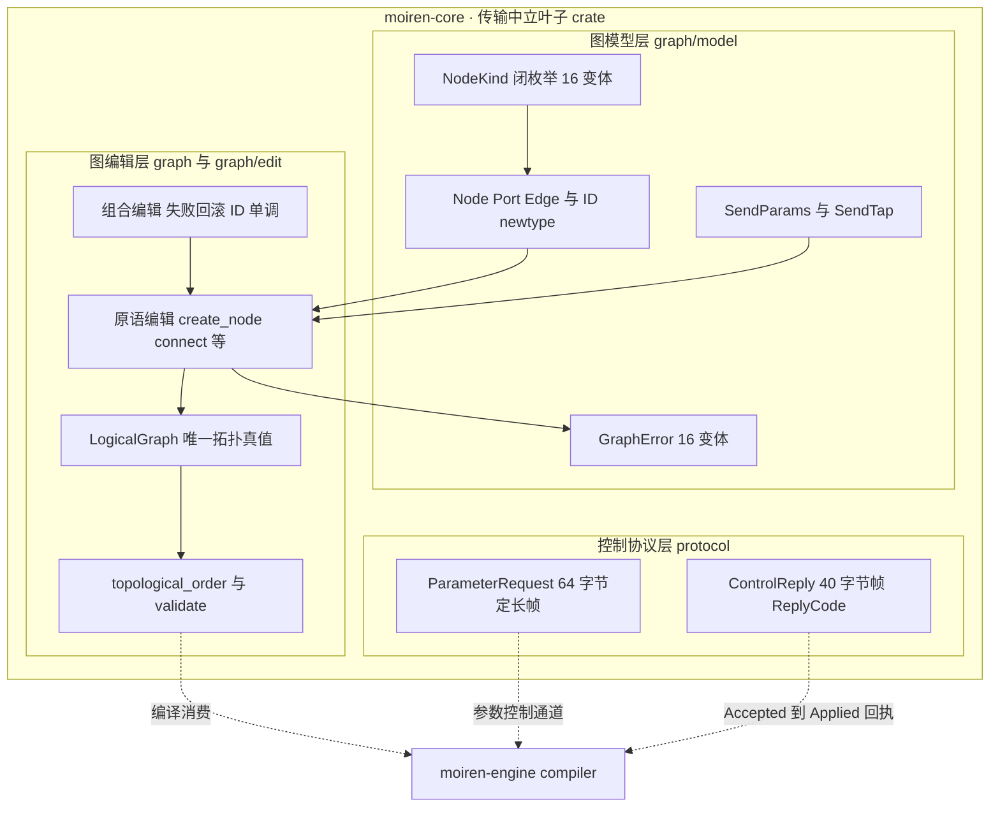

# moiren-core 架构审计（2026-11-20）

基线：main @ `d8610e05`。方法：子代理 `audit-core-signal` 逐文件通读 src（6 文件）+ 集成测试；依赖方向与 engine 消费面经 grep 验证；主代理复核收录。

## 职责摘要

可编辑、传输中立的 `LogicalGraph`（唯一拓扑真值）+ 版本化控制协议。纯非 RT：无 DSP、无缓冲、无线程、无平台代码。端口承载流而非通道或实时地址；只有图操作可变更模型。`#![forbid(unsafe_code)]`，唯一依赖 thiserror，真叶子 crate，可独立跑 Miri。

## 公共 API 面

- `graph::model`：`NodeKind` 闭枚举（16 变体，`model.rs:46-76`）、`Node`/`Port`/`Edge`（字段 `pub(super)` 封装）、`NodeId`/`PortId`/`EdgeId` newtype、`SendParams`/`SendTap`（`model.rs:156-193`）、`GraphError` 16 变体。
- `graph::LogicalGraph`：原语编辑 `create_node`/`create_channel_mapper`/`create_rack`/`add_input_port`/`add_output_port`/`remove_*_port`/`connect`/`disconnect`/`remove_node`/`set_send_params`/`set_node_channels`（`graph.rs:344`）；探测式 `can_connect`（`graph.rs:327`）；`topological_order`（Kahn，取最旧就绪，`graph.rs:503`）；`validate`（`graph.rs:528`）。
- `graph::edit`：组合命令 `connect_to_new_bus_input`，失败回滚新增端口、ID 仍单调（`edit.rs:7-24`）。
- `protocol`：`ParameterRequest`/`ControlReply`/`ParamValue`/`ApplyAt`/`ReplyCode`（10 码），定长帧 64/40 字节，`PROTOCOL_VERSION=1`（`protocol.rs:6-8`）。

关键不变量：端口地址空间 u16 契约（`graph.rs:12-14`）；ID 计数器先检查后提交、拒绝不改图（`graph.rs:146-191`）；`connect` 拒绝环/宽度不匹配/占用输入（`graph.rs:446-463`）；只有 Bus 输入与 Rack 输入/输出是动态端口（`graph.rs:19-24`）；读帧前先拒绝超长帧、NaN 拒绝、worker 只能回 Accepted 而 Applied 仅 RT（`protocol.rs:129-140,161`）。

## 架构图

**数据流**：编辑侧（app/engine 测试）通过原语或组合命令改图 → 编译前 `validate` + `topological_order` 重查结构契约 → 运行期参数走 `ParameterRequest` 帧携带 `plan_revision`/`timeline_epoch` 定位目标计划，RT 按 `ApplyAt::NextBlock/Frame` 应用后回 `Applied/AppliedLate` 与 `effective_frame`；帧内无任何实时内存地址跨 IPC（`protocol.rs:1-2`）。

## 与 engine 的衔接点（grep 验证，67 处引用）

- 图编译：`compiler/bindings.rs:4-5`、`compiler/send.rs`、`compiler/plan.rs`、`compiler/update.rs`、`compiler/observers.rs` 消费 `LogicalGraph/NodeKind/NodeId/PortId/PortRole` 及 `edge.params()`（`host/supervisor/requests.rs:166-174` 把 gain/pan/mute 降为 ParamValue）。
- 协议全域：`control/channel.rs:3`、`control/schema.rs`、`host/model.rs:9`、`host/retirement.rs:9`、`runtime/mix.rs:10`，以及全部 `processor/builtin/*` 的 `ParamValue/ParameterId/ParameterKey/ProcessorId`。
- 组合编辑：`engine/tests/host/edits.rs:2` 与 `engine/examples/logical_graph.rs:3` 使用 `edit::connect_to_new_bus_input`。

## 架构观察

| # | 现象 | 证据位置 | 影响 |
|---|------|----------|------|
| 1 | 真叶子：仅 thiserror、`forbid(unsafe_code)`、无内部 crate 引用 | `Cargo.toml:9-10`；`src/lib.rs:1`；grep 无 engine/signal/app 引用 | 三层分离规则在依赖层面被强制；契约稳定、可独立 Miri |
| 2 | 文档偏差：crate guide 的 Layout 未列出单元测试模块 `src/graph/tests.rs` | `docs/development/crates/moiren-core.md:11-15` vs `src/graph.rs:9-10`（278 行 6 个测试） | 轻微漂移：读者会低估「拒绝保持图不变」类覆盖 |
| 3 | 文档滞后（轻微）：guide 对 graph.rs API 列举缺 `create_rack`/`create_channel_mapper`/`set_node_channels`/`can_connect` | `moiren-core.md:11` vs `src/graph.rs:102,117,327,344` | 「例如式」列举未随 API 增长更新；建议按职责分组描述 |
| 4 | 编辑路径复杂度：每次 `connect`/`can_connect` 重建拓扑索引并 DFS，测试注释自认超线性 | `src/graph.rs:578-598`；`tests/graph.rs:498-501`（512 深链、Miri 降 64） | 非 RT 编辑侧可接受；图规模/编辑频率增长时是潜在热点，可届时缓存拓扑索引 |
| 5 | 协议防御性好：定长帧读 body 前验证长度（不预分配）、NaN/越界拒绝、版本/操作码不符即断连 | `src/protocol.rs:129-140,60-67,94-99` | 控制管道对损坏输入的内存安全边界清晰 |
| 6 | 无 README：契约全在 docs guide（signal 有 README 双源） | 仓库布局 | 单一真相源，无双源漂移风险（对照 signal 观察的对照项） |
