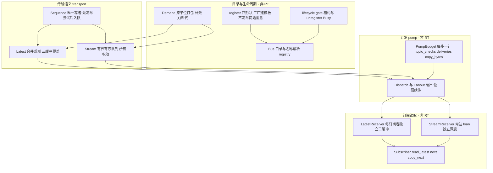
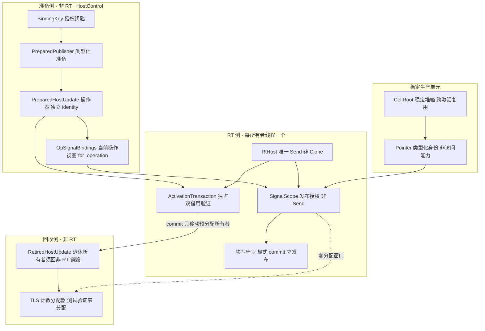

# moiren-signal 架构审计（2026-11-20）

基线：main @ `d8610e05`。方法：子代理 `audit-core-signal` 逐文件通读 src（21 文件）+ 9 集成测试 + example；主代理复核收录。

## 职责摘要

类型化 `Latest`/`Stream` 信号存储：固定容量、全额预算、全预分配、显式生命周期所有权。注册/订阅/解析/泵送/清理全部非 RT；发布经每所有者线程一个 `RtHost` + 当前操作表授权的 `scope` 进行，RT 路径零分配。四种封闭形状（`LatestValue`/`StreamValue`/`LatestBlock`/`StreamBlock`），载荷必须 `Copy + Send + Sync + 'static`（`types.rs:249-262`）。

## 内部分层

| 模块 | 职责 |
|---|---|
| `types.rs` | 配置与形状（`BusConfig` 默认 32MB/128 topic/64 订阅者/深度 8/1MB 载荷）、sealed `Shape`、`Topic
`（纯身份无发布权）、`PumpBudget/PumpReport` |
| `registry.rs` | `Bus` 非 RT 目录与资源所有者：注册（prepare 预算预留→commit 两阶段）、`resolve`、`subscribe`、`pump` 轮转目录槽（`registry.rs:204-228`） |
| `lifecycle.rs`/`demand.rs`/`sequence.rs` | gate 租约/`DirectoryId`；`Demand` 单原子位打包（低 7 位计数、bit7 关闭、高 56 位 generation，`demand.rs:4-6`）；`Sequence` 唯一写者分配序列 |
| `storage.rs` | `ValueSlot/BlockSlot`（`#[repr(C)]`）、`Latest/StreamStorage`（64 物理 sender 槽 + occupied 位图）、`PoolWriter/PoolReader` 所有权转移池（每槽恰一所有者，`storage.rs:179-182`） |
| `transport/latest.rs`/`stream.rs` | 两种传输端点与写守卫 |
| `dispatcher.rs` | `Dispatch`/`Fanout` 扇出与逐步计费 |
| `subscriber.rs` | `TopicState`、`SubscriptionLease`（Drop 时 `demand.remove`）、`Subscriber` 读 API 与 `BlockReadGuard` |
| `host/` | `HostControl`/`RtHost`/`Table`/激活事务、`BindingKey`/`PublisherHandle`/`ErasedBinding`/`OpSignalBindings`、`SignalScope`/写守卫、`CellRoot`/`Pointer`（唯一生产 unsafe 边界，`slot.rs:1`） |
| `budget.rs` | `Budget/Charge` 原子台账 + RAII 退款；显式建模 pinned triple_buffer 9.0.0 私有布局（`budget.rs:139-152`） |
| `test_alloc.rs` | TLS 计数分配器（`#[global_allocator]`） |

## 图 1：目录/传输/分发/订阅分层

## 图 2：发布所有权与 RT 边界

## 语义要点

- **Latest/Stream**：Latest 是带合并的观测（覆盖 + `publish`，守卫 Drop = 中止不发布）；Stream 是有界有序队列，满时新消息本地丢弃 `DroppedFull`，晚订阅者以 `subscription_fence` 过滤不回放（`sequence.rs:58-63`）；ingress 与订阅者溢出是两套独立饱和计数（`types.rs:231-241`）。
- **发布所有权**：一 topic 一 host owner（`host/mod.rs:205-208`）；`RtHost` 唯一 Send 非 Clone 非 Sync；发布需 `scope(&OpSignalBindings)` 且活动 Table identity 匹配否则 `InactiveBinding`（`scope.rs:37-60`）；`Table` basis 单调，`StaleBasis` 拒绝复用（`host/mod.rs:450-451`）；scope/守卫借用独占 host 访问、非 `Send`（compile_fail 文档测试，`scope.rs:7-20`）。
- **有界性**：`Bus::new` 基线含自身内联与全部目录槽（`registry.rs:124-131`）；退休资源保持计费直到真实非 RT 释放（`registry.rs:148-155`）；pump 每槽耗一 `topic_checks`，复制按完整布局计字节，放不下时如实报告不部分消费（README:48-67 ↔ `dispatcher.rs:74-85`）。
- **TLS 分配器覆盖**：`tests/allocation.rs:21`（激活/commit、发布、中止、StaleBasis、NoDemand、代刷新全零分配）；`host/mod.rs:674` 验证生产 cell 在清理线程释放且台账退款；`tests/registry.rs:1186,1319` 用真实分配器布局与预算模型对账。

## 与 engine 的衔接点（grep 验证，71 处引用）

- 准备链：`compiler.rs:173`、`compiler/bindings.rs:33`（`PreparedPublisher<LatestValue<f32>>`）、`host/preparation.rs:163-175`（`create_host` 返回 `HostControl` + `RtHost`）。
- RT 换装：`runtime.rs:376-388`、`runtime.rs:156-178`、`runtime/swap.rs:1069-1097`（`ActivationTransaction::commit` → `RetiredHostUpdate` 退休回非 RT）。
- 控制面 hub：`host/signals.rs:24,659,786`（SignalHub）；观测面：`meter/signal.rs:11`、`spectrum.rs:22`、`processor/builtin/compressor.rs:11`；封装层：`signal/process.rs`、`signal/plan.rs`。

## 架构观察

| # | 现象 | 证据位置 | 影响 |
|---|------|----------|------|
| 1 | 依赖精确 pin：`triple_buffer="=9.0.0"`、`crossbeam-utils="=0.8.23"`，预算模型显式建模 triple_buffer 私有布局 | `Cargo.toml:12-14`；`src/budget.rs:139-152` | 升级依赖会静默破坏预算正确性；防线是 `tests/registry.rs:1186` 对账测试。有意的脆弱点管理，升级须同步重跑 |
| 2 | unsafe 高度收敛：生产 unsafe 全部在 `host/slot.rs`（6 处，文件头自我声明唯一边界），每处附 SAFETY 论证 | `src/host/slot.rs:1,61,137,161,163,191,211` | 审计面小；core 全无 unsafe 与 guide 承诺一致 |
| 3 | 订阅者 64 上限三处硬编码耦合：物理槽数组、BusConfig 校验、Demand 位打包 min 截断 | `src/storage.rs:119,152`；`src/registry.rs:32,118`；`src/demand.rs:83` | 改上限需同步四处（含位布局）；当前一致且有测试锁定，属隐性重复真值 |
| 4 | 契约双源：canonical 契约在 crate README（88 行），docs guide 亦详述 | `moiren-signal.md:39`；`README.md` | 需双向维护防 drift；本次逐条比对未发现实质矛盾（Latest 种子不回退、pump 计费、Busy 语义均与代码一致） |
| 5 | `has_pending` 保守语义：预算耗尽时把未检查槽位计为有工作 | `src/registry.rs:226`；README:65-67 | 不漏工作但可能空泵一轮；与「调用者决定何时再泵」契约一致 |
| 6 | Latest 订阅种子与扇出交互语义精细且有针对性测试 | `src/registry.rs:300-309`；`src/dispatcher/tests.rs:147` | fanout 改动时最易回归的点已被行为测试锁定 |

**小结**：signal 是整个 workspace 不变量密度最高的部件，RT/非 RT 所有权契约靠类型系统（非 Send/非 Clone、Copy 身份句柄、sealed 形状）+ TLS 分配器测试 + Miri 三重锁定。
