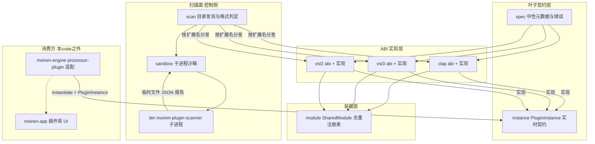
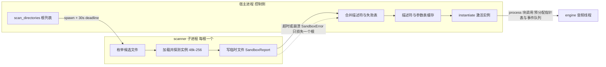

# moiren-plugins 架构审计（2026-11-20）

基线：main @ `d8610e05`。方法：主代理通读 src 全部 13 文件 + Cargo.toml + crate 指南；只读审计。

## 职责摘要

第三方插件宿主：CLAP / VST2 / VST3 二进制的加载、扫描与实时实例。刻意做成**叶子 crate**——只认识插件 ABI 与自己的 `spec` 类型，不含任何 engine 概念；engine 侧由 `processor/plugin.rs` 适配到 `RtProcessor`（f32 staging 桥接）。依赖仅 `thiserror/serde/serde_json/libloading`。

## 内部分层

| 分层 | 文件 | 职责 |
|---|---|---|
| 中性契约 | `spec.rs` | `PluginFormat`/`PluginDescriptor`/`PluginParameterSpec`/`PluginParamEvent`/`PluginError`；参数单位按格式（CLAP 真值、VST 归一化 0..1） |
| 实时契约 | `instance.rs` | `PluginInstance` trait：`process` 是唯一 RT 入口（宿主侧零分配/零锁/零系统调用），state/preset 均控制侧 |
| 模块装载 | `module.rs` | `SharedModule` 注册表：按 canonical path 去重，一个文件一条 live handle；CLAP `init/deinit` 恰好配对一次，装载在注册表锁下串行 |
| 扫描 | `scan.rs` | 标准目录约定 + `CLAP_PATH/VST3_PATH/VST_PLUGIN_PATH` 覆盖；VST3 bundle 解析到平台二进制；逐文件收集失败 |
| 进程外沙箱 | `sandbox.rs` + `bin/moiren-plugin-scanner.rs` | 扫描永不在宿主进程加载插件：每扫描根 spawn 一次子进程、30s deadline、报告走临时文件而非 stdout（防插件 printf 污染） |
| ABI 实现 | `clap/`、`vst2/`、`vst3/`（各含 `abi.rs` 常量/布局转写 + `mod.rs` 实现） | 每格式暴露 `instantiate` + `scan_descriptor[s]`，由 `lib.rs::instantiate` 按 format 分发 |

## 图 1：crate 总览

## 图 2：扫描与实例化数据流

## 架构观察

| # | 现象 | 证据 | 影响 |
|---|---|---|---|
| 1 | 依赖方向干净：零 `moiren-*` 依赖 | `Cargo.toml` dependencies 仅 thiserror/serde/serde_json/libloading | 与 repository.md「plugins 不得依赖任何 moiren-* crate」一致，engine 适配方向正确 |
| 2 | 扫描进程隔离已实现，但实例化仍在本进程 | `sandbox.rs:1-15`（子进程 + deadline + 临时文件）；`lib.rs:49` instantiate 在宿主进程 | 崩溃面被限定在扫描期；**运行期**插件崩溃仍可带走宿主（11-11 审计 M3 已记为「C++ ABI 无崩溃隔离」） |
| 3 | 模块装载全局串行 | `module.rs:62-64`（装载在注册表锁下，注释明确接受无界耗时） | 控制侧可接受；但同进程两个实例并发首次装载会互相阻塞，属已知取舍 |
| 4 | RT 契约表述精确到「宿主侧」 | `instance.rs:8-12`、`lib.rs:8-14`（插件自身 RT 行为归插件作者） | 与 engine 的 rt-check 不同，插件进程内无零分配 gate——第三方内核不在测试边界内 |
| 5 | 报告通道选临时文件而非 stdout 有明确理由 | `sandbox.rs:11-15` | 防插件 printf 污染 JSON；子进程契约稳定，`SandboxError` 区分「根死了」与「单插件坏了」 |
