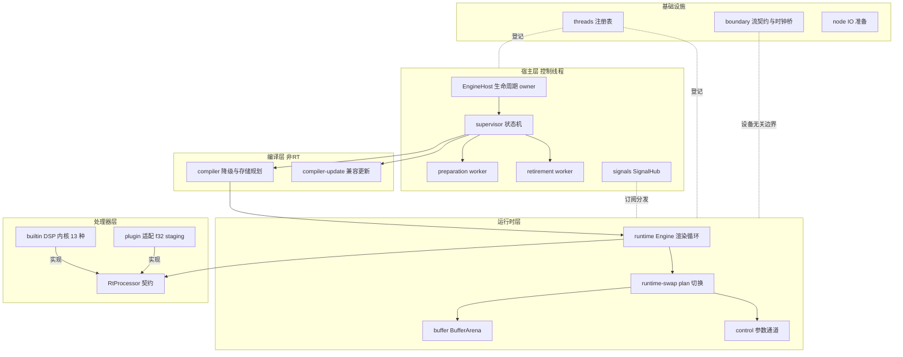
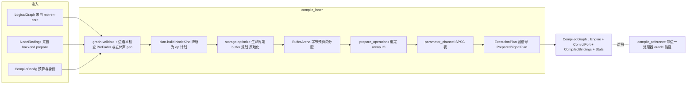
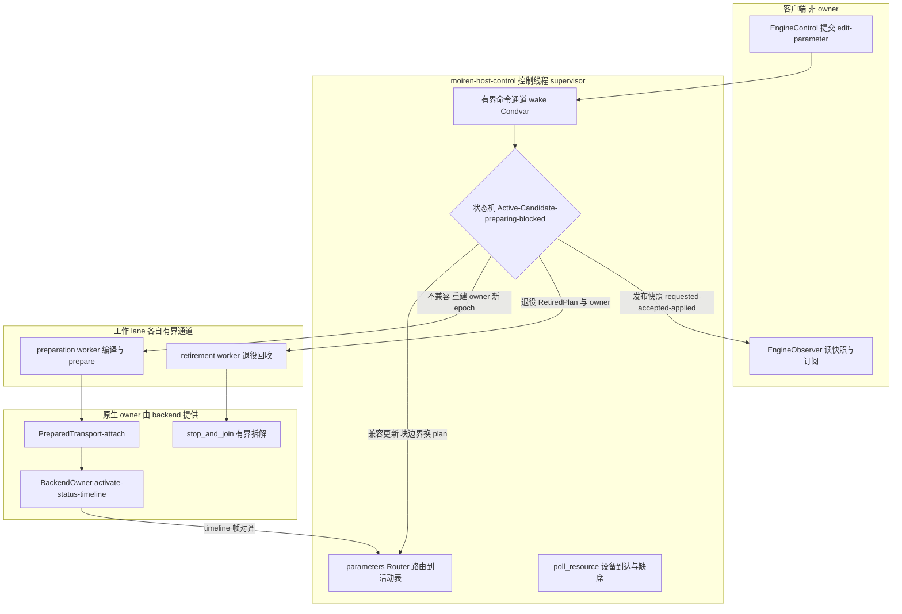
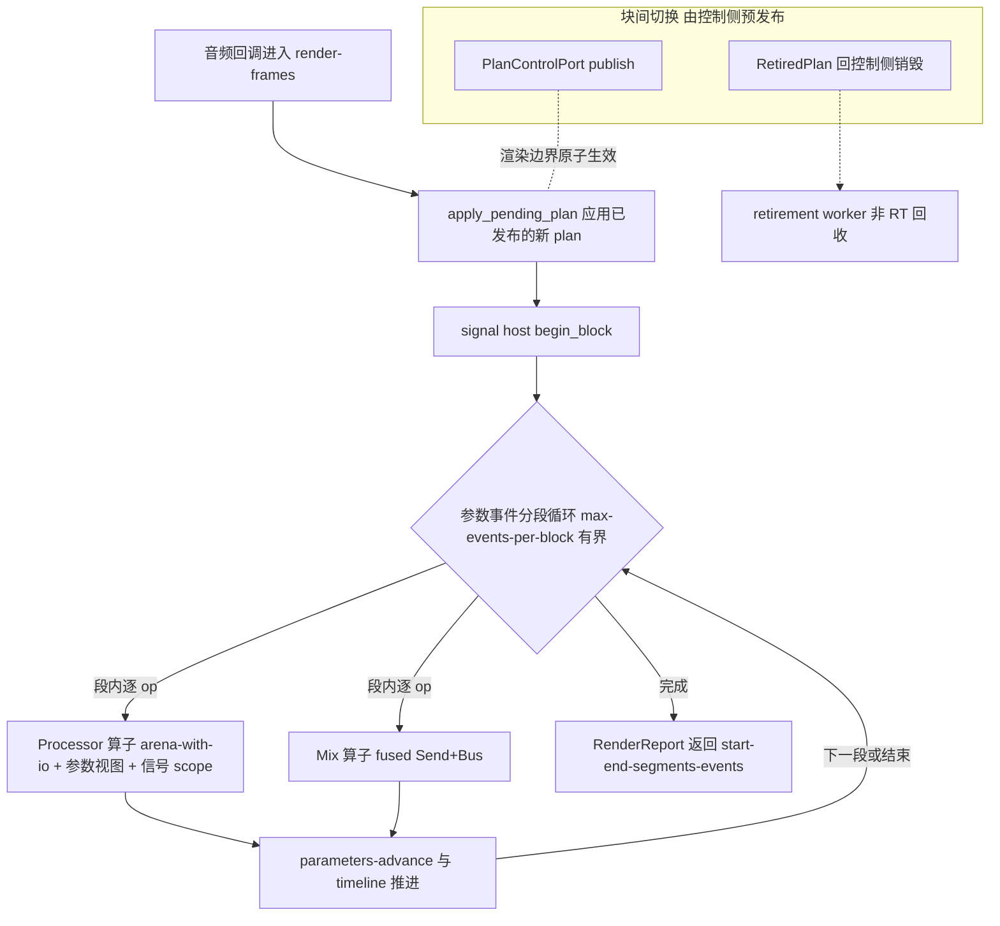
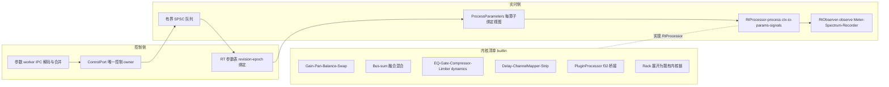

# moiren-engine 架构审计（2026-11-20）

基线：main @ `d8610e05`。方法：主代理通读 crate 指南与 `host.rs`、`host/backend.rs`、`host/supervisor.rs`、`compiler.rs`、`runtime.rs`、`processor/mod.rs`、`threads.rs`，并抓取全部 107 个模块的 `//!` 文档行；只读审计。

## 职责摘要

实时执行、非实时编译与托管宿主；传输层在 `moiren-windows-audio`。`compiler` 把 `LogicalGraph` 降级为不可变 prepared plan（含 fused Bus 混合与基于生命周期的 buffer 规划），`EngineHost` 拥有编译/激活/参数路由/信号挂接的全部所有权，`runtime::Engine` 在音频线程线性执行 plan。f32/f64 双精度泛型。

## 内部分层（97 文件，六层）

| 层 | 模块 | 职责 |
|---|---|---|
| 宿主层 | `host.rs` + `host/`（supervisor、preparation、retirement、parameters、signals、snapshot、project、edits、backend） | `EngineHost` 唯一非 RT 生命周期 owner；supervisor 控制线程状态机；prepare/cleanup 双 worker lane；backend 契约 |
| 编译层 | `compiler.rs` + `compiler/`（bindings、plan、storage、send、update、observers） | 校验→降级→存储规划→参数通道→ExecutionPlan；兼容更新 `compile_update`；`compile_reference` 对拍 oracle |
| 运行时层 | `runtime.rs`、`runtime/swap.rs`、`runtime/mix.rs`、`buffer.rs`、`control.rs` | `Engine::render` 线性执行；plan 在渲染边界有界所有权转移；fused Send+Bus 内核；参数 SPSC 通道 |
| 处理器层 | `processor/`（builtin 13 内核 + plugin 适配） | `RtProcessor`/`RtObserver` 安全 DSP 契约；插件经 f32 staging 桥接 |
| 观测内容层 | `meter.rs`、`spectrum.rs`、`recorder.rs`、`signal/`、`rack.rs` | demand-gated 表头/频谱；录音走有界 SPSC + 文件线程；Rack 控制侧展开 |
| 基础设施 | `threads.rs`、`boundary.rs`（+bridge）、`node.rs`、`audio_config.rs`、`sample.rs` | 进程级线程注册表；设备无关流契约与时钟桥；IO 节点准备；f32/f64 |

## 图 1：crate 总览分层

## 图 2：编译流水线（控制侧，一次性）

## 图 3：EngineHost 生命周期与更新语义

## 图 4：RT 渲染块路径（音频线程，零分配）

## 图 5：处理器与参数通道组织

## 架构观察

| # | 现象 | 证据 | 影响 |
|---|---|---|---|
| 1 | 三层分离与 RT 契约在类型层强制：plan/资源/参数表都有身份互检 | `runtime.rs:426-437`（`ForeignResources`/`ForeignParameters`）；`compiler.rs:204-273` 流水线 | 跨 plan 误用资源在编译期外的第一道口子被拒；「Rust 内存安全不保证实时安全」的补丁打得系统化（`processor/mod.rs:1`） |
| 2 | 身份体系五元分离落到具体字段 | `host.rs:158-169`（desired/active revision、plan revision、owner/resource generation）；`host/backend.rs:114-122`（PrepareRequest 携带三元身份）；`backend.rs:181-185` OwnerTimeline epoch+revision+frame | requested→accepted→applied 有真实数据结构支撑，UI 侧无需伪造；epoch 与 revision 不互冒充 |
| 3 | supervisor 单线程状态机 + 两个 worker lane，全部通道有界 | `host/supervisor.rs:88-91`（sync_channel(1) prepare、cleanup_capacity 清理）；主循环 `supervisor.rs:184-261` | 控制面无失控队列；「准备与回收分 lane」的规则在结构上不可违反 |
| 4 | 兼容/不兼容判定集中在两个纯函数 | `supervisor.rs:341-360` transport_compatible（engine+IO 集合）、`supervisor.rs:361-381` same_structure | 判定语义单点可审；strip 值变化走参数不重编译（`supervisor.rs:361-364` 注释） |
| 5 | 退役路径全程离 RT | `runtime.rs:494-497` retire_controls、`swap.rs:816-851` RetireOutcome/RetiredPlan、`supervisor.rs:305-333` Cleanup::Owner 整包移交 | 符合「退役对象回控制侧销毁」；#105 卡死端点的有界弃置语义在 `backend.rs:187-209` 有明确文档与 None 通道 |
| 6 | 观测类处理器的计算被刻意移出 RT | `spectrum.rs:1-4`（FFT 在读侧）；`meter/signal.rs:1`（demand-gated 精确窗口）；`recorder/session.rs:1-3`（文件线程） | RT 半边只留有界拷贝与发布；与「Meter 非 LUFS」的边界声明一致 |
| 7 | 线程注册表父侧登记 + enter 一次原子写 | `threads.rs:9-26`、`threads.rs:128-134`、`threads.rs:176-183` | RT 线程注册路径零锁零分配；app 性能面板行行可归因到 spawn 点 |
| 8 | `runtime/swap.rs` 是最大的单文件（43KB） | 文件清单排序第一 | plan 切换/复用/快照逻辑集中度偏高，属可接受的内聚，但新增切换语义时是主要审读面 |
| 9 | 编译器保留 reference 对拍路径 | `compiler.rs:159-167`、`compiler.rs:1-2` | 优化 lowering（fused/in-place）始终有正确性 oracle，测试策略成熟 |
