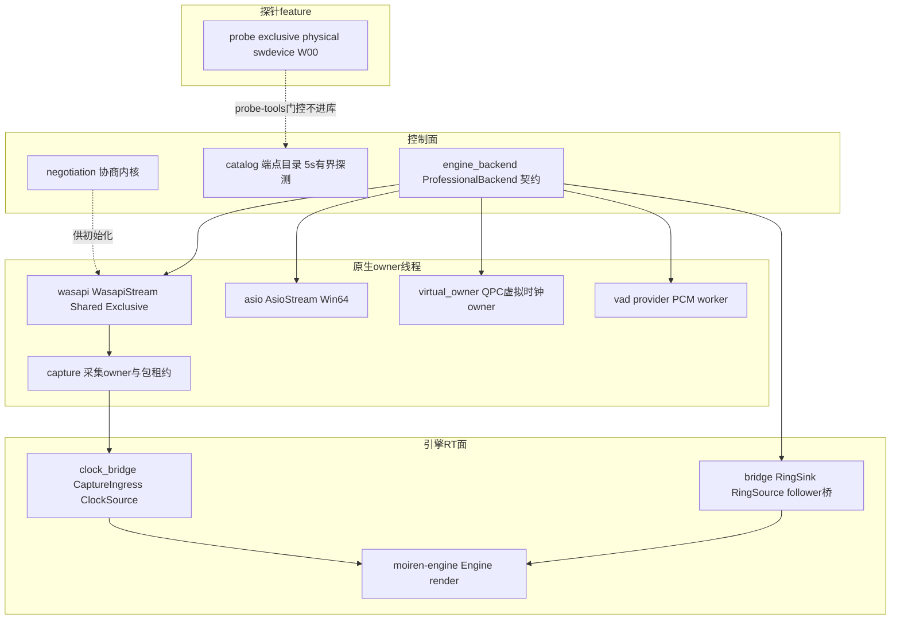
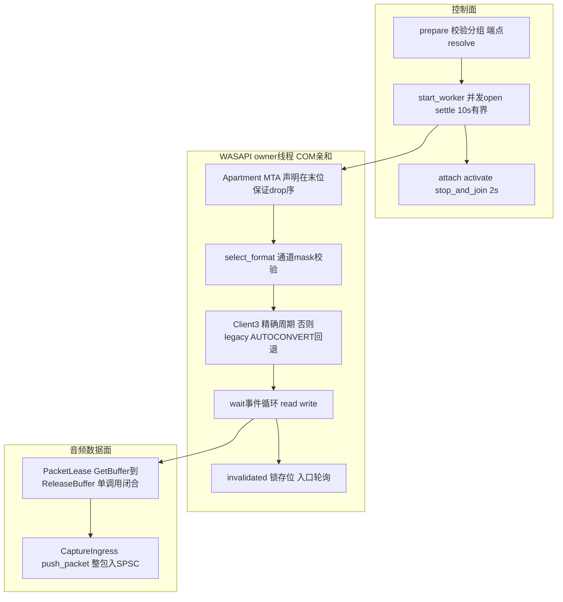
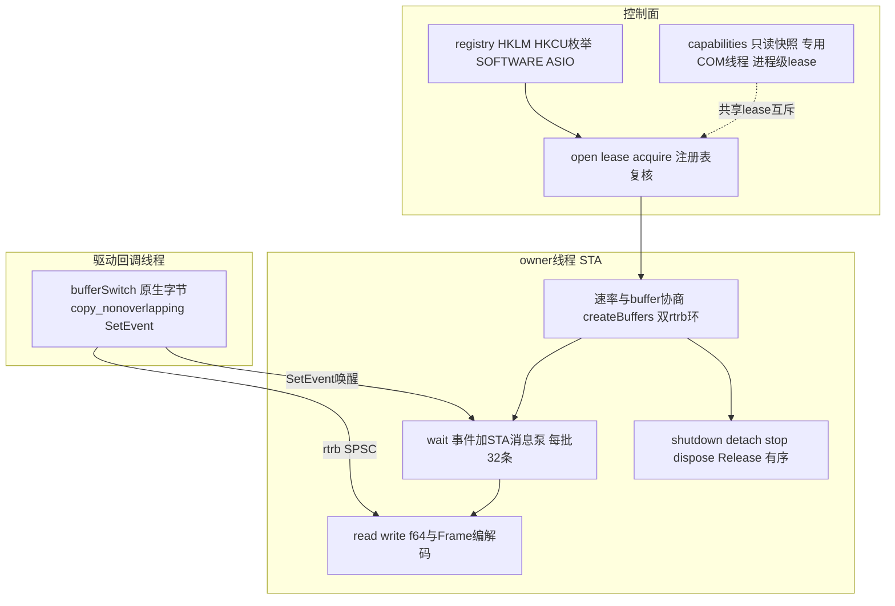
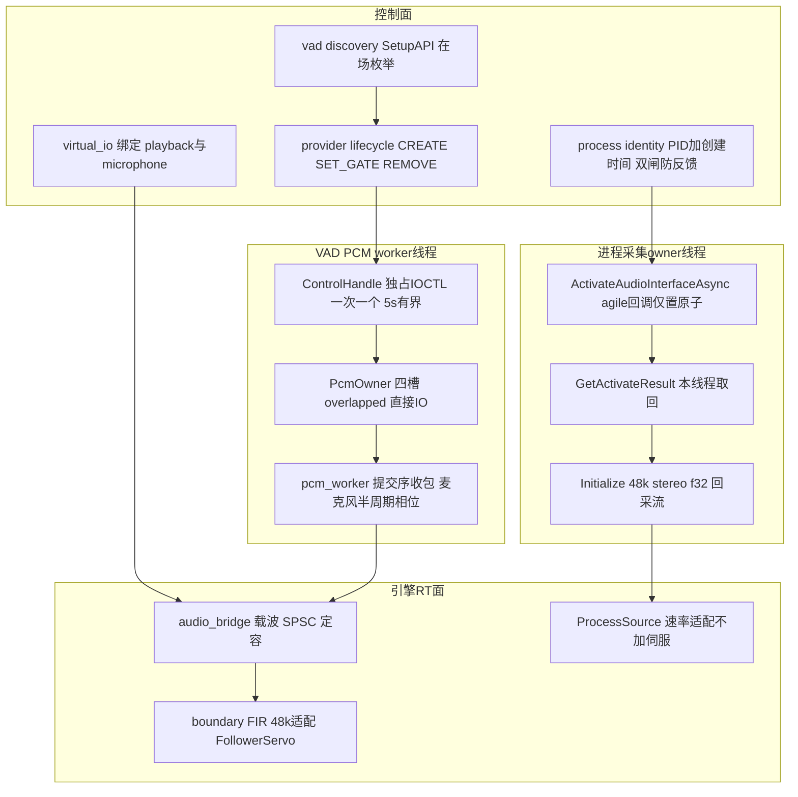
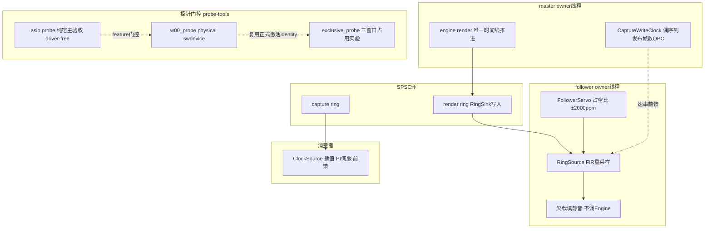
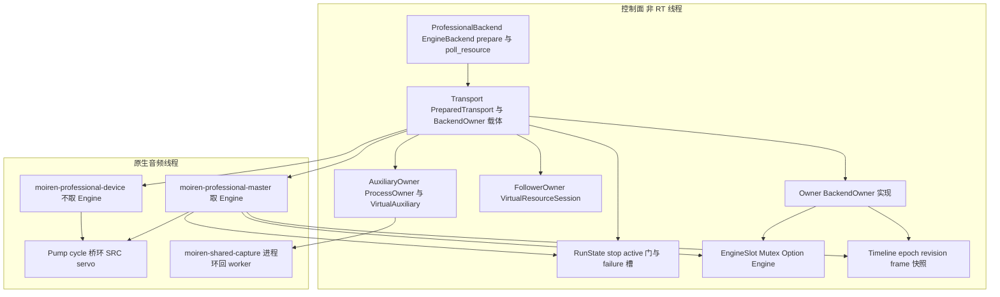
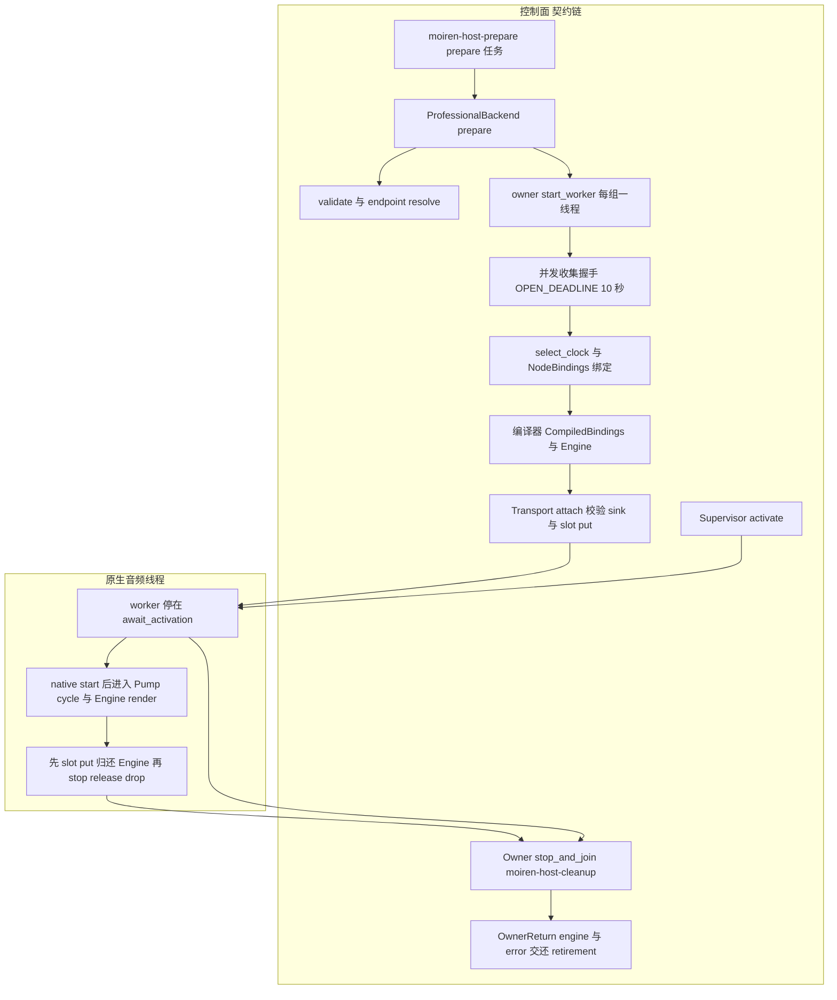

# moiren-windows-audio 架构审计（2026-11-20）

基线：main @ `d8610e05`。方法：子代理 `audit-win-audio` 递归拆分（WASAPI、ASIO、engine_backend、VAD/虚拟/进程回采由下级子代理，时钟桥与探针由其自查汇总）；engine_backend 分片另由 `audit-wa-backend`（deepseek-v4.1-flash 路由）独立补审交叉验证；主代理复核收录。

## 职责摘要

专业 Windows 音频后端 crate：以 `engine_backend::ProfessionalBackend` 实现 moiren-engine 的 `EngineBackend` 契约（prepare/attach/activate/stop_and_join），聚合 WASAPI Shared/Exclusive（`wasapi.rs`）、ASIO（`asio/`，仅 Win64）、引擎侧物理/进程回采（`capture/`、`process_loopback/`）、VAD 驱动虚拟设备（`vad/`、`virtual_owner/`）与主从时钟桥（`clock_bridge/`、`bridge.rs`、`servo.rs`）。COM/driver 对象全程钉在各自 owner 线程，音频线程只做预分配缓冲、rtrb 无锁环与原子操作；native teardown 以 `NATIVE_TEARDOWN_DEADLINE=2s`（`src/lib.rs:44-56`）有界回收。探针（W00/exclusive/ASIO）是 example-only 工具，被 `probe-tools`/`vad-probe` feature 与 `#[cfg]` 排除在库构建之外。crate 不依赖 app，端点枚举/可用性轮询归 app service（README:82-87）。

## 分层与文件归属

| 子系统 | 文件 | 职责 |
|---|---|---|
| 契约适配 | `engine_backend.rs`、`engine_backend/{owner,recovery,absence,observations,validation,virtual_io}.rs` | 契约四阶段、owner 线程与 Transport、ASIO 恢复预算、缺席三分支、truthful 观测、虚拟 IO 绑定 |
| WASAPI | `wasapi.rs`、`negotiation.rs`、`format.rs`、`codec.rs`、`resample.rs`、`catalog.rs`、`win32_raii.rs` | WasapiStream（NativeStream 实现）、Client3/legacy/Exclusive 协商、格式编解码、窗函数 SRC、端点目录、Win32 RAII |
| 采集 | `capture.rs`、`capture/wasapi*.rs`、`capture_packet.rs`、`stats.rs`、`latency/*`、`session.rs`、`session/gate.rs` | 采集 owner 骨架、包租约、统计、固定存储延迟遥测、StopSignal/ActivationGate |
| ASIO | `asio.rs`、`asio/{abi,driver,registry,capabilities,buffer,sample,stream,callback,probe}.rs` | IASIO 手写 ABI、注册表发现、只读能力查询、buffer 协商、回调所有权层 |
| 时钟桥 | `clock_bridge.rs`、`clock_bridge/{ingress,source,timing,rate,telemetry}.rs`、`bridge.rs`、`servo.rs` | 采集桥（生产者/消费者/包时间戳/速率估计）、engine 侧 follower 桥（RingSink/RingSource/FIR+伺服）、占空比伺服 |
| VAD/虚拟 | `vad.rs`、`vad/**`（20 文件）、`virtual_owner.rs`、`virtual_owner/**` | 驱动 ABI v2 协议、控制/PCM 传输、lifecycle 状态机、PCM worker、虚拟边界 FIR、QPC 虚拟时钟 owner |
| 进程回采 | `process_loopback.rs`、`process_loopback/{activation,identity,stream}.rs` | 异步激活、PID+创建时间身份双闸、48k 虚拟采集流 |
| 探针 | `probe.rs`、`probe/*`、`exclusive_probe/*`、`physical/*`、`swdevice/*`、`asio/probe.rs`、`clock.rs`、`examples/*` | W00 系列诊断实验，全部 feature 门控 |

两个测试文件不属于任何 crate 目标，仅由 `tools/rt-check` 以 `#[path]` 影子编译：`asio_rt_tests.rs`、`engine_backend/recovery_host_tests.rs`（`src/lib.rs:5-8`）。

## feature gate 面

| 门 | 位置 | 门控的消费面 |
|---|---|---|
| `probe-tools` | Cargo.toml:29 + `src/lib.rs:67-77` | `probe`/`exclusive_probe`/`physical`/`swdevice` 四模块 + `clock.rs`（离线 clock-fit）+ 四个 example（required-features，Cargo.toml:36-50）；库构建与 engine/app 依赖图完全不含该 COM 面 |
| `vad-probe` | Cargo.toml:32 + :52-62 | `vad_lifecycle/vad_native/vad_active_lifecycle` 三个 example；测试不碰驱动/设备 |
| `cfg(windows)` | `lib.rs:12,25,36,59,79-89` | `bridge`/`engine_backend`/`wasapi`/`session`/`catalog`/`win32_raii`/`negotiation` |
| `cfg(all(windows, target_pointer_width="64"))` | `lib.rs:10-11` | `asio` 实现；非 64 位提供永远 `Unsupported` 的存根（`asio.rs:76-109`），「不活动的后端无法伪装成 IO」 |
| `cfg(any(windows, test))` | `lib.rs:15-16` | `capture_packet`（Linux 可测借用校验） |

## 关键数据流

**(a) 契约实现链**：`EngineBackend::prepare`（`engine_backend.rs:322-361`）→ `prepare_with_native`（:365-1040，控制线程：validate → resolve/缺席三分支 → 分组 → 10s 有界并发 open → ring/预算 → `select_clock` → NodeBindings 绑定）；attach 时 Engine 经共享 `slot.put` 交给 master worker（`owner.rs:1042-1043`）；activate 先唤 auxiliary 再 `RunState::activate` notify_all（`owner.rs:874-888,140-151`）；stop_and_join 每 worker 独立 `join_within(2s)` 超时 abandon（`owner.rs:957-1000`）。**只有 master owner 的 Pump 调 `engine.render`**（`owner.rs:760-807`），follower 欠载填静音、绝不碰 Engine 时间线。

**(b) 线程模型**：每 native 组一条 owner 线程（factory 就地开流，COM/驱动对象全生命周期留在线程内，NativeStream 无 Send，`native.rs:49`）；ASIO 回调在驱动线程经静态 `CONTEXT` 原子指针 + rtrb 双环交接，零锁零分配（`asio/callback.rs:1-3,94-103`）；进程回采 agile 回调只写 AtomicBool（`process_loopback/activation.rs:44-51`）；VAD 控制面在 service 作业池、PCM 在专用 `moiren-vad-pcm` worker、Engine render 线程零接触。

**(c) 时钟桥**：恰一物理 master（`validation.rs:138-152`）驱动 Engine；master 线程 `engine.render` 写所有 `RingSink.tx`；各 follower 用 `RingSource`（FIR SRC + `FollowerServo` 占空比 ±2000ppm，`servo.rs:10` 增益=限幅）消费自己的环；采集侧 `CaptureIngress.push_packet` → SPSC（容量 8192 帧）→ `ClockSource`（连续线性插值 + PI 伺服 + capture/QPC 前馈 `RateClock`），`ProcessSource` 对进程源只做速率适配不再叠加伺服（`bridge.rs:360-362`）。无物理 master 时降级 QPC 虚拟时钟（`VirtualPreparedTransport`）。

## 图 ①：crate 总览

## 图 ②：WASAPI backend 路径

## 图 ③：ASIO backend 路径

## 图 ④：VAD 与引擎侧 capture

## 图 ⑤：时钟与探针

## 架构观察

| # | 现象 | 证据 | 影响 |
|---|---|---|---|
| 1 | COM 线程亲和靠结构而非约定保证：字段声明序控制 drop 序，`_apartment` 永远最后释放 | `src/wasapi.rs:154-171` 显式注释；失效回调注销先于 CoUninitialize（`wasapi.rs:285-301`）；Exclusive 对齐重试 drop 旧 client 重新 Activate（`wasapi.rs:652-668`） | 未注销回调不会被 CoUninitialize 截断，失败 Initialize 状态不带入新会话 |
| 2 | 音频线程 RT 纪律可逐点验证 | ASIO 回调路径只有 `copy_nonoverlapping`、rtrb push/pop、原子与裸 BOOL SetEvent（`asio/callback.rs:20-25,226-303`），`asio_rt_tests.rs:41-47` 分配器插桩下跑真实回调证零分配；Pump 缓冲与 `ProcessSource` scratch 全预分配（`owner.rs:680-681`、`engine_backend.rs:1206`）；`LatencyRecorder` 直方图内联定长、快照仅停流后（`latency/telemetry.rs:142-244`） | 「回调禁堆分配/锁/COM」在本 crate 有代码+测试双重支撑 |
| 3 | teardown 有界分层，但存在两处已知缺口 | 有界面：owner 每 worker 独立 `join_within(2s)` 超时 abandon+detach（`owner.rs:50-56,975-980`）。缺口一：`CaptureSession::Drop` 是无界裸 `join()`（`capture/wasapi.rs:124-131`）；缺口二：ASIO `detach` 自旋等 `READERS==0` 无超时（`asio/callback.rs:75-82`） | 依赖 Drop 兜底的握手失败分支理论上可被卡死 worker 阻塞；2s deadline 只能「有界检测、无界恢复」；均为注释显式承认的第三方契约风险 |
| 4 | master/follower 不对称是时钟模型骨架：恰一物理 master、唯一 `engine.render` 推进点 | `validation.rs:138-152`；master Pump（`owner.rs:760-807`，含超产保护与 QPC 计时）；follower 欠载填静音并计数（`owner.rs:808-818`）；无物理 master 降级 QPC 虚拟时钟 | 多设备时钟漂移收敛为重采样率微调问题，Engine 永远只有一个时钟权威 |
| 5 | 取消/激活门的优先级设计使取消永不丢失 | stop 事件占句柄等待表索引 0；`cancel` 先 `request_stop` 再 CAS 门状态（`session/gate.rs:86-92`）；CancellationToken 经 `on_cancel → RunState.cancel`（`owner.rs:1038-1041`）；任一 worker 终态故障联动 cancel 全体（`owner.rs:105-117`） | 激活前/中/后三种时序的取消都收敛到同一事件；`WorkerPanicked` 优先级不可降级 |
| 6 | 缺席/恢复/重插语义统一，防重开风暴 | open 超时 stuck、运行中拔出 runtime-absent、枚举缺失三分支都会话级抑制重开（`engine_backend.rs:487-580`、`absence.rs:41-161`）；unplug worker 先 `absence.report` 再记失败（`owner.rs:597-605`）；ASIO 自动恢复单次预算制、ticket 须五阶段全成功（`owner.rs:538-553`、`recovery.rs:64-121`） | 拔插/挂死不引发失败循环；缺图节点保拓扑绑 ConstantSource/DiscardSink（`engine_backend.rs:953-1004`） |
| 7 | panic 恢复真正回到非 RT joiner | Engine 与 catch 闭包分离、put 回 slot 先于 stop（`owner.rs:506-507,534-536`）；run/stop/observation/release/drop 五阶段独立 `catch_unwind`（`owner.rs:507-568`）；ASIO extern C 回调入口无 panic 路径（`callback.rs:306-379`） | 音频线程 panic 不 unwind 进 FFI；stop wedge 时 stop_and_join 仍能取回 Engine（`owner.rs:1099-1108`） |
| 8 | 进程回采的 COM/内存边界纪律 | agile 完成回调只写 AtomicBool、`GetActivateResult` 与 IAudioClient 全在 capture owner 线程（`process_loopback/activation.rs:44-51,129-140`）；PROPVARIANT 用 ManuallyDrop 压掉 PropVariantClear（`activation.rs:66-85`）；PID+创建时间双闸、目标自身/祖先拒绝（`identity.rs:16-90`） | Windows 永不释放 Rust 内存；PID 回收不误绑 |
| 9 | VAD 协议 fail-closed 且控制/PCM 面物理分离 | 控制 IOCTL 独占句柄一次一个、超时毒化不重试（`control_io.rs:238-387`）；PCM 四槽 overlapped 直接 IO 在专用 worker，内核配额拒绝一律 defer（`pcm.rs:495-502`、`pcm_worker.rs:210-292`）；ABI 常量 `include_str!` 一致性测试钉死（`protocol/abi_conformance.rs:64-171`）；驱动缺失静默降级（`provider.rs:71-73`） | 畸形驱动响应无法翻译成非法请求；拔驱动只损失虚拟端点能力 |
| 10 | 探针与正式路径：门控隔离彻底，但存在平行实现 | 隔离：四模块 + clock.rs 仅 `probe-tools` 下编译（`lib.rs:67-77`）、example required-features（Cargo.toml:36-50）；复用：进程探针激活直接委托 `process_loopback::activation::activate`（`probe/activation.rs:6`）；平行：`physical/stream.rs` 自建 WASAPI 打开/初始化（仅复用工具函数），Exclusive 实验同理 | 探针不污染生产构建，但 probe 侧 WASAPI 逻辑与 `wasapi.rs`/`negotiation.rs` 有漂移风险，只能靠 feature 常闭缓解 |
| 11 | truthful 观测三层落实 | requested vs actual settle 后强一致校验（`engine_backend.rs:893-916`）；null 流如实 `absent=true`（`:1071-1104`）；计数单写者=音频线程 relaxed 原子、控制面只读快照、generation-fenced（`observations.rs:91-267`）；Running 仅在「所有 worker started 且无失败」时发布（`owner.rs:925-936`） | 符合仓库「requested→accepted→applied、Unknown 不造假」规则 |
| 12 | catalog 有界性以遗弃线程为代价 | 每端点独立探测线程 + 共享 5s deadline，超时线程不 join、标记 not_responding（`catalog.rs:296-300,362-366`） | 目录刷新恒有界（issue #105），代价是卡死期间线程/apartment 暂存泄漏，设计上明示接受 |

**总体评价**：该 crate 是边界纪律极强的原生后端——RT 回调零分配、COM/驱动线程亲和结构性保证、teardown 有界、fail-closed 协议、truthful 观测均有代码与测试（含 rt-check 影子编译与 fake NativeStream 注入，`engine_backend/tests/fakes.rs`）双重支撑；主要残余风险集中在第三方契约（ASIO detach 无超时、`CaptureSession::Drop` 无界 join、驱动调用不可取消）与探针平行实现的漂移面上，且这些边界均在注释中显式承认而非掩盖。

## 附：engine_backend 深审（`audit-wa-backend`，deepseek-v4.1-flash 独立交叉验证）

本节由独立子代理对 `engine_backend/`（11 文件，核心 `owner.rs` 1112 行/43.9KB）逐文件深审，与上文六分片汇总**互相印证**的部分：契约四阶段实现链、master 独占 `Engine::render`、「先归还 runtime 再驱动 teardown」顺序保证、follower 饥饿填静音不推进时间线——结论一致，可视为已双源确认。

**新增分层事实**：`engine_backend/` 内部为 owner.rs（线程生命周期 + RT Pump + Transport + Owner/FollowerOwner 契约）、absence.rs（缺失判决与 StuckOpens）、observations.rs（分代观测快照）、recovery.rs（ASIO 恢复预算与一次性 ticket）、validation.rs（准入 + select_clock）、virtual_io.rs（虚拟边界 prepare 与协作式 join）；`recovery_host_tests.rs` 仅由 rt-check 挂载。

### 附图 ①：owner/transport/线程模型

### 附图 ②：契约四阶段实现链

### 深审新增观察（编号接续上文，现象 → 证据 → 影响）

| # | 现象 | 证据 | 影响 |
|---|---|---|---|
| 13 | **[高] owner.rs 单文件五类职责**：线程生命周期、RT Pump、Transport、Owner/FollowerOwner 混在一处 | `owner.rs:58,84,154,173,202,318,359,424,623,832,1007,1053,1086`（1112 行） | 回调路径改动都发生在 teardown 语义文件里；rt-check 必须整文件挂载并另造 owner 垫片（`tools/rt-check/tests/professional_rt.rs:61-62`），拆分成本高 |
| 14 | [中] teardown 上界是「每 worker 2s」无 transport 级总上界，串行 join | `owner.rs:971-980`；`lib.rs:56`（2s）；`validation.rs:111-115`（≤64 IO 节点） | 最坏 Stop/退出延迟 ≈ 组数×2s；#105 的「有界」需按 per-worker 理解，建议补总预算或文档化 |
| 15 | [中] 「活动相位内无日志/无分配」在故障路径不成立：start 后有 `log::debug!`，故障分支 `to_string()` 构串 | `owner.rs:510-515`；`owner.rs:709,763,766-768,776,823`；`bridge.rs:303-305` | 正常路径零分配已由 rt-check 钉死，但**故障路径**在音频线程堆分配；属「transport 正在死亡时」的低危字面违约，不应被当作已证明不变量 |
| 16 | [中] `poll_resource` 缺失探测持锁、不可取消、跑在 host control 线程（契约要求 bounded and cancellable） | `absence.rs:15,219-242`；`engine_backend.rs:342-352`；契约 `moiren-engine/src/host/backend.rs:132-133`；调用点 `supervisor.rs:184-191` | 一次卡住的 MMDevice 枚举/COM 调用会阻塞控制线程，拖住 prepare/activate/retire 调度与 UI 状态；契约与实现有缝隙 |
| 17 | [中] `OPEN_DEADLINE` 只覆盖物理设备组：进程环回与虚拟边界 prepare 不在截止内 | `engine_backend.rs:749,766-810,1186`；`engine_backend.rs:662` | 卡住的 `inspect_process`/虚拟边界 open 仍可冻结 `moiren-host-prepare`；建议补同等 deadline 或记为已知缺口 |
| 18 | [中] prepare 非纯函数：`stuck`/`runtime_absent` 判决持久在 backend 实例上，重试结果隐式不同 | `engine_backend.rs:85-93,524-580`；`absence.rs:33-69,88-160` | 同一 project 连续 prepare 可能得到 真实流 vs null stream；service/UI 必须按「用户重新 apply = 新建 backend」叙述，否则误报「已应用但无设备」 |
| 19 | [低] `status()` 是带副作用的查询（失败时 cancel、auxiliary 失败时 fail），契约无 Stopping 态 | `owner.rs:906-937`；`backend.rs:173-178` | stop 请求后状态回落 Starting；当前靠 supervisor 先移走 active 才未暴露，属潜在真值状态缺口 |
| 20 | [低] 正常路径 `cleanup()` 执行两遍（stop_and_join 显式 + Drop） | `owner.rs:1002-1005,1077-1084,1102-1111` | 当前幂等但靠实现细节；未来加非幂等步骤会静默出错 |
| 21 | [低] 并发打开的收敛端是串行轮询：每次只 settle `pending[0]`（20ms 片）+ rotate | `engine_backend.rs:766-865` | 已就绪组感知延迟最坏 (N-1)×20ms，进度上报抖动；非正确性缺陷 |
| 22 | [信息] 线程/时钟拓扑随 backend 变化：WASAPI 同端点 in/out = 两条 owner 线程两个时钟域；ASIO = 单 duplex 会话（全工程限一、同 rate/buffer） | `engine_backend.rs:601-627,638-647,181-212`；`wasapi.rs:451-460` | 容量预算、故障域、teardown 时长随 backend 变化，UI/文档不能给统一承诺 |
| 23 | [信息] 文档漂移：threads 文档把 `#[cfg(test)]` 的 `spawn` 当作 master 线程 spawn 点，生产路径实为 `start_worker` | `owner.rs:315-323`（注释自述）；`docs/platform/windows-audio-threads.md:29` | 按文档改线程模型会改错函数；低成本修正文档指向 |
| 24 | [低] `EngineSlot` 用 `Mutex<Option<Engine>>` 且归还发生在 `stream.stop()` 之前（仍在已启动窗口） | `owner.rs:154-171,495-499,534-537,1108`；规则 `docs/platform/windows-audio-threads.md:20-25` | 实际无竞争（stop_and_join 在 join 后才取 slot），属约定性风险：control 侧一旦运行期读 slot 即成 RT 锁竞争；建议文件头写明显式约束 |
| 25 | [正面] 「先归还 runtime，再做驱动 teardown」靠顺序而非超时达成，且五阶段独立 catch_unwind、弃置 worker 用 fence 阻止事后记账 | `owner.rs:495-507,529-553,590-608,241-246,301-304` | 卡死驱动调用只丢失 `OwnerReturn::engine`（契约允许），不钉死 runtime 或清理线程；review 中应作为不变量保护 |
| 26 | [正面] follower 饥饿整段填静音并计 xrun，绝不推进 Engine 时间线 | `owner.rs:808-818`（注释 "never advance Engine's timeline to mask a queue shortfall"）；`:807` | 与总报告观察 4 双源一致：truthful state 在时钟层同样成立 |

深审边界声明：以上为静态读码结论（未构建/未跑测试）；#105 实时行为需 rt-check 与硬件验收定论；rt-check 只度量分配不度量锁。

