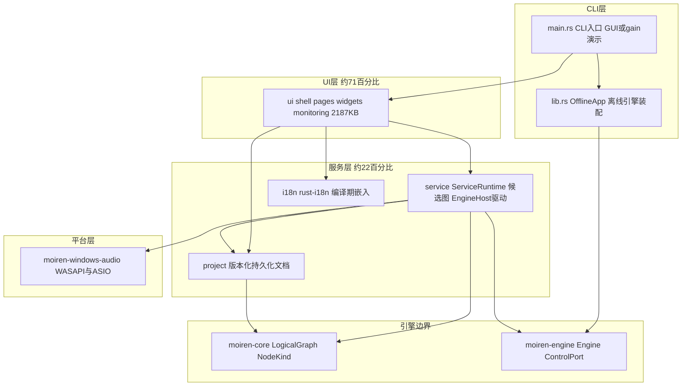
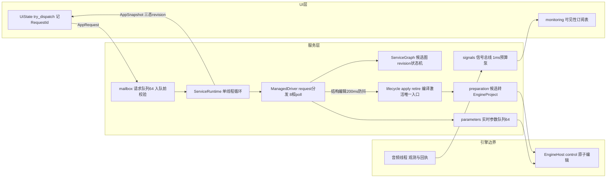
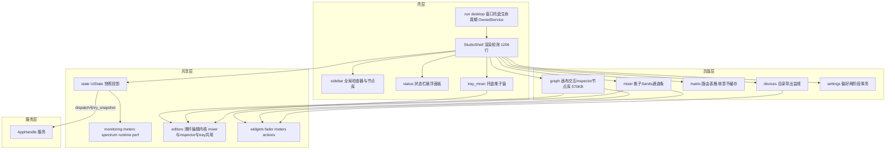
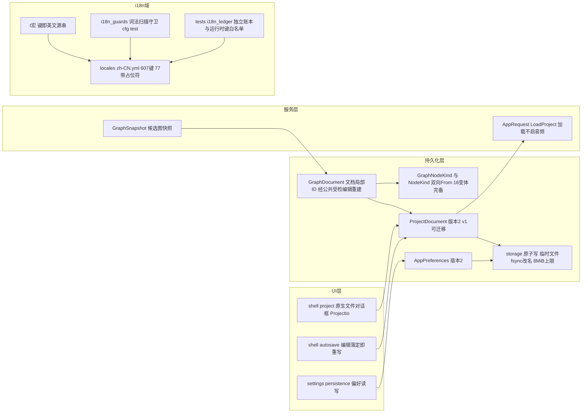

# moiren-app 架构审计（2026-11-20）

基线：main @ `d8610e05`。方法：子代理 `audit-app` 递归拆分（下级子代理 2 个交付、3 个失败域由其亲自审计补齐），关键指控经抽查验证；主代理复核收录。

## 职责摘要

栈顶桌面应用 crate：应用服务（候选图唯一真相、EngineHost 驱动、快照/信号发布）、gpui-kit 桌面 UI（Graph/Mixer/Matrix/Devices/Settings 五工作区 + shell/托盘）、项目与偏好持久化、CLI 入口（GUI 与 `--gain` 离线演示）、编译期 i18n（zh-CN 607 键）。约 164 文件 3058KB：UI 层占 71%（2187KB）、服务层 22%（677KB）、持久化 105KB、crate 根 91KB；内联测试约 1/3。分层执行总体严格：UI 只经 `AppRequest`/`AppSnapshot` 与服务通信，编译/激活只在服务层 `lifecycle`，`t!`+zh-CN 账本有双守卫。

## 图 1：crate 总览分层

依赖方向验证：service 生产代码 `grep crate::ui` 仅 2 处且均在测试内（`service/mod.rs:910` 位于 `#[cfg(test)] mod snapshot_publish_tests`；`settings_tests.rs:61`），唯一 seam `finish_service` 由 `ui/mod.rs:43-44` 以 `cfg(any(test, feature="gpui-test"))` 导出——契约真实成立。project↔service 存在同 crate 双向类型耦合：`project/graph.rs:7-10` 导入 `crate::service::{GraphNodeState, validate_node_state}`，而 `service/model.rs:77` `AppRequest::LoadProject(crate::project::ProjectDocument)` 反向引用。

## 图 2：服务层与 EngineHost 交互

**下行（UI 编辑 → 引擎）**：`UiState::try_dispatch` → `AppHandle::try_request_tracked` 入队前校验（`mailbox.rs:82-143`，无效请求不消耗 RequestId）→ app-service 线程每轮 ≤16 请求（`mod.rs:656-668`）→ `ManagedDriver::request`（`driver.rs:5-159`）。值类编辑走实时参数通道免重建（`graph.rs:443-505` → `parameters.rs:14-42`，容量 64，`NextBlock` 生效）；结构编辑置 200ms 防抖（`managed.rs:117`；`driver.rs:109-111`）→ `lifecycle::apply()` 编译 `EngineProject`（`preparation.rs:67-72`），已有 owner 时 `owner.control.edit` 原子替换执行计划（`lifecycle.rs:170-186`），否则 `EngineHost::open`（`lifecycle.rs:308/317`，全目录唯一）；引擎拒绝 → `preparation_rejected` 只记 fault，旧图继续运行（`driver.rs:688-695`；`graph.rs:1130-1144`）。**UI 无编译/激活入口**：`AppRequest` 无 compile 变体，仅 `ApplyGraph`（`model.rs:90`），CoreDriver 兜底拒绝（`mod.rs:415-418`）。

**上行（观测 → 三态 → UI）**：candidate_revision（requested，编辑即增，`graph.rs:817-820`）/ pending_revision（accepted，`lifecycle` 提交后写入 `graph.rs:1051-1059`）/ active_revision（applied，双闸确认：参数 ACK 屏障 + 世代复核，`driver.rs:818-854`；`confirmed()` 仅 `pub(crate)`，`graph.rs:1083-1110`）→ 令牌化快照发布（`mod.rs:429-509`）→ mailbox 值去重保 Arc 稳定（`mailbox.rs:259-283`）→ `UiState::poll` 以 `Arc::ptr_eq` 判变（`state.rs:181-197`）→ 文案映射 `control_feedback`：Applied/AppliedLate→"Changes applied"、Accepted→"Applying changes..."（`presentation.rs:525-554`）。电平/频谱走信号总线 `LevelSource` 直持引擎订阅（`managed/meters.rs:1-34`），频谱换形即换 topic 重订阅（`signals.rs:150-196`）。

## 图 3：UI 层组织

要点：五页全部经 `state.dispatch(AppRequest)` 提交、无绕过（如 `interactions.rs:631-667`、`routing.rs:119/379`、`matrix.rs:334-390`、`exports.rs:164`、`transaction.rs:44-119` 三段链）；Mixer 推子经 `UiState::edit_mixer` 读候选改后回发 `SetMixer`（`state.rs:274-283`）。Settings 的 Requested|Active 双列（`settings.rs:630-682`）与 Devices 三态模型（`monitor.rs:24-35` Running/NotRunning/Detached）是三态呈现最完整的两处；Graph 画布以 `preparing_nodes` 描边表达重备中（`graph_canvas.rs:383-446`）；Mixer/Matrix 页自身只画候选（见观察 8）。

## 图 4：项目持久化与 i18n

保存链：`GraphSnapshot → GraphDocument::from_snapshot`（文档局部 ID，保存时即 round-trip 校验，`project/graph.rs:154-237`）→ `ProjectDocument::from_graph`（`model.rs:46-61`）→ `write_json` 原子写（`storage.rs:211-227`：`create_new` 临时文件 + `sync_all` + 同文件系统 rename）。加载链：`load_project → migrate`（v1→v2，`model.rs:144-156`）→ `validate`（4096 节点/32768 边/65536 端点上限，`graph.rs:240-283`）→ `to_graph` 仅经 `create_node/connect` 公共受检编辑重建（`graph.rs:239-373`）→ `AppRequest::LoadProject`；加载不启动音频（`project.rs:1-4`、`state.rs:303-316`）。`deny_unknown_fields` + legacy 容忍字段（`model.rs:166-181`）让旧文件可解析。autosave 与 preferences 同目录（`storage.rs:97-108`），损坏 autosave 不阻塞启动（`storage.rs:112-123`）。i18n 双保险：`i18n_guards.rs` 四类守卫（每个 `t!` 键在目录 `:669`、目录键可达 `:831`、`%{placeholder}` 一致 `:864`、Debug 格式不达 UI `:499`）；`tests/i18n_ledger.rs` 独立账本 + `ALLOWED_RUNTIME_KEYS` 白名单；`build.rs:28-30` 补 yml rerun 触发。

## 架构观察

| # | 现象 | 证据 | 影响 |
|---|---|---|---|
| 1 | 绘制巨兽 God file：全部节点卡片/连线/仪表 paint 集于单文件 | `ui/pages/graph/graph_canvas_view/nodes.rs`（60.8KB） | 任何节点视觉改动都在同一文件冲突；按绘制对象拆分即可 |
| 2 | 服务层三大文件职责过载 | `service/mod.rs`（43KB/1069 行）；`service/graph.rs`（45KB/1147 行）；`managed/driver.rs`（42KB/965 行单 poll 串 8 阶段） | 修改半径大；耦合点在 `&mut ServiceContext`，拆分需权衡 |
| 3 | 内联测试占约 1/3 且多巨兽 | `ui/pages/graph/tests.rs` 184KB、`mixer/tests.rs` 154KB、`managed/tests.rs` 122KB | 浏览/审阅成本高；`#[cfg]` 内联既是原因也是放大器 |
| 4 | shell↔pages glob 循环 re-export | `pages/mod.rs:12` 与 `shell.rs:10` 反向 re-export | 每页 `use super::*` 传递整个壳面，符号来源难追溯 |
| 5 | StudioShell 上帝状态：12+ 文件给它加 impl | `shell.rs:222-1206` 及各页 impl 块 | 行为散布全壳；页面状态 struct 已拆但未收回行为 |
| 6 | **t! 绕过（实锤）**：节点类型标题硬编码英文 | `node_catalog.rs:99-119` `kind_title` 返回英文（注释自认 design 21 §4 待办），经 `mixer.rs:146-151`、`node_inspector.rs:147` 用户可见；另 `matrix.rs:363/373` "−1 dB"/"+1 dB" 字面量 | 与「用户文案必须走 t!」规则冲突；中文界面下这些文案恒为英文 |
| 7 | 三态纪律是真实现而非约定（好） | `confirmed()` 仅 pub(crate) + 参数 ACK/世代双闸（`driver.rs:818-854`）；快照 `fresh()` 世代过滤（`mod.rs:298-302`）；空闲轮不重建有回归测试（`mod.rs:856-911`） | requested→accepted→applied 可信；候选不被冒充为活动 |
| 8 | Mixer/Matrix 页内无 pending 就地反馈 | `strip_controls.rs:78` 只画 requested；`matrix.rs:142-150` 只画候选边 | 合规（不冒充），但混音中的用户需去 Devices/Settings 看 applied |
| 9 | Apply-ACK 屏障是复杂度热点 | `driver.rs:673-854` 需同时推理 apply_id/revision/host_revision/document 四量纲 | 本目录最难维护的 ~150 行，改动高风险 |
| 10 | 有界队列静默降级 + 通道共享 | 参数队列满即丢弃仅记错误（`parameters.rs:37-40`）；订阅请求与普通请求共享 64 队列（`mailbox.rs:494-511`） | 突发订阅可挤占用户请求；丢弃无 UI 可见提示 |
| 11 | undo journal 深拷贝成本 | 每步编辑克隆整份 GraphSnapshot、深度 100（`graph.rs:288-317`；`edit.rs:64`） | 4096 节点上限下极端图内存可观 |
| 12 | 测试设施以 feature 而非 cfg(test) 暴露 | `service/mod.rs:22-24` `test_backend` 挂 `gpui-test` | 带该 feature 的非测试构建会编入假后端 |
| 13 | 缓存键手工维护 | `graph/page.rs:30-68` `ControlsKey` 18 字段需与 world_cache 输入一一对应 | 新 UI 输入漏进键=陈旧缓存，仅靠 gpui-test 守护 |
| 14 | 跨页职责错位与隐蔽耦合 | `update_node_meters` 定义在 `mixer.rs:24-89` 却服务 Graph 页；`devices/overrides.rs:2,25` 直接写 settings 草稿 | 命名误导；协作正确但无显式契约 |
| 15 | RenderOnce 规则与实现不符 | pages 生产码 0 处 `RenderOnce`（自由函数+div 树）；`docs/development/crates/moiren-app.md:13` 要求使用 RenderOnce 组件 | 文档契约与实现漂移；组件复用靠约定 |
| 16 | 引擎/平台类型直达 UI（类型耦合非操作越界） | pages 下 7 处 `moiren_windows_audio` 类型导入（`devices/monitor.rs:9,112`、`settings.rs:10`、`binding_choices.rs:472` 等） | 不违反「不 compile/activate」，但 UI 直接依赖平台 crate 类型，移植性受限 |
| 17 | 持久化健壮（好） | 原子写（`storage.rs:211-227`）、保存时 round-trip 校验（`graph.rs:235`）、加载经公共受检编辑（`graph.rs:239-373`）、v1→v2 迁移、GraphNodeKind↔NodeKind 16 变体完备（`graph.rs:80-124`） | 版本演进路径清晰；NodeId 不复用旧会话身份 |
| 18 | i18n 守卫双保险（好） | 四类守卫 + 独立账本 + 白名单 + rerun 触发 | 漂移在测试期即被拒；盲区在观察 6 的绕过点 |
| 19 | CLI 入口手写且简陋 | `main.rs:20-37` 仅 `--help`/`--gain` | 可接受（演示用途），扩展需换 clap |

**总评**：分层契约（UI→服务→引擎边界、候选/活动三态、i18n 账本、持久化版本化）在类型与测试两个层面都被认真执行，是这个 crate 最强的部分；主要债务集中在 UI 侧的文件规模与 glob 依赖（观察 1-5）、少量 t! 绕过（观察 6）与服务侧上帝上下文/复杂度热点（观察 2、9）。
