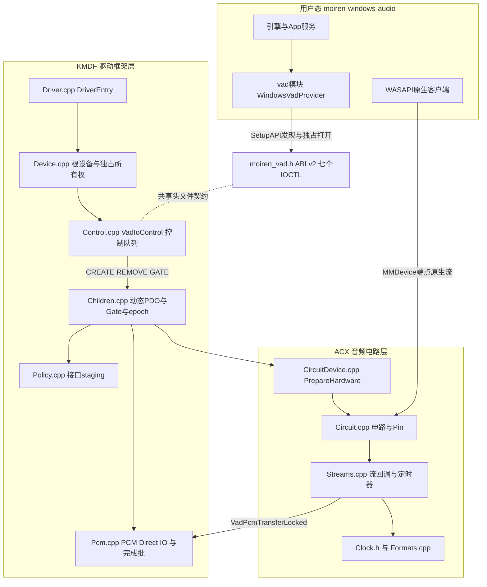

# driver/vad、tools/rt-check、audio-hack-lab、scripts 架构审计（2026-11-20）

基线：main @ `d8610e05`。方法：子代理 `audit-driver-tools` 通读 driver 文档/STATUS/ABI 与源文件结构、rt-check 影子编译机制、实验区目录；主代理复核收录。

## driver/vad

**职责摘要**：独立的 x64 ACX 1.1/KMDF 1.31 虚拟音频驱动（VS+WDK 10.0.28000.0，`ROOT\MoirenVad` 根设备 + 动态 raw PDO，上限 64 端点）。根设备持有一个独占、不可继承的控制文件对象（标准用户 ACL + 会话 epoch），通过 7 个 IOCTL 提供 ABI v2 控制与 Direct I/O PCM 通道（`ABI.md:10-18`）。ACX 电路提供 mono/stereo 48 kHz PCM16/Float32 原生流，每端点一条，事件/定时器双驱动路径。Cargo 完全不依赖 WDK，主产品默认不使用此驱动（`driver/README.md:16`）。

**分层与文件归属**

| 分层 | 文件 |
|---|---|
| 入口/注册 | `src/Driver.cpp`（DriverEntry→WdfDriverCreate+AcxDriverInitialize，`Driver.cpp:10-31`）、`src/Driver.h`（VAD_ROOT/VAD_CHILD/VAD_SHARED 上下文与跨模块契约，`Driver.h:18-45`） |
| 根设备/所有权 | `src/Device.cpp`（VadAddDevice:13、VadFileCreate:173 独占判定、RevokeFileOwner:222、VadRootCleanup:303）、`src/Ownership.h` |
| 控制队列 | `src/Control.cpp`（VadIoControl:131 分发 CAPABILITIES/CREATE/QUERY/REMOVE/SET_GATE，:33-34 PCM 转发 VadPcmSubmit；单槽 handoff 工作项:175-197） |
| 子设备/PDO | `src/Children.cpp`（VadCreateChild:59、VadRemoveChild:201、VadRevokeSession:243、VadSetGate:323、stream generation 管理:390-487） |
| 策略/属性 | `src/Policy.cpp`（StageInterface:64 系统工作线程 staging AUDIO/direction/REALTIME 三接口，PreparePolicy:163）、`src/InterfaceName.h` |
| PCM 传输 | `src/Pcm.cpp`（VadPcmSubmit:161 被动级 MDL 映射、VadPcmTransferLocked:262 DPC 安全有界拷贝、VadPcmComplete:327 四项完成批） |
| ACX 音频电路 | `src/audio/CircuitDevice.cpp`（Prepare:79 成功后才 AcxDeviceAddCircuit）、`Circuit.cpp`（BuildCircuit:51、SetFormat:39）、`Formats.cpp`（格式验证:14）、`CircuitIdentity.h`（128 位稳定 ID→component URI） |
| ACX 流处理 | `src/audio/Streams.cpp`（CreateStream:671、AllocatePackets:762、SetRenderPacket:528、GetCapturePacket:595、TimerDrivenTick:260）、`Clock.h`（QPC 有理 deadline，纯逻辑可 host 测）、`TimerPcm.h` |
| ABI/构建/测试 | `include/moiren_vad.h`（wire 契约权威）、`MoirenVad.inf/.vcxproj`、`build.ps1`（MSBuild+InfVerif）、`test.ps1`（7 个 host 套件:4）、`tests/*.cpp` + 2 个提取脚本、`STATUS.md/ABI.md/PROVENANCE.md` |



**与用户态的接口**：不是"探测"，而是 `crates/moiren-windows-audio/src/vad/`（`vad.rs:1-52`：discovery/client/control_io/protocol/pcm/pcm_bridge/endpoint_name/provider）作为完整控制侧实现；`WindowsVadProvider` 实现 `VirtualBoundaryProvider`（`provider.rs:275`），以 `VadSession` 工作线程承载 PCM（`provider.rs:420-507`）。另有 WASAPI 原生客户端（probe/第三方应用）直接以独占事件/定时器模式打开 MMDevice 端点，走 ACX 流而不经过控制 ABI。

**STATUS 声明的当前状态**（`STATUS.md`，2026-10-27 更新）：源码层 ABI v2 全实现（epochs 栅栏、64 PDO、QPC rebase）；target（VMware Win11 测试签名安装）有界结果为生产 INF 绑定 + 事件模式 8/8 + 定时器模式 8/8 + 8 小时 idle 浸泡 PASS（2026-10-22，`STATUS.md:7-14`）；**P1 target 资格未过**（`:18-19`），music 相位、16 小时、fresh-OS 安装、标准用户控制、Verifier、生产签名等全部保持开放（`:282-298`）。

## tools/rt-check

**机制说明**：独立 Cargo workspace（`Cargo.toml:10` 空 `[workspace]`，root members 不含 tools），唯一测试目标 `tests/professional_rt.rs`。存在理由：库单测二进制已安装计数分配器，无法再测量库内私有 RT 路径（`professional_rt.rs:1-2`），故用 13 个 `#[path]`（`:36-104`）把 `crates/moiren-windows-audio/src` 的 bridge/codec/resample/servo/observations/absence/owner/recovery/win32_raii/negotiation 及 `asio_rt_tests.rs` 原文件影子编译进测试 crate，配合共享的 `tests/common/alloc_guard.rs`（`:103-104`）断言零分配。影子模块里的 `crate::` 绝对路径靠顶层重导出桥接（`:19-24`，被 `bridge.rs:2`、`engine_backend/owner.rs:13,627`、`win32_raii.rs:4` 消费），模块路径镜像（`:68-86`）保证生产源一字不改即可编译。运行：`cargo test --manifest-path tools/rt-check/Cargo.toml`（`:3`）。

**覆盖的 RT 契约清单**（17 个测试函数）：

- **零分配**：resampler reset/规划无陈旧音频（`:111`）；5 格式编解码 + 全速率对传输（`:373`）；Pump 渲染循环 f32/f64 部分写（`:443`）；RingSource 捕获 + servo 启动静音（`:549`）；ASIO 真实回调与诊断快照（`asio_rt_tests.rs:22`，仅 Windows）。
- **故障语义**：单点故障 7 组合 Engine 必归还控制侧（`:1023`）；native+DSP 全组合 panic 支配 + 控制侧 drop（`:870`）；wait 错误×stop panic 等三组（`:754/766/778`）；auxiliary cancel panic 不死锁 status（`:811/818`）。
- **恢复协议**：可恢复通知仅在 owner 清理后发布（`:622`）；延迟恢复尊重取消与耗尽 ticket（`:697`）。
- **生命周期**：owner 等待激活并归还 Engine（`:987`）；激活前取消/attach 失败保留未渲染 Engine（`:1064`）。
- **观测/回归**：observation 快照元数据字段（`:504`）；Tone 奈奎斯特 + Float32 溢出饱和（`:1097`）。

```mermaid
flowchart LR
    subgraph HARNESS[rt-check 影子测试 crate]
        TEST[tests/professional_rt.rs]
        GUARD[alloc_guard 零分配断言]
        MIRROR[owner 与 engine_backend 路径镜像]
    end
    subgraph SHADOW[#[path] 影子编译的生产源]
        OWN[engine_backend/owner.rs Pump与Transport]
        DSP[bridge codec resample servo]
        REC[recovery与recovery_host_tests]
        ASIO[asio_rt_tests.rs 真实回调]
    end
    subgraph LIB[库依赖 path 引入]
        WAUDIO[moiren-windows-audio]
        ENG[moiren-engine与moiren-core]
    end
    TEST --> GUARD
    TEST --> MIRROR
    TEST --> SHADOW
    OWN -->|crate::路径经顶层重导出| WAUDIO
    WAUDIO --> ENG
```

## audio-hack-lab 与 scripts

**audio-hack-lab**：一次性实验区——独立 crate `lab/`（windows 0.58，刻意脱离主 workspace 的 0.62.2 精确 pin）+ e3/e4a/e4b/e8/e11/probe 脚本 + `pdb/`（AudioDG 等公开符号）；`REPORT.md` 记录 2026-10-23 在 Win10 26300 上实测钉死的引擎管线顺序与"防双声"方案裁决（推荐：进程 loopback + 端点主静音；排除 session 静音、APO、audiodg 注入），日志不入库。

**scripts/**：`vad-soak.ps1` 是在专用 guest 内运行的浸泡监督器（不安装/重配驱动，`:1-2`；流式采样 GetPerformanceInfo 防内存增长，校验函数 `Confirm-SoakReport:19`）；`tests/vad-soak.tests.ps1` 用 AST 提取真实校验函数做无驱动的隔离回归（`:11-19`）。

## 架构观察

| # | 现象 | 证据 | 影响 |
|---|---|---|---|
| 1 | 内核/用户态契约以单一头文件为真相源并被双向锁定 | `ABI.md:3`；`crates/moiren-windows-audio/src/vad/protocol/abi_conformance.rs:8` 用 `include_str!` 解析内核头，断言 31 个常量、7 个 IOCTL 值与 6 个结构尺寸一致（`:68-132`） | ABI 漂移在 host `cargo test` 即失败，无需 VM 循环；改头文件必须两侧同步 |
| 2 | 驱动对主产品是旁路可选件 | `driver/README.md:16`；`STATUS.md:18-19`（P1 未过） | 引擎默认路径不受未签名驱动影响；接入点收敛在 `VirtualBoundaryProvider` trait |
| 3 | 状态声明集中且区分证据等级 | `STATUS.md:3-5` 自称唯一当前判定 owner；有界 target 结果与"非稳定可重复"措辞分离（`:21-28`） | 符合仓库 truthful-state 规则；验收读 STATUS.md 而非历史 docs |
| 4 | C++ 驱动也有与 rt-check 同构的"影子编译" | `test.ps1:24-33` 用 `extract-cleanup.py` 从生产 `Device.cpp`/`Children.cpp` 提取真实函数对 DDI stub 编译进 host 套件；`STATUS.md:135-142` 明确 host 不测 WDF/PnP/取消/真实音频 | 测真实源码而非拷贝的哲学跨语言一致；内核回调语义仍只能由 target VM 证据闭合（`:282-298`） |
| 5 | RT 测试分两层：库内集成测试 + rt-check 影子 harness | `lib.rs:5-8` 声明 `asio_rt_tests.rs` 与 `recovery_host_tests.rs` 只在 rt-check 编译；库内 `tests/clock_bridge.rs:449` 等用 `assert_allocates_nothing` | 完整 RT gate 是两条命令：`cargo test -p moiren-windows-audio` + `cargo test --manifest-path tools/rt-check/Cargo.toml`；rt-check target/ 残留 .d 产物是分拆前历史痕迹 |
| 6 | 影子编译隐含一份"crate:: 依赖清单" | `professional_rt.rs:19-24` 顶层 use 并非残留，被 `bridge.rs:2`、`owner.rs:13,627`、`win32_raii.rs:4` 的 `crate::` 绝对路径解析消费 | 生产模块新增 `crate::` 依赖而未加入重导出清单时 rt-check 编译即失败——既是保护也是维护点 |
| 7 | rt-check 覆盖空缺：VAD 用户态 PCM 桥与 process_loopback 无零分配断言 | `professional_rt.rs` 影子清单不含 `vad/*`；库内 `assert_allocates_nothing` 使用者仅 clock_bridge/latency/virtual_boundary；process_loopback.rs 无断言 | VAD PCM 桥（`vad/pcm_bridge.rs`、`pcm_worker.rs`）与进程 loopback 捕获的 RT 分配保证不在任何本地零分配 gate 内 |
| 8 | 实验区与主依赖树隔离不彻底但可控 | `audio-hack-lab/lab/Cargo.toml:9`（windows 0.58）vs root `Cargo.toml`（windows =0.62.2 精确 pin）；`REPORT.md:4` 日志不上库 | 结论可安全指导 `process_loopback` 设计；`pdb/` 下 4 个符号文件是目录内二进制，勿随日志策略误扩大 |
| 9 | 浸泡监督器与驱动的安全边界清晰 | `scripts/vad-soak.ps1:2`（guest 内运行、不装驱动、不重配置）；`tests/vad-soak.tests.ps1:2`（无驱动访问的隔离回归）；SHA256 先验（`vad-soak.ps1:48`） | 八小时 gate 的证据链可复验、可拒伪；与 STATUS.md 的"starting or rehearsing them is not an eight-hour PASS"（`:58-60`）闭环 |
