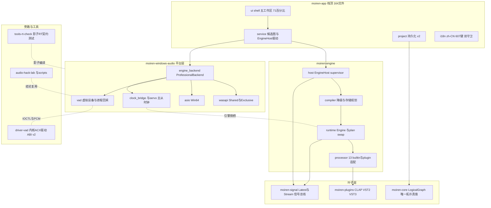
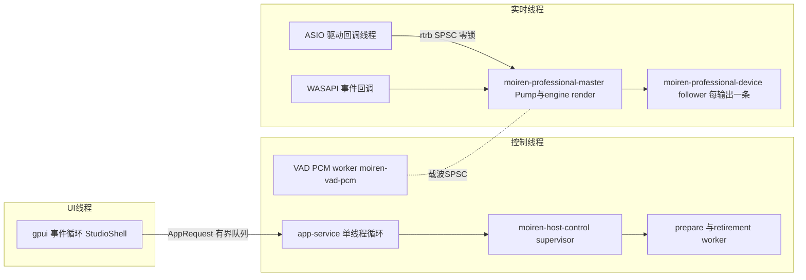

# 2026-11-20 架构审计：全仓分层架构图与跨模块审计

- **基线**：main @ `d8610e05`（2026-11-19，工作区干净）。
- **性质**：只读审计，零代码改动，本目录为唯一产出。
- **触发**：用户要求审计并绘制当前软件的架构图——每个子模块单独成图、注意分层、每图不过大。
- **方法**：主代理 + 递归子代理树（共 22 个子代理实例：core+signal、plugins、win-audio×6 分片、app×5 域、driver+tools；engine 与 plugins 因速率限制由主代理亲审；win-audio 的 engine_backend 分片另经 `opencode-go/deepseek-v4.1-flash:max` 路由独立深审，与六分片汇总双源交叉验证）。全部只读，证据落点为 文件:行。

## 仓库级架构总览

依赖方向（Cargo.toml 实证）：`core`、`signal`、`plugins` 零内部依赖；`engine → core+plugins+signal`；`windows-audio → core+engine+signal`；`app → 全部五库 crate`。driver/vad 与 rt-check 不在 workspace members 内，分别以内核 ABI 与 `#[path]` 影子编译连接。

### 线程地图（跨 crate 汇总，threads.rs 注册表口径）

## 部分与文件

| # | 部分 | 图数 | 要点 |
|---|---|---|---|
| 01 | [moiren-core](01-moiren-core.md) | 1 | 传输中立叶子；NodeKind 闭枚举 16 变体；先验证后提交的单调 ID 编辑；64/40 字节定长控制协议 |
| 02 | [moiren-signal](02-moiren-signal.md) | 2 | Latest/Stream 四形状全预分配；发布所有权靠类型系统三重锁定；pinned 依赖与预算模型对账 |
| 03 | [moiren-plugins](03-moiren-plugins.md) | 2 | 扫描子进程隔离（30s deadline、临时文件报告）；实例化仍在本进程（已知缺口）；模块装载去重注册表 |
| 04 | [moiren-engine](04-moiren-engine.md) | 5 | 六层：host/compiler/runtime/processor/观测/基础设施；五元身份体系；块边界 plan swap；RT 渲染零分配 |
| 05 | [moiren-windows-audio](05-moiren-windows-audio.md) | 5+2 | 契约四阶段实现链；WASAPI/ASIO/VAD/时钟各一图；teardown 2s 有界（含深审新增缺口）；探针 feature 门控；附 engine_backend 独立深审两图与双源确认 |
| 06 | [moiren-app](06-moiren-app.md) | 4 | UI 71% 服务 22%；三态 revision 真实现；持久化 v2 原子写；i18n 双守卫；God file 债务清单 |
| 07 | [driver 与 tools](07-driver-and-tools.md) | 2 | ACX/KMDF 分层图；ABI 头文件双向锁定；rt-check 影子编译 17 测试；VAD PCM 桥零分配断言空缺 |

## 执行摘要（跨模块发现，按建议处置优先级）

**架构强项（证据充分，应保持）**

1. **三层分离在依赖与类型两层都被强制**：core/signal/plugins 零内部依赖；plan/资源/参数表身份互检（engine 观察察 1）；平台类型未泄漏进 engine 公共契约。
2. **RT 契约有测试 Teeth**：signal TLS 分配器 + Miri、windows-audio rt-check 影子编译（17 测试）、ASIO 真实回调零分配插桩、app 空闲轮不重建回归——四层各有 gate。
3. **truthful state 是真实现**：requested→accepted→applied 三态在 app/engine/windows-audio 三层各有结构支撑（revision 状态机、双闸确认、generation-fenced 观测）。
4. **边界契约单点锁定**：VAD ABI 头文件 `include_str!` 一致性测试；i18n 账本双守卫；rt-check 的 `crate::` 重导出清单。

**跨模块问题（新增发现或既有确认）**

| # | 发现 | 证据 | 建议处置 |
|---|---|---|---|
| X1 | t! 绕过实锤：节点类型标题硬编码英文用户可见 | [06 观察 6](06-moiren-app.md)（node_catalog.rs:99-119、mixer.rs:146-151） | 小 PR 落 t!，与 design 21 §4 对齐 |
| X2 | teardown 无界点两处：CaptureSession::Drop 裸 join、ASIO detach 无超时 | [05 观察 3](05-moiren-windows-audio.md) | 与 #105 卡死端点四阶段同线处理 |
| X3 | rt-check 覆盖空缺：VAD 用户态 PCM 桥与 process_loopback 无零分配断言 | [07 观察 7](07-driver-and-tools.md) | 补影子清单或库内 `assert_allocates_nothing` |
| X4 | 探针平行实现漂移风险：physical/exclusive_probe 自建 WASAPI 打开链 | [05 观察 10](05-moiren-windows-audio.md) | 保持 feature 常闭；或抽公共 open 工具 |
| X5 | UI 侧 God file 集群：60KB 绘制文件、43-45KB 服务三文件、glob 循环 re-export | [06 观察 1-5](06-moiren-app.md) | 按绘制对象/阶段拆分（排期参考 11-11 审计 A-1） |
| X6 | 文档漂移点：core guide 测试模块缺列、app guide RenderOnce 规则与实现不符、signal README+guide 双源 | [01 观察 2-3](01-moiren-core.md)、[06 观察 15](06-moiren-app.md)、[02 观察 4](02-moiren-signal.md) | 文档卫生批量小 PR |
| X7 | plugins 运行期崩溃隔离缺位（扫描已隔离、实例化未隔离） | [03 观察 2](03-moiren-plugins.md) | 与 11-11 审计 M3 插件生态线合并推进 |
| X8 | 有界队列静默降级在 app 两处无 UI 提示（参数丢弃、订阅挤占） | [06 观察 10](06-moiren-app.md) | 并入 GraphFault 类型化波次 |
| X9 | `poll_resource` 缺失探测持锁、不可取消、跑在 host control 线程（契约要求 bounded and cancellable） | [05 深审观察 16](05-moiren-windows-audio.md) | 卡住的 COM 枚举可拖住控制线程与 UI 状态；补取消/上界 |
| X10 | teardown 无 transport 级总预算：每 worker 2s 串行 join，最坏 ≈ 组数×2s | [05 深审观察 14](05-moiren-windows-audio.md) | 与 X2 同线：#105 有界语义按 per-worker 理解或补总预算 |
| X11 | RT 故障路径存在堆分配与 start 后 debug 日志（正常路径零分配已由 rt-check 钉死） | [05 深审观察 15](05-moiren-windows-audio.md) | 记录为「未证明不变量」，review 时不得引用为已证 |
| X12 | prepare 非纯函数：stuck/runtime_absent 判决持久于 backend 实例，重试隐式不同 | [05 深审观察 18](05-moiren-windows-audio.md) | UI 叙述需按「重新 apply = 新建 backend」，或改判决作用域 |
| X13 | `OPEN_DEADLINE` 不覆盖进程环回与虚拟边界 prepare | [05 深审观察 17](05-moiren-windows-audio.md) | 与 X2/X10 同线补 deadline |

## 与既往审计的关系

2026-11-09（架构与代码组织）、2026-11-11（效率/可维护性/缺口/steward）已覆盖 God file 判定、渲染热路径、插件断链 M3 等；本轮不重查其判定，专注**分层架构图与跨层边界的当前状态**。11-11 审计的整改注记（W-1/W-2、A-1、A-2）已并入 main，本轮证据均取自 `d8610e05` 现状。
