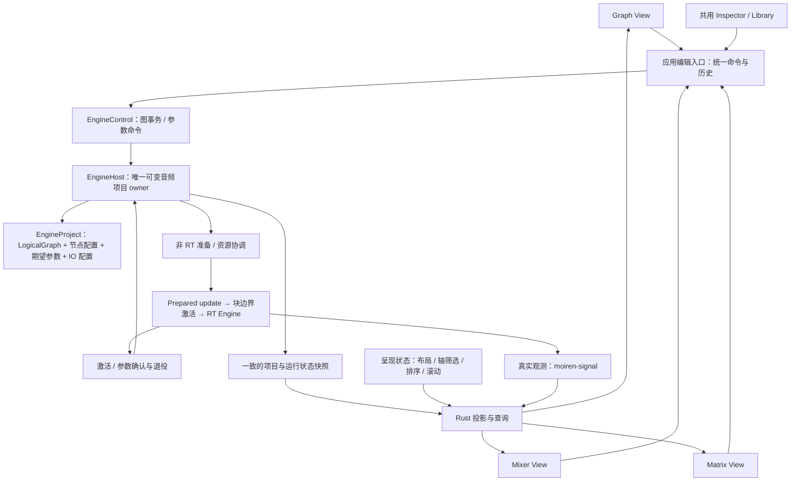

# Graph、Mixer 与 Matrix 统一编辑架构评估

> 状态：历史评估（2026-10-14；文内源码路径指向当时版本，部分文件已随重构删除）。

日期：2026-10-14。性质：设计评估与建议架构；本文不表示三个视图的拓扑编辑已经实现，也不改变当前硬件能力边界。

本文的“当前基线”记录评估时的状态。后续 core/engine 基础接口已按[后端读取与编辑契约](12-unified-topology-backend-contract.md)推进，桌面 UI 尚未迁移；接口实施状态以该契约为准。

## 1. 评估结论

这个方向成立，并且比“只有 Graph 画布能改变图结构”更符合 Moiren 的数据模型。应把 **LogicalGraph 是唯一拓扑权威** 与 **Graph View 是唯一编辑入口** 分开：前者继续保留，后者应取消。Graph、Mixer、Matrix 都可以提交节点、端口、连接及参数修改，由同一个后端事务入口执行。

建议将设计表述调整为：

> 一个可编辑的逻辑音频图，三个平等的编辑视图。Graph 展示节点和连线；Mixer 展示节点及其入边、出边列表；Matrix 展示输出端与输入端之间的直接连接。所有视图共享图对象身份、编辑规则和后端确认；布局、筛选、排序属于各自的展示状态。

“每个逻辑节点都有 Mixer Slot”可以成为完整性的要求，但需要补充三个条件：

1. **Slot 是节点的展示条目，不是新的音频对象。** 它不自动给节点增加 Gain、Pan、Mute、Meter 或额外处理阶段。
2. **节点对应条目，连接对应边，精确连接对应端口对。** 节点级 Matrix 单元格可能包含多条边，不能总是解释为一个开关或一个增益值。
3. **完整可访问不等于默认全部展开。** 每个节点都能在 Mixer 与 Matrix 中定位；默认视图可以筛选或折叠，但必须能看见筛选范围和被隐藏的关系。

因此，本设计值得采用。真正需要补齐的是端口和多重边语义、按能力生成控件、筛选后的编辑范围，以及多视图共用的事务与运行状态，而不是再建一份 Mixer 或 Matrix 拓扑。

## 2. 当前基线与旧设计中需要修正的表述

以下事实以本次读取的工作区源码为依据，包含现有未提交的 UI 改动；历史设计文档仅用于识别原来的意图。

| 当前对象 | 已有事实 | 对新设计的影响 |
| --- | --- | --- |
| `LogicalGraph` | 图对象通过编辑 API 修改；边记录 NodeId、源/目标 PortId、EdgeId 和 SendParams | 三个视图应复用同一套身份与校验 |
| 端口 | 一个端口承载完整多声道流；输入至多一条边，输出允许扇出 | Matrix 首先是流端口之间的路由矩阵，不是声道系数矩阵 |
| Bus | 可动态增删输入；同一源可连接同一 Bus 的多个输入 | 同一节点对可以有多条边，单元格需要汇总与下钻 |
| 图约束 | DAG；相同声道数量才能直接连接；没有隐式混音或声道转换 | 所有视图都必须在完整图上检查，不能在过滤后的可见图上检查 |
| 编译器 | 支持边 gain/pan/mute；PreFader 尚无已定义的 channel strip 取样点，编译时拒绝 | Mixer 的传统推子语义不能直接套到所有节点上 |
| 托管引擎 | `EngineHost` 已提供项目事务、参数目标、自动准备、激活确认、资源恢复与回收 | 新 UI 应接入托管入口，不在每个视图复制编图和换图逻辑 |
| 桌面 UI | `StudioState` 持有固定 `Source → Gain → Pan → Sink` 的 SessionGraph；Mix 是一个会话条；AppRequest 仍是 Start/Stop/SetGainPan 等 | 当前多视图共享的是有限会话控制，尚不是任意图编辑器 |
| Matrix | 当前 `main.slint` 接入 Graph 与 Mix，没有 Matrix 页面 | 本文的 Matrix 规则属于待实现设计 |

原 PRD 第 6.2 节把 Mixer 称为“不是第二套拓扑编辑器”，容易被理解为 Mixer 禁止修改拓扑。应改为“Mixer 可以编辑拓扑，但不持有独立拓扑状态”。第 12.1 节的“Graph 始终是 canonical topology”应明确指 `LogicalGraph` 数据模型，不指 Graph View。

2026-10-12 UI 重设计已经写明三个视图共享 routing model，Matrix 可编辑同一份 Edge。新的方向是在此基础上明确 Mixer 的结构编辑权限、所有节点的覆盖要求，以及 Matrix 的无歧义编辑规则。

此外，该重设计里的统一 Source trim、Pan、Fader 和固定 Master Strip 不能成为所有逻辑节点的强制结构。项目允许多个 Sink，且 outgoing Edge 地位相同；固定在右侧的 Monitor 只能是显式选择的节点或监控目标，不能创造特殊 Main Output。

## 3. 数据结构上的成立范围

### 3.1 Mixer 是带属性的邻接表视图

对节点 `v`，Mixer 可展示：

```text
NodeSlot(v)
├── 节点身份、配置、支持的参数与真实观测
├── Inputs：入边列表，每项保留源端口、目标端口和 EdgeId
└── Outputs / Sends：出边列表，每项保留目标端口、EdgeId 和发送参数
```

这能完整表达当前逻辑图。仅有传统的推子条不能完整表达图；必须有输入和输出邻接列表，尤其需要覆盖 Sink 的输入、Bus 的多个输入以及独立处理节点。

邻接表是由图导出的查询索引，不需要在节点上再保存一份 send 列表。边参数仍归 Edge。UI 可以建立入边/出边索引提升查询速度，但应能从同一图快照重建。

### 3.2 Matrix 应分成节点汇总与端口精确两层

Moiren 当前更准确地说是**带端口约束、边属性和并行边的有向无环图**。简单的节点布尔邻接矩阵只能表达“有没有至少一条边”，不能完整表达它。

节点级单元格定义为：

```text
Cell(u, v) = { e | e.src = u 且 e.dst = v }
```

这个集合可以为空、包含一条边或多条边。节点级矩阵适合浏览和常见连接；端口级矩阵则用输出端口作为行、输入端口作为列，显示一对明确端口的直接连接。当前端口契约下，一个精确端口对至多对应一条边。

推荐固定方向：**行是输出侧，列是输入侧**，从行向列发送。Source 通常只出现在行轴，Sink 只出现在列轴，处理节点两轴都出现。Bus 即使暂时没有输入，也应作为可接收目标出现，因为它有新增输入的能力。无需强制给没有输入的 Source 分配可编辑列。

因此常用 Matrix 是矩形的输出/输入关系投影，不必机械地占满一个 `N × N` 方阵。所有节点的覆盖要求是“每个节点能在适用轴上定位”，不是“每个节点必须同时具有有效的行和列”。

以 `Mic → Bus input 1`、`Mic → Bus input 2`、`Game → Bus input 3`、`Bus → Speakers` 为例，节点汇总与端口明细如下：

| 输出节点 ↓ / 输入节点 → | Bus | Speakers |
| --- | --- | --- |
| Mic | 2 条边，展开查看 | 无直接边 |
| Game | 1 条边 | 无直接边 |
| Bus | 禁用：自环 | 1 条边 |

展开 Bus 后，Mic 行在 input 1、input 2 各有一个独立连接，Game 行在 input 3 有一个连接。这两条 Mic 路由会被 Bus 分别求和，不能在节点级单元格合并成一个 gain。Mixer 的 Mic 条目同样列出两项发送，Graph 同样保留两条端口边；三种表示因此能相互核对。

### 3.3 直接连接与间接可达必须分开

例如：

```text
Mic → Gain → Pan → Speakers
```

直接连接矩阵中有三个单元格。`Mic → Speakers` 没有直接边，即使声音最终能到达 Speakers。

如果筛选只显示 Mic 与 Speakers，中间节点隐藏后，该单元格仍表示“无直接边”。可以附加“存在经 Gain、Pan 的间接路径”，但不能把这条路径变成可开关的直连，否则断开含义不明确，新建直连还会绕过已有处理。

“邻接矩阵”“可达矩阵”“声道映射矩阵”应成为三个明确概念。首版 Matrix 编辑邻接关系；路径总览可以作为只读辅助，声道系数编辑留给明确的 Mapper/Mixer 处理器。

## 4. 方案比较与推荐

| 方案 | 表达方式 | 优点 | 代价与问题 |
| --- | --- | --- | --- |
| A：所有节点有条目，按能力展示，支持端口下钻 | Mixer 以 NodeId 为条目身份；Matrix 节点汇总与端口连接共享 EdgeId | 覆盖完整图；不改变 DSP 语义；三个视图可以相互定位 | 需区分不同节点的控件，并处理汇总单元格 |
| B：Mixer 只展示 Routable/传统混音节点 | 其他处理节点主要在 Graph 中编辑 | 默认界面简洁，接近传统混音器 | 无法满足三个视图完整访问图；仍需补充“全部节点”模式 |
| C：把多节点链自动折叠成一个 channel strip | 从图结构推断 Source、Rack、Gain、Pan 和 Output 的组合 | 常见链路操作紧凑 | 分支、共享处理器、多输出时归属不唯一；容易制造第二套拓扑规则 |

建议采用 A，以 B 作为可切换的筛选预设。C 暂不采用；未来如需要 channel strip，应使用显式组合节点或明确的用户分组语义，不能依靠扫描任意图猜测。

“三个视图平等”指它们都能表达并提交同类编辑，不要求所有操作使用相同的手势。Matrix 可以通过轴标题、上下文菜单和共用 Inspector 新增/删除节点或管理端口；单元格负责连接编辑。Mixer 用槽位菜单与入边/出边列表。Graph 用节点卡片和端口。

## 5. 更新后的系统架构

### 5.1 项目、编辑、投影与执行



图表示建议接入关系。当前桌面 UI 尚未按此连接到 EngineHost。

| 层 | 拥有的数据与责任 | 不应承担的责任 |
| --- | --- | --- |
| `moiren-core` | LogicalGraph、Node/Port/Edge 身份与图约束 | UI 槽位、筛选、Windows owner、实时资源 |
| `moiren-engine` | EngineProject、EngineHost、参数 schema、编译、自动更新、激活、回收 | 像素布局、页面排序、选择与筛选偏好 |
| `moiren-windows-audio` | 原生设备与进程资源、时钟边界、owner、资源事件 | 独立的 UI 路由模型 |
| `moiren-signal` | 有界观测传输、订阅与需求 | 以可丢弃的观测代替事务和参数结果 |
| `moiren-app` | 项目文件、用户命令、Undo/Redo、元数据、三视图投影与选择、EngineHost 生命周期接入 | 第二套可独立演进的音频图、手工驱动后端准备/回收 |
| Slint 页面 | 展示投影、局部输入草稿、交互与展示状态 | 私自决定连接是否合法或声称参数已生效 |

EngineHost 中的期望项目是唯一可变音频项目。UI 可以持有只读快照和暂存草稿；它们是版本化副本，不能作为另一个独立 owner 提交整图覆盖。应用层的名字、颜色、标签和分组按稳定身份关联；节点删除后的清理以事务接受结果为依据，不能在请求刚入队时就删除元数据。

### 5.2 展示状态不进入音频拓扑

建议在应用层区分：

```text
Audio project：图 + 节点配置 + 期望参数 + IO / processing 配置
Project presentation：节点名字/标签/颜色、Graph 坐标、Mixer 顺序、Matrix 预设
Workspace state：页面、选择、焦点、滚动、缩放、临时搜索和编辑草稿
```

Mixer Slot 的长期身份直接来自 `(project identity, NodeId)`；其显示序号可以随筛选和排序变化。Matrix 轴条目以节点/端口身份为键，路由以 EdgeId 为键。它们与 engine buffer slot、ProcessorId、计划内参数序号没有对应关系。

项目身份必须加入跨项目缓存与选择的键。当前 NodeId 只保证图内身份，不能用另一个项目中的相同数字命中旧 Slot。排序不改变执行顺序；如未来存在 Rack processor 顺序，那是显式音频配置修改。

### 5.3 统一编辑入口

应用层命令应描述用户意图，例如：

```text
CreateNode / DeleteNode
ConnectPorts / ConnectToBus / DisconnectEdge / ReplaceConnection
SetNodeConfiguration / SetNodeParameter / SetEdgeParameter
InsertNodeOnEdge / DeleteNodeWithPolicy
```

这些是建议的命令类别，不是已经存在的公共 API。三个视图只改变发起方式，连接解析、端口占用、声道匹配、DAG 检查、预算与后端能力判断保持一致。

结构编辑作为一个事务验证和接受；接受后托管宿主自动更新，不给各页面增加 Compile/Publish 按钮。图合法但暂时无法准备时，保留期望项目并报告受阻；旧执行计划仅在 IO 与 owner 仍有效时继续运行。

实时 gain/pan/mute 通过稳定的 `ParameterTarget::Node` 或 `ParameterTarget::Edge` 下发。不要只修改投影或调用 `graph.set_send_params()` 就显示 Applied。参数命令使用独立 ParameterReceipt；仅获得 EditOutcome::Activated 不能证明参数已经在音频线程应用。

### 5.4 一致快照与必要的接口补齐

三视图应从同一个项目快照投影。建议快照同时关联项目身份、展示用快照版本、期望 GraphRevision、活动 GraphRevision、PlanRevision、owner/epoch、更新状态与参数结果。

其中展示用快照版本也覆盖参数和元数据变化；GraphRevision 不应因实时参数、筛选或排序而推进。参数结果单独关联编辑凭据，避免以“两个图版本相等”推断所有期望参数都已应用。

当前托管 API 已有事务与参数凭据，但 UI 集成还需要明确以下契约：

- `EngineObserver::project()` 与 `snapshot()` 分别读取不同 Mutex；连续调用不保证同一发布时刻。需要增加共同版本标记或一致的组合读取，不能拼成未经核对的页面模型。
- HostSnapshot 提供活动版本及运行状态，未直接提供完整的活动 LogicalGraph。显示 pending 删除或旧计划边时，需要可按活动版本定位的只读项目描述；可以是宿主提供的活动摘要或应用保留的版本快照，不能从编译器内部 buffer 反推用户拓扑。
- 当前 `EngineControl::edit` 是返回 `Result<(), ProjectError>` 的闭包，EditReceipt 也未直接返回创建的 NodeId/PortId/EdgeId。任意图 UI 需要带命令身份的接受结果与新对象身份，用于定位、元数据和 Undo；不能靠显示序号猜测新对象。
- 当前 edit 入口没有显式的 expected revision 参数。替换、删除、批量编辑需要执行时检查目标身份与预期占用关系；若需要版本冲突诊断，应补齐该契约，不把 UI 侧的预检当作执行保证。

以上是接入缺口，不要求另建一个通用消息框架或新增 crate。

## 6. Mixer Slot 的具体语义

### 6.1 所有节点都有条目，控件由能力决定

| 节点 | Slot 的基本内容 | 当前适用控制 | 不能默认假设 |
| --- | --- | --- | --- |
| Source | 资源身份、输出端口、出边列表 | IO 配置；各出边参数 | 节点自带推子或总 mute |
| Sink | 资源身份、输入端口、入边列表 | IO 配置；已有入边参数 | 具有出边、发送或 Master 地位 |
| Bus | 多输入列表、汇总输出、出边列表 | 增删/连接 Bus 输入；各边参数 | 自动归一化、限幅或节点级音量 |
| Gain | 输入、输出与相邻边 | 当前节点 LEVEL 参数 | 同时具有 Pan、Mute 和独立表计 |
| Pan | 输入、输出与相邻边 | 当前 stereo balance POSITION | 具有通用多声道定位能力 |
| Compressor | 输入、输出与相邻边 | 已声明的 compressor 参数及已接入的观测 | 普通音量推子可以代表压缩器全部语义 |

不支持的参数区可以省略或显示能力说明。表计必须标明观测点，例如“节点输出”“边发送之后”；没有 publisher 的节点显示不可用，不能复用附近表计并标成该节点的测量。

如用户希望 Source/Bus/Sink 都拥有传统推子，应单独设计“节点处理后 channel strip”或显式插入 Gain/Pan。前者会改变音频模型、参数 schema 和 Pre/Post 语义，后者会产生真实逻辑节点，都不能作为创建 Mixer Slot 的隐含副作用。

节点级 mute 与 solo 也需要另行定义。把某节点的所有出边逐条 mute，不具备单一节点 mute 参数的原子性；Sink 没有出边，solo 还涉及其他分支与状态恢复。首版只提供已有的 Edge mute，避免用一个看似通用的按钮掩盖不同操作范围。

### 6.2 默认布局与完整编辑能力

推荐提供“全部节点”“输入与总线”“输出”“当前选择的上下游”等预设，并保留用户手工顺序。全部节点模式用于检查覆盖；常用预设用于减少 Source、Gain、Pan 等独立条目占用的空间。

每个 Slot 支持选择节点、跳到其他视图、新增/删除节点、管理其合法端口、添加输入或输出连接、断开明确 Edge，以及编辑节点或边参数。固定端口布局不能在 Mixer 中绕过 core 规则。

当前单个 Session mix 同时控制 Gain 与 Pan，是有限会话摘要。迁移后可以保留明确标注的会话摘要，但不能把它伪装为一个逻辑节点的 Slot。任意图模式应按真实 NodeId 投影，避免把不同节点参数悄悄收进一条条带。

## 7. Matrix 的连接与单元格编辑规则

### 7.1 单元格状态需要多个维度

不建议使用一个 `connected: bool` 覆盖全部状态。至少分别表达连接集合、可创建性、运行状态和选择：

| 情况 | 展示与编辑行为 |
| --- | --- |
| 无直接边且可连接 | 空格可提交连接；后端再次验证 |
| 无边但端口方向、声道或 DAG 不允许 | 显示禁用与具体原因 |
| 目标固定输入被其他来源占用 | 显示占用者，即使该来源被筛选隐藏；提供显式替换动作 |
| 一条边 | 显示连接及该 Edge 的发送状态；可选择、编辑参数、明确断开 |
| 同一节点对多条边 | 显示数量；下钻列出 EdgeId 与端口；不显示一个假的统一 gain |
| 有边但 mute 或 gain 为零 | 仍是已连接；与“无连接”区分 |
| 新增、删除或参数请求等待生效 | 标明期望状态与活动状态差异 |
| 设备不可用或更新受阻 | 保留真实图关系，同时标明运行条件；不把它显示成成功工作的音频路径 |

多个边的汇总控制默认不开放。若以后开放，应区分“把所有边设为一个值”“按比例调整”“断开全部”，逐项预览操作对象和数量，不能把混合值当作零或 unity。

### 7.2 节点级点击必须能解析为明确端口

建议规则：

1. 输出端与目标输入各只有一个无歧义选择时，节点单元格可以直接连接。
2. 目标是 Bus 时，“添加发送”优先复用用户明确保留且适合此用途的空输入；没有唯一选择时分配一个新输入，并与连接一起提交。不要任意占用用户命名或预留的空端口。
3. 节点对已有一条边时，普通点击选择它；不要再次添加一条重复发送。重复发送必须显式选择“新增独立路由”。
4. 有多输出、多输入、多个已有路由或其他歧义时，先打开端口/路由选择器。
5. 固定输入被占用时，通过 ReplaceConnection 原子地断旧边、接新边。普通“连接”不得静默替换。

现有 `connect_to_new_bus_input` 可以作为组合操作基础，但 UI 仍需定义空端口复用策略和操作结果身份。

Bus 在端口展开模式中需要一个“新增输入”的操作位。它是提交时解析的目标意图，不是假的 PortId；创建成功后显示真实端口。断开默认保留输入，符合当前 core 契约；如要清理自动生成的空输入，需要端口用途元数据和同一事务，不能删除用户保留的输入。

### 7.3 全部结构操作不应压进单元格

Matrix 的轴标题和共用 Inspector 应支持节点创建、删除、配置及端口管理。插入节点到某条边属于组合事务：创建节点及配置、断开原 Edge、连接新端口，并明确原发送参数迁移到哪条新边。

删除处理节点默认删除其关联边，不自动把输入和输出接通。允许“删除并重接”时必须预览具体映射；有多入、多出或并行边时不能猜测。

## 8. Matrix 筛选设计

### 8.1 筛选是查询，不是图编辑

设完整图为 `G`，当前输出轴条目集合为 `R`，输入轴条目集合为 `C`。Matrix 显示 `R × C` 中的直接连接查询结果。行列筛选可以不同，这不必是一个同节点集合的诱导子图。

推荐把四类操作分开：

| 类型 | 作用 | 是否改变音频图 |
| --- | --- | --- |
| 行筛选 | 选择输出侧节点/端口，如“应用 A 的输出” | 否 |
| 列筛选 | 选择输入侧节点/端口，如“所有 Bus 和物理输出” | 否 |
| 单元格显示条件 | 突出 mute、pending、异常或已有边 | 否 |
| 音频操作 | 连接、断开、修改 gain/mute | 是，提交命令 |

分组折叠、搜索、隐藏无连接、只看选中路径，都不意味着删除或静音。筛选不得触发编译、停止设备、推进 GraphRevision 或改变 IO 绑定。

### 8.2 推荐筛选模型

| 维度 | 推荐规则 |
| --- | --- |
| 方向 | 行与列独立筛选；提供清晰的 Source/Output 与 Destination/Input 标签 |
| 名字和身份 | 普通搜索匹配名称、用户标签；高级定位支持稳定身份；同名对象显示资源/端口上下文 |
| 节点类型 | Source、处理、Bus、Sink 分别选择；预设不改变真实 NodeKind |
| 设备与应用 | 默认匹配节点直接绑定的资源；“来自某应用的下游”是另一个明确的路径筛选 |
| 用户分组 | 显式标签或分组，可用于排序和预设；不自动成为混音 Bus |
| 连接状态 | “有直接连接”“未连接”“mute”“pending”等明确区分；mute 和零 gain 仍算已连接 |
| 可用性 | 可以筛选不可用节点，但默认保留并标记，以便修复设备绑定 |
| 上下游上下文 | 针对选中节点显示直接邻接或所有可达节点，必须标注范围；不能自动增加捷径边 |
| 视图密度 | 节点汇总、展开端口、折叠分组；属于展示粒度 |

同一维度多值使用 OR，不同维度使用 AND；行查询与列查询各自计算。首版不需要通用查询语言，也不提供未定义的“自动归属到某设备”推断。

例如选择“应用 A”作为行过滤，不应自动把它经过的共享 Bus 都归属于应用 A。若想查看这部分信号链，使用明确的“应用 A 的下游上下文”，并将共享节点标明为共享。

### 8.3 隐藏关系必须可解释

至少显示以下信息：

- 顶部显示当前筛选条件、显示轴条目数/总条目数，并提供重置和“全部节点”入口。
- 行标题显示该输出侧“连接到隐藏目标”的直接边数量；列标题显示“来自隐藏来源”的直接边数量。
- 入边、出边列表中的隐藏对端仍能通过摘要定位。点击摘要可以查看列表或临时揭示对端，不创建新边。
- 如果边因 mute/pending 等单元格条件而不被突出，单元格仍保留占用提示。边过滤不能把已连接输入显示成可用空输入。

隐藏计数按 Edge 数统计，不把不同目标节点数误称为路由数；节点汇总可以同时展示“3 条边，2 个目标”。节点级计数与端口展开模式的计数口径应有明确标签。

计数实现可以沿用同一个稀疏索引：一行的轴外隐藏数是“源属于该行、目标不属于可见列集合”的 Edge 数；一列的轴外隐藏数是“目标属于该列、源不属于可见行集合”的 Edge 数。因单元格显示条件弱化的边另记为“当前条件隐藏”，不与轴外数量混算；分组汇总按 EdgeId 去重。计数与占用状态必须来自同一快照。

一个直接例子：`Mic → Bus input 1` 被行筛选隐藏后，Matrix 中 Bus 的这个输入仍被占用。另一个来源不能因为看不见 Mic 而直接连进去。占用、DAG、声道与预算检查始终基于完整期望图。

### 8.4 不要让“只看已连接”破坏编辑

推荐“只看参与连接的节点”主要裁剪轴，而不是把矩阵变成只含非空格的列表。保留入选轴之间的空交点，用户才能添加新路由。允许通过显式添加轴条目或临时揭示，把当前没有连接的节点加入工作区。

此模式仍然可能在断开某节点最后一条边后移除整行/列。因此编辑手势期间冻结可见轴和排序；事务接受后再更新，并保留选择对象的短暂定位提示或固定条目。不能让目标在按下与抬起之间移位。

按连接状态、pending、设备状态排序也应遵循这个规则。表计变化不应影响轴排序，避免路由矩阵随音频不停跳动。

### 8.5 批量编辑必须锁定对象集合

批量连接、断开或设置参数时，在操作开始时记录：项目身份、查询/轴版本、具体 NodeId/PortId/EdgeId 集合、预期占用关系，以及可见范围。后续筛选变化不能把尚未执行的操作转向另一个对象集合。

默认作用范围是**已选择的可见对象**。“所有满足筛选的对象”和“整个项目”是额外显式范围，执行前显示数量与隐藏对象数量。清除筛选只恢复展示；“断开所选路由”只断开预览中的 Edge。

例如“连接 A、B 到 Gain”会触及同一个固定输入，不能逐格执行并让后一次悄悄覆盖前一次；应拒绝整个结构事务并说明冲突。需要合流时显式插入 Bus。

结构批量操作使用原子图事务。实时参数批量操作与结构事务不同：当前宿主参数入口逐目标返回凭据，不能承诺多条边在同一音频帧原子生效。首版逐项报告成功/失败；如需严格同步的场景切换，另行扩展有界参数批次契约。

### 8.6 分组单元格与路径视图

分组后的一个交点可能覆盖多源、多目标和多条边。首版仅显示汇总并允许展开；不要把点击解释为笛卡尔积全连接，也不要把“部分已连接”当作可以一次清空的开关。

过滤掉处理节点时，保留真实直接边语义。可选的“隐藏中间节点后的端到端总览”应显示路径信息并默认只读；编辑时定位具体 Edge 或跳转到上下文完整的邻接视图。

### 8.7 筛选与选择、期望状态、活动状态

推荐编辑模式固定作用于期望项目，并以活动状态叠加显示差异。可提供独立的“活动拓扑查看”模式；在该模式中结构编辑入口禁用，切回期望项目后再编辑，防止用户以旧图覆盖新项目。

筛选默认查询期望项目属性。活动快照专用过滤需标明“活动”，不能把期望名称、活动边和旧参数任意拼在一起。pending 删除的活动边以差异提示保留，不因从期望图消失就声称已经静音。

跨视图选择使用稳定身份，而不是行号。筛选隐藏选中对象时保留语义选择与 Inspector，提示“当前对象不在筛选结果中”，提供一次性揭示或固定入口。切页不应暗中清除筛选；定位动作也不应无提示地覆盖用户预设。

选中节点级汇总格时，共享选择可以表达“节点对及其 Edge 集合”，不能随意挑第一条边作为唯一选中对象。对象真实删除后清理选择；跨项目打开时重新绑定项目身份。

## 9. 尚未考虑周全的系统问题

### 9.1 多入口并不自动获得原子编辑与 Undo/Redo

当前 core helper 只保证有限组合编辑的回滚，托管项目已有候选验证与提交；UI 的统一命令历史仍需建立。Undo/Redo 应在应用层记录被接受的语义事务，三个视图共用一条音频编辑历史。布局拖动可使用独立展示历史，避免 Ctrl+Z 先撤销几十次相机或布局变化。

撤销已经激活的结构编辑也是一次新的后端编辑，不是把 UI revision 倒拨回去。撤销 pending 编辑需要处理已提交候选可能抢先激活的情况，以真实回执为准。

删除后恢复节点/边需要定义身份恢复和历史保留规则。现有公开 Graph API 没有完整的 restore 操作；不能直接重放 `create_node` 却假装得到原 ID，也不能用旧整图快照覆盖新编辑、回退 ID 分配器并导致身份复用。应在实现历史系统前明确恢复 API 或身份重映射，并同步更新元数据与参数目标。

### 9.2 视觉等价不等于音频语义等价

节点 Gain 与边 gain 作用范围不同。Source 扇出到两条边后，只调整其中一条 Edge 不会改变另一条；调整一个共享 Gain 节点则改变其所有下游。Mixer 的推子标题必须说明目标，Matrix 的 gain 默认指选中的 Edge。

PreFader 不能由 UI 自行推断。当前没有通用节点 channel strip，独立 Gain 节点的输入也不能被定义为所有节点的 PreFader。Rack 内部处理顺序、bypass 和外部图边界是后续独立设计；当前 NodeKind 尚没有 Rack。

### 9.3 图合法与运行可用是两类检查

声道数相等不等于 speaker layout 语义匹配，当前也没有隐式 SRC/upmix/downmix。节点在三视图里都有位置，并不代表其设备、采样率或功能当前能运行。

UI 预检可以快速说明禁用原因；事务提交仍以 core/host 校验和准备结果为准。拓扑非法应拒绝；合法但资源或预算受阻应保留期望状态。资源失效时，不能保证无关路径继续播放，第一阶段仍遵循现有 owner 组的故障边界。

### 9.4 参数与节点配置的读取口径

EngineProject 同时有节点配置初值、Edge SendParams 与期望参数集合。UI 不能只读取 `NodeConfig::Gain.initial` 或 `edge.params().gain` 就假设这是最近的期望值。当前 `parameter_values()` 先从节点配置和 Edge 构造基础值，再按 ParameterTarget 用显式期望参数覆盖；共用投影应遵循相同优先级，必要时提供可查询的后端接口。实际已应用值与期望值仍分别展示。

该解析应在共用投影层完成，否则 Graph 标签、Mixer 推子、Matrix 数值会出现同一对象三个值。

### 9.5 大规模矩阵的性能与观测需求

每个节点都有条目不意味着同时实例化全部控件。Matrix 的理论交点数量按行列数乘积增长；应使用两轴虚拟化、冻结标题，以及基于 Edge 的稀疏连接索引。现有图查询可线性扫描，投影层可以按快照构建一次索引，避免每个单元格都扫完整 Edge 列表。

结构和参数变更按对象更新，表计刷新走独立观测路径，不因每次电平消息重建矩阵。连通性预检按拓扑版本复用索引，权威检查仍在事务执行时完成。

表计只对实际可见且有真实 publisher 的观测点建立需求。筛选可以降低展示订阅，不改变运行图。切页、滚动裁剪、宿主重启仍遵循现有 epoch 与新数据下界，避免把旧缓存标成新节点的实时状态。

### 9.6 持久化与元数据关联

保存一份音频项目及其呈现元数据，不保存三个视图各自的边副本。可以保存 Mixer 手工顺序、Matrix 筛选预设和固定对象；滚动位置、临时搜索通常属于本机 workspace 偏好。

按稳定身份保存的筛选预设可能引用已经删除的节点或不可用设备。加载时应显示失效引用并允许修复，而不是按同名对象自动绑定。节点命名、端口用途与分组尚需应用层元数据设计；不能把未来文件格式当成已实现能力。

## 10. 推荐推进顺序与验收条件

### 10.1 推进顺序

1. **先统一数据和编辑入口。** 桌面接入 EngineHost，补齐一致快照、接受结果中的对象身份、执行时前置条件与统一参数投影。Graph 结构编辑也走该入口。
2. **实现完整节点与边的 Mixer 投影。** 每个当前 NodeKind 都有可定位条目；输入/输出邻接表可编辑；控件严格对应能力。先建立一条跨视图命令历史。
3. **实现直接连接 Matrix。** 固定行列方向，节点汇总可下钻到端口，支持 Bus 添加输入、占用提示和明确的替换；暂不开放分组格的批量开关。
4. **接入基础筛选与大图呈现。** 独立行列查询、隐藏关系计数、选择揭示、稳定操作集合、两轴虚拟化与固定标题。
5. **再扩展路径总览和更高级混音语义。** Pre/Post、节点级 mute/solo、显式 strip/Rack、参数批次与 scene 需要各自的语义设计和后端验证。

每一步都可以交付可用功能，但不能因为先做 Graph 就重新把它设为唯一有结构编辑权限的页面。

### 10.2 应验证的行为

| 场景 | 通过标准 |
| --- | --- |
| 三视图编辑同一条边 | 端口与 EdgeId 对应一致；所有视图反映同一接受结果 |
| 包含孤立节点与零输入 Bus | Mixer 可定位全部节点；Matrix 的适用轴和新增输入入口完整 |
| 同源连接同一 Bus 的两个输入 | 显示两条独立边，不覆盖、不合并增益、不丢失端口身份 |
| 隐藏占用输入的来源 | 仍显示占用，普通连接拒绝；显式替换作为一个事务执行 |
| 隐藏形成回路的中间节点 | 新连接仍被完整图的 DAG 校验拒绝 |
| 筛选后只显示链路两端 | 没有伪造直连；间接路径提示不能直接删除整条路径 |
| 分组或混合参数单元格 | 显示数量/混合状态；展开后才能指定边操作 |
| 批量结构修改有一项非法 | 整个事务拒绝，已有图和相关配置保持一致 |
| 批量参数更新 | 按真实逐项凭据显示结果，不伪称同帧原子生效 |
| 删除最后一条边与改变筛选 | 手势期间目标不跳动；已提交命令不因行号变化改目标 |
| 准备期间继续编辑或调整参数 | 过时完成项不能覆盖新项目；参数不路由到错误的计划内身份 |
| 更新受阻但旧 owner 有效 | 三视图一致显示期望/活动差异与原因 |
| 设备消失与重新可用 | 保留项目身份和路由；不伪造可用性；按宿主实际恢复结果展示 |
| 跨视图 Undo/Redo 与跨项目打开 | 历史、对象身份与元数据一致；不回退版本或命中旧项目缓存 |
| 大矩阵与快速电平刷新 | 仅实例化可见区域；观测不重建拓扑投影、不进入 RT 分配路径 |

本次只修改报告，没有运行 Rust 构建或测试；以上是后续实现的验收要求，不是本次取得的执行证据。

## 11. 建议更新的设计约定

后续同步 PRD 与 UI 规格时，建议统一使用以下约定：

- `LogicalGraph` 是唯一逻辑拓扑；EngineProject 是配套音频配置与期望参数的完整项目。
- Graph View、Mixer View、Matrix View 是平等的编辑入口，共享事务、身份、历史与运行确认。
- 每个逻辑节点都具有 Mixer 条目，并能在 Matrix 的适用轴中定位；控件与端口由节点能力决定。
- Matrix 编辑直接端口连接；节点和分组交点是汇总，间接路径与声道映射有独立语义。
- 筛选和排序只改变展示；隐藏对象继续参与占用、DAG、声道与资源检查。
- 期望状态、事务接受、计划激活与参数应用分别表达；视图切换不改变它们。
- 不通过新增 Slot 隐式增加 DSP，不通过隐藏节点隐式生成直连，不通过聚合单元格隐式批量改边。

## 12. 本次核对依据

- [PRD 与路线图](../Moiren-PRD-Roadmap.md)：第 4、6、12、13 节，原拓扑、Mixer、Matrix 与持久化定义。
- [LogicalGraph 契约](04-logical-graph.md)；[core 图实现](../../crates/moiren-core/src/graph.rs)、[对象与发送参数](../../crates/moiren-core/src/graph/model.rs)、[Bus 组合编辑](../../crates/moiren-core/src/graph/edit.rs)。
- [Compiler 契约](05-graph-compiler.md)；[当前 compiler](../../crates/moiren-engine/src/compiler.rs)，核对 PreFader、非 stereo pan 与计划内身份边界。
- [UI 重设计规格](../superpowers/specs/2026-10-12-moiren-figma-ui-redesign-design.md)：第 2、7.2、7.3、8 节；[第一轮 UI 接入记录](10-ui-round1-integration.md)。
- [托管生命周期设计](../superpowers/specs/2026-10-13-engine-managed-lifecycle-design.md)；[EngineHost 接口](../../crates/moiren-engine/src/host.rs)、[EngineProject](../../crates/moiren-engine/src/host/project.rs)、[凭据与快照](../../crates/moiren-engine/src/host/model.rs)、[命令处理](../../crates/moiren-engine/src/host/supervisor/requests.rs)。
- [当前 Studio 投影](../../crates/moiren-app/src/ui/studio.rs)、[固定会话图](../../crates/moiren-app/src/session_graph.rs)、[应用请求与状态](../../crates/moiren-app/src/service/model.rs)、[Mix 页面](../../crates/moiren-app/ui/pages/mixer.slint)、[页面接入](../../crates/moiren-app/ui/main.slint)。
