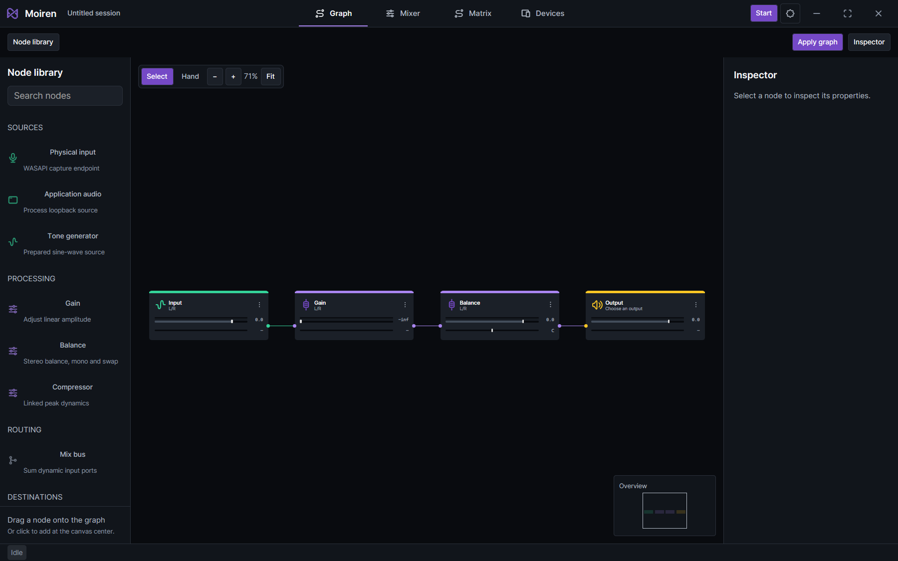
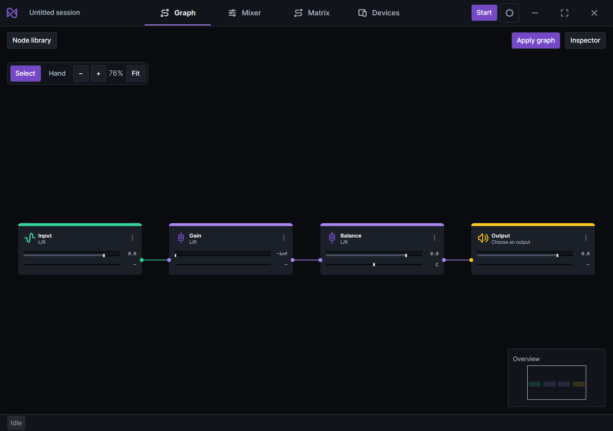
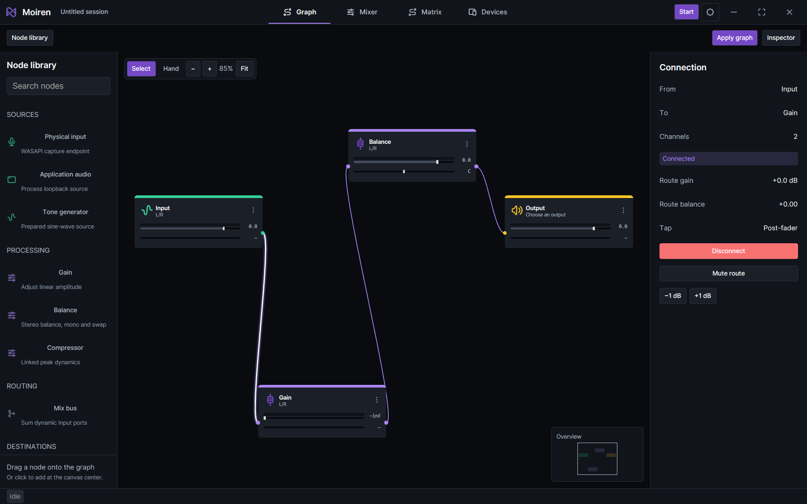
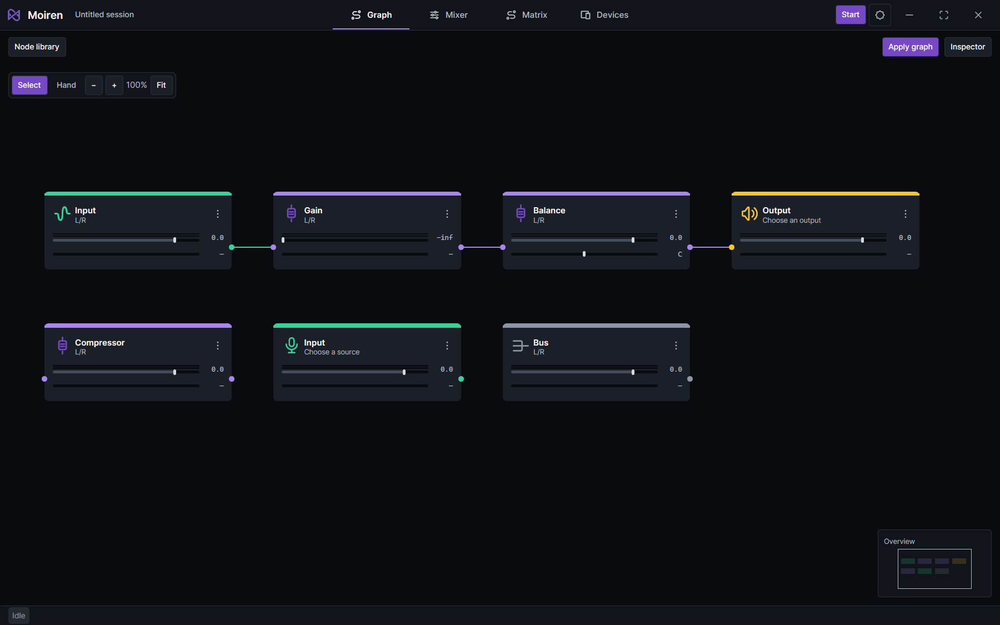

# Graph nodes and canvas interaction verification

Verified on Windows on 2026-10-16 using the production GPUI renderer.
The target viewports are 1440 x 900 and 1024 x 720 logical pixels.
Images include the machine's 125% display scaling.

The node references are Moiren UI v0.1.2 Input `556:11071`, DSP
`556:11072`, Output `648:12412`, and Bus `650:6644`. The cards use the
270 x 112 layout, category header, original SVG icons, stereo meter
tracks, gain and balance readouts, and edge ports. Parameters come from
the service snapshot. Card tracks display those values; parameter
editing is available in the selected node's Inspector. Unsupported
balance and unavailable meter readings remain unknown.

The capture service leaves audio stopped and does not write preferences.
These images verify native layout and selection appearance, rather than
hardware playback or live audio measurements.

## Native screenshots

The comfortable layout keeps the library and Inspector beside the canvas.



The compact layout preserves the drawing surface and uses collapsible panels.



A selected wire has a bright stroke and a soft halo. Its Inspector shows
the source, destination, channels, send gain, balance, and tap.



The node family capture uses 100% canvas zoom and includes a source that
has not yet been bound, plus DSP, output, compressor, and bus nodes.



## Verification

Run Cargo commands serially:

```powershell
cargo test --locked -j 2 -p moiren-app --features gpui-test -- --test-threads=2
cargo test --locked -j 2 -p moiren-app --features gpui-test --lib ui::window::graph::tests -- --test-threads=2
cargo clippy --locked -j 2 -p moiren-app --all-targets --features gpui-test -- -D warnings
cargo run --locked -j 2 -p moiren-app --features gpui-test --example ui_capture -- <temporary-directory>
```

The full application suite passed. The graph regression group was rerun
after the final gesture changes: all 12 tests passed. It covers dragging
connections in either direction, cancellation, fitted and fractional zoom,
stable node placement, node and wire deletion, text editing focus, refused
deletion requests, and selection and Inspector preservation during panning.
Application Clippy and formatting checks on changed frontend files passed.
The default test run skips the explicit native window and live hardware
startup tests.

Validation used the current shared workspace. The frontend commits depend
on the separate service, engine, and WASAPI changes; those backend changes
were kept out of the frontend commits.
