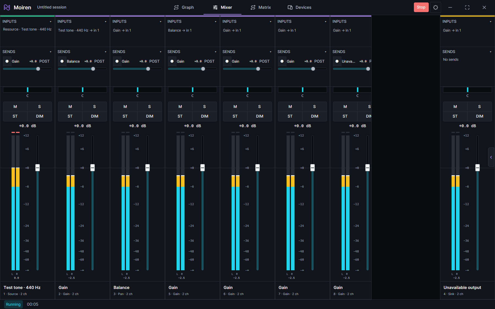
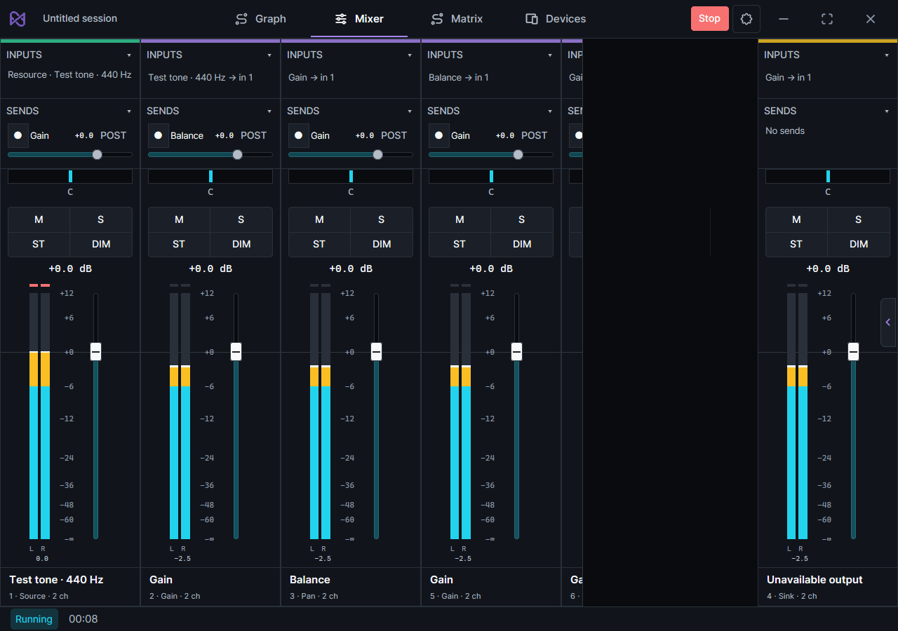

# Mixer meter render isolation

Measured on Windows on 2026-10-27 using the production GPUI renderer in
Release with `ui-profiler`. Baseline is commit `88d2774`; both sides use
the same eight-node fake-backend graph, display, viewport, and capture path.
No physical audio devices are opened and no preferences are written.
The percentile summary and event counts are retained in `timings.json`.

## Render boundary

- `MixerControls` caches the existing strip tree at its allocated page size.
- A sibling `MixerMeterFrame` pumps observations during prepaint, after
  controls report their current geometry and visibility. Its painting-only
  canvas reuses the original bar painter and has no input hitbox.
- Track/readout placements retain their scroll-container content masks.
  Real control changes invalidate the cached tree; elapsed-time publications
  do not. Slider model entities have explicit invalidation subscriptions;
  GPUI child notifications still invalidate input/hover/scroll state.
- Graph and tray rendering, audio processing, and meter ballistics are unchanged.
  The shell itself still renders; this is not whole-window render isolation.

## Release measurements

Three seconds per viewport, including startup/resize/inspector settling.
Values are milliseconds, p50 / p95. These are single-run local measurements,
not hardware-independent guarantees.

| Viewport | Metric | Baseline | Isolated |
| --- | --- | --- | --- |
| 1440 x 900 | CPU draw | 11.691 / 18.021 | 1.710 / 2.693 |
| 1440 x 900 | Prepaint | 7.461 / 11.886 | 0.331 / 0.663 |
| 1440 x 900 | Present interval | 12.540 / 18.863 | 4.248 / 6.998 |
| 1024 x 720 | CPU draw | 11.613 / 14.432 | 1.486 / 2.115 |
| 1024 x 720 | Prepaint | 7.537 / 9.613 | 0.320 / 0.529 |
| 1024 x 720 | Present interval | 12.126 / 15.242 | 4.181 / 6.116 |

CPU draw p95 is below the 4.17 ms budget for 240 Hz in both captures.
**Stable 240 FPS/physical 240 Hz is not established**: GPUI reports a 6.944 ms
display refresh interval (144 Hz), and scheduling/presentation still has tails.
Present events are not a measurement of physical scan-out refresh rate.

## Steady-state follow-up

One second of viewport settling is excluded, followed by twelve seconds per
viewport. `steady-timings.json` retains measured wall time, counts, percentiles,
deadline overruns and raw-report hashes. The previous table includes transitions
and remains the like-for-like comparison against the original pipeline.

| Viewport | Draw / present count | Measured time | Actual draw FPS | CPU draw p95 | Present gap p95 | Strip rebuilds |
| --- | --- | --- | --- | --- | --- | --- |
| 1440 x 900 | 2773 / 2773 | 12.051 s | 230.11 | 2.402 ms | 6.797 ms | 0 |
| 1024 x 720 | 2827 / 2827 | 12.035 s | 234.90 | 1.897 ms | 6.450 ms | 0 |

Both captures lose zero journal entries and meter samples. Meter paint counts
match draw counts. A managed-publisher regression also verifies that display
ballistics continue to change without rebuilding strips, rather than accepting
repeated paints of frozen levels. Screenshots still match the baseline except
for the elapsed clock.

The Windows compositor reports a nominal **239.998 Hz** composition/refresh
ratio (`10000000 / 41667`), distinct from GPUI's display-mode metadata above.
The capture now records both, without changing any system display setting.
All handled frame signals report `NativeCallback`; observed source gaps have
p95 6.386 / 6.217 ms. These signals may be coalesced and are **not** an independent
count of every native tick. Draw time also has occasional overruns: 23/2773
comfortable draws exceed 4.167 ms, compared with 0/2827 compact draws.

This closes the Mixer strip-rebuild bottleneck, **not the full sustained-240
acceptance gate**. The next investigation crosses into GPUI/Windows compositor
pacing, message dispatch and presentation, with remaining foreground/GPU costs
still possible contributors. This PR does not patch dependencies, bypass native
pacing with a busy loop, or claim every missed deadline is a scheduling fault.

The snapshots below match the same-commit baseline pixel-for-pixel after
excluding the elapsed clock area. This includes meter labels and peak readouts.
The compact capture has five visible/live nodes; the comfortable capture has
eight. Do not compare their subscription counts as an error.





## Reproduce

```powershell
$env:MOIREN_CAPTURE_METERS = '1'
$env:MOIREN_CAPTURE_STATES = '1'
$env:MOIREN_CAPTURE_SECONDS = '12' # Optional; default 3, bounded to 1..60.
cargo run --locked --release -p moiren-app --features ui-profiler --example ui_capture -- <output-directory>
```

Outputs include native screenshots, `meter-{comfortable,compact}.json`, and
`platform-{comfortable,compact}.json`. Schema v2 platform reports contain
`elapsed_ms`, actual `render_fps` / `present_fps`, frame arrays and foreground
journal arrays (including short-task summaries). Only the capture window's
frame/signal events count toward FPS. The bounded journal is drained every
250 ms; JSON serialization happens after measurement. Meter samples restart
for each viewport and expose any truncation via `dropped`.

Use platform `draw_ms` for total CPU render cost; meter-only timing includes
actual canvas painting, unlike the old element-construction-only instrumentation.
Use the explicit 4.167 ms budget, not GPUI's profiler late-frame flag: its
internal budget has a 120 Hz floor.

Regression tests cover cached animation frames, unrelated shell notifications,
control invalidation, live managed observations, clip reset, scroll geometry,
offscreen demand, settings pause, stopped observations, phase-only legacy
activation, slider notifications, vertical decoration culling, and existing Mixer
editing/dragging/routing/multichannel layout behavior.

Local verification: `cargo test --locked -p moiren-app --features gpui-test`
(389 passed, four explicit opt-in tests ignored), strict Clippy with the same
feature and all app targets, workspace/all-targets check, and rustfmt check.
Follow-up: `cargo test --locked -p moiren-app --features ui-profiler`
(391 passed, four opt-in ignored), strict Clippy with `ui-profiler`/all app
targets, and red/green tests for window-scoped diagnostics and sample reset.
