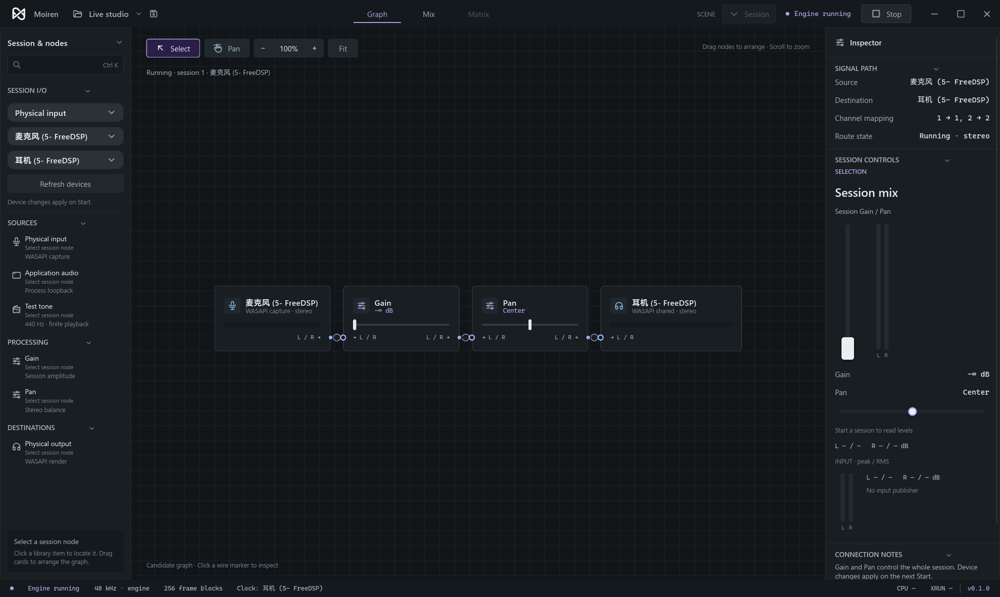

# 桌面自动启动修复与引擎压力测试

## 问题与修复

桌面入口调用 `start_service()`，但原来只启动应用线程并枚举设备，没有设置运行意图。新增 `EngineHost` 并不自动迁移旧应用 Service，因此此前打开窗口后仍停在 generation 0 / Idle。真实默认设备回归先复现了这个问题，再修复服务入口，而不是在 UI 中模拟点击 Start。

- 生产 `start_service()` 启用 `BackendDriver::with_automatic_startup()`：目录就绪后自动启动默认物理输入 → Gain/Pan → 默认输出，`UntilStopped`，初始 gain 为 0，防止麦克风突然回放。普通低层 `BackendDriver::new` 保留显式会话语义，已有 CLI 不变。
- 缺少默认设备或暂时枚举失败时，每秒至多一次目录重查，同一时间至多一个目录工作；显式 Start/Stop/退出取消这个启动意图。准备失败保持可见，不循环重启音频。
- UI 接收后端新 generation 的参数，正确显示静音，而不是仍显示原来的 0.01。正常同 generation 快照不反向覆盖正在操作的参数。
- 短压测发现参数竞态：RT 已切换而控制侧尚未确认时，旧 ControlPort 同步返回 StaleRevision。NextBlock 请求现在等待新映射；已经被新期望值取代的旧请求终结为 Superseded，不再冒充运行故障。显式 frame 请求不适用这条重路由规则。
- 并行窗口验收复现 `0x88890028`：另一个共享客户端已锁定不同周期。只针对 PERIODICITY_LOCKED 查询当前周期，在格式完全一致且周期合法时协商重试一次；保留原请求及失败诊断，不对其它初始化错误重试，不改用未知格式。依据 [Microsoft 的 Client3 初始化约定](https://learn.microsoft.com/en-us/windows/win32/api/audioclient/nf-audioclient-iaudioclient3-initializesharedaudiostream)。

本轮是现有桌面 Service 的默认启动接线，不宣称已完成全部应用图事务到 `EngineHost` 的迁移。压力探针直接测试托管引擎；桌面启动另外通过真实 capture/render 和窗口验收。

## 验证

先观察失败，再修复的回归：

1. `desktop_service_starts_without_a_ui_start_request`：修复前默认设备存在但仍 Idle；修复后 Running → 自动退出。
2. `automatic_startup_parameters_are_projected_from_the_service`：原来显示 0.01，修复后显示真实的 0。
3. 两项参数路由单测：原来返回 Rejected(StaleRevision)，修复后分别应用和 Superseded；Linux-target Miri 默认/Tree Borrows 均通过。
4. 共享周期协商单测：合法当前周期只重试一次，非法/相同周期不重试，重试失败保留真实设备错误，其它初始化错误仍然终止。
5. 缺少设备/枚举失败恢复不依赖 UI Refresh；用户 Stop 以及准备失败后的目录刷新均不会自动重启会话。

原生窗口用例先保留另一个真实共享输出 owner，再调用生产 `start_service()`，不发送 Start 请求。两个音频客户端同时运行，窗口显示 Engine running 和 −∞ dB，关闭完成后双方回收。硬件为 FreeDSP 默认输入/输出；测试不改变系统默认设备，不保存音频。



原生用例均为显式执行的 ignored 测试，普通 CI 不需要音频硬件：

```text
cargo test --locked -p moiren-app --test automatic_startup -- --ignored --nocapture
cargo test --locked -p moiren-app --lib desktop_automatically_runs_and_projects_muted_startup_without_clicking_start -- --ignored --test-threads=1 --nocapture
cargo test --locked -p moiren-windows-audio --lib shared_stream::wasapi::tests
cargo test --locked -p moiren-app --test service_backend automatic_startup
cargo +nightly miri test --target x86_64-unknown-linux-gnu --locked -p moiren-engine --lib host::parameters::tests
```

## 压力测试方法

Release 二进制 `moiren-windows-audio --example managed_stress`，真实 WASAPI 默认 Multimedia 输出，48 kHz / stereo，原生周期 480 帧（10 ms）。输入为软件 tone，处理链每四个节点一个 Compressor，其余 Gain，末级独立 Gain(0) 全程静音，不能被编辑或参数命令解除。所有 DSP 正常执行，但不采集麦克风。

机器：Intel Core Ultra 9 285H，16 个逻辑处理器。采集独立进程的 CPU 时间、private bytes、working set、线程和句柄，每秒一次；跳过前 5 秒取稳定运行阶段。CPU 同时记录单核口径和除以 16 的整机口径。不把 Slint/UI 或物理输入 clock bridge 的资源计入这个表。

```powershell
cargo build --release --locked -p moiren-windows-audio --example managed_stress
.\scripts\managed-stress.ps1
```

脚本只管理本轮启动的 PID，所有用例有超时，最后退出全部探针；不停止用户已有进程。目录已存在时拒绝覆盖。原始报告和每秒样本位于 [engine-stress](2026-10-14-engine-stress/summary.json)，每个用例保留完整 JSON/JSONL。

## 实测结果

下表节点数仅计算工作负载处理器，另有 source、末级静音 Gain、output 三个节点。

| 场景 | 运行时间 | 节点 | 编辑/参数每秒 | CPU 单核 / 整机 | Private 峰值 | Working Set 峰值 | Private 首尾变化 |
| --- | --- | --- | --- | --- | --- | --- | --- |
| 基线 | 60 s | 8 | 0 / 0 | 1.77% / 0.11% | 2.57 MiB | 12.41 MiB | +0.23 MiB |
| 持续更新 | 120 s | 64 | 20 / 200 | 5.02% / 0.31% | 5.69 MiB | 15.07 MiB | +0.69 MiB |
| 过载编辑 | 120 s | 120 | 400 / 2,000 | 27.31% / 1.71% | 6.84 MiB | 16.45 MiB | +0.37 MiB |

- 三档均无宿主 fault、回收错误、bridge shortfall、timeout wake 或非零输出。empty-padding wakes 为 0；这个计数本身不是对所有驱动 XRUN 的完整证明。
- 音频 callback 最大耗时分别约 0.360 / 0.848 / 1.267 ms，低于本次 10 ms 周期。时间线最长观测间隙分别 25 / 17 / 19 ms；轮询间隙不等同于 callback 期限。
- 句柄范围 188–189，线程范围 11–12；未随持续更新增长。反复启停 10 + 20 + 30 = 60 次，全部到达 Closed；最长关闭耗时 81 ms。
- 64 节点用例激活 2,399 个编辑事务，参数 21,493 Applied / 2,506 Superseded，全部已接受请求都有终结结果。
- 400 次/秒结构性编辑会大量合并：47,999 次已提交编辑中，2 个事务激活、47,997 个被取代；参数 49,463 Applied / 190,534 Superseded。持续编辑期间 active 可长期落后，停止提交后收敛到最新 desired。**这证明过载下音频继续运行且存储有界，不代表引擎能逐次激活 400 个图修改/秒。**

五分钟测量使用的二进制 SHA-256 为 `70A6B240E3F7606758900E4B17A1AD2B01392E6FD14D7278FFFF4C02E3BC5D4E`，已包含参数竞态修复。随后补充的周期冲突协商仅在另一个客户端锁定周期时触发，以上单输出探针未触发该分支；另有上述并行原生窗口回归覆盖。

全部代码修改后重建 Release，再按相同三档执行 10 / 15 / 15 秒复核及另外 60 次启停，仍全部通过；CPU 单核平均分别 1.14% / 11.31% / 29.62%，详见 [最终短复核](2026-10-14-engine-stress/final-smoke-summary.json)。短窗口与长窗口的中档 CPU 有明显波动，不能把 5.02% 当作固定开销；未绑定 CPU 核心或控制整机调度/频率，测试期间也有独立验证任务运行。两轮合计 120 次显式启停均闭合，工作集峰值均未超过长测表中的数值。

工作区 check/test、严格 Clippy 和 fmt 检查通过；目录等待逻辑最后补充后，再次运行应用全部测试以及相关原生/共享周期回归。新增参数竞态单测在两种 Miri 模式下通过，不声称重新执行过完整工作区 Miri。所有压力进程和验收窗口已退出，未推送或触发远程 CI。

## 边界

这是约五分钟持续运行与 60 次生命周期检查，不是小时级 soak、任意设备或物理拔插的稳定性保证；小幅 private 增长不能直接证明泄漏或完全无泄漏。没有测整个桌面进程的 UI/GPU 占用，也没有在此表中混入物理捕获或进程捕获成本。所有已接受请求终结计数、原生音频统计和逐秒进程数据均保留，便于延长测试或比较后续优化。
