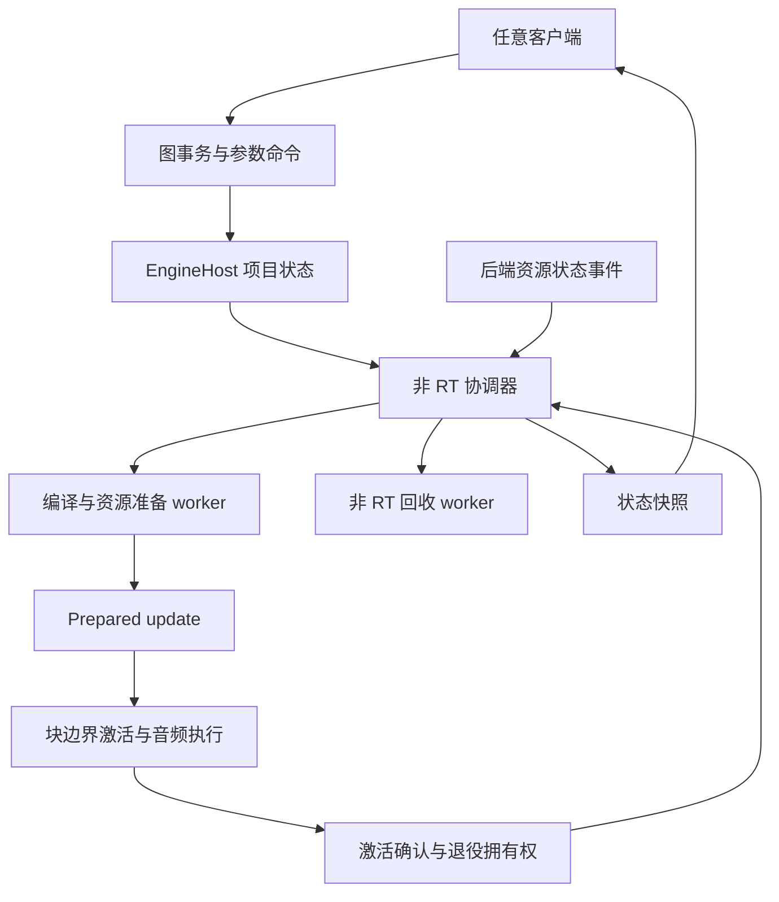

# 引擎托管生命周期与自动图更新

状态：后端托管宿主、自动图更新、Windows 适配与资源恢复已实现。应用/UI 采用是独立后续集成；后端接口及验收不依赖现有界面。

## 1. 目标与使用契约

创建或打开引擎宿主后，后端自动根据项目中的图、处理配置和 IO 选择准备并运行音频。提交节点、连接或处理配置修改后，后端自动更新执行状态。释放宿主时，后端自动停止并回收全部拥有的资源。

正常使用只需要打开项目、编辑图、修改参数和观察状态，不需要调用 compile、start、refresh、publish、retire 或 join。低层接口仍可用于离线处理、测试及特殊嵌入，托管接口内部使用这些接口。

所有客户端遵循同一后端契约。现有界面、按钮、SessionSpec 或应用 Service 的数据结构不构成引擎设计的约束。

资源驱动模型把宿主生命周期、音频资源可用性和图更新结果分别表达。设备缺失是依赖等待；非法编辑是事务拒绝；有效图的准备失败是更新受阻。这些情况都不删除项目的运行意图。

## 2. 实施前的后端基础与缺口

本节记录实施前核对的源码基线。托管宿主、更新编译和一致时间线现已实现；实施结果与验证边界见 [验收记录](../plans/2026-10-14-engine-managed-lifecycle-validation.md)。

| 位置 | 已有能力或限制 | 对本设计的影响 |
| --- | --- | --- |
| `crates/moiren-core/src/graph.rs` | 非 RT 的 LogicalGraph，稳定的图对象 ID | 继续作为拓扑权威 |
| `crates/moiren-engine/src/compiler.rs` | 消耗 NodeBindings，生成 Engine、ControlPort 与计划内映射 | 增加支持已有资源的更新编译入口 |
| `crates/moiren-engine/src/compiler/plan.rs` | 未连接输入分配初始化的静音 buffer；ProcessorId 按本次编译生成 | 未连完的合法图可静音；复用不能只比 ProcessorId |
| `crates/moiren-engine/src/runtime/swap.rs` | 非 RT prepare，块边界 swap，显式 DSP 复用，退役队列 | 托管层自动驱动发布、确认与回收 |
| `crates/moiren-windows-audio/src/render.rs` | DemandRenderer 拒绝 plan switching；TimelineObserver 的 epoch/revision 在构造时固定 | 原生热更新必须先解决输出绑定与一致的时间线观测 |
| `crates/moiren-app/src/service/core.rs` | 当前 failed 路径清除 desired | 新托管状态不能继承这个失败语义 |

## 3. 职责归属

`moiren-engine` 增加非 RT 的 `EngineHost`，拥有项目、协调器、编译任务、计划控制端、参数路由和回收任务。现有 `runtime::Engine` 继续执行已经准备好的音频计划。

项目包含真实的 `LogicalGraph`、以 NodeId 标识的处理器配置、IO 资源选择和编译预算。处理器配置是图节点的配套数据；不得复制一套 Node/Port/Edge 拓扑。图修改和配套配置修改必须在同一编辑事务中验证、提交。

`moiren-engine` 定义平台无关的后端资源契约。`moiren-windows-audio` 实现 WASAPI 资源准备、原生 owner、设备状态事件和取消。设备 COM 对象始终留在其所属线程中；引擎协调器只持有可跨线程的控制令牌与拥有权包装。

`moiren-core` 保持逻辑拓扑和必要的跨 crate 协议。第一阶段不把线程、Windows 设备或宿主生命周期状态加入 core。

后续 `moiren-app` 采用托管入口并提供项目加载、保存等应用功能。本轮不迁移正在演进的应用/UI；托管层已经能够被无界面程序直接使用和测试。



## 4. 宿主生命周期

`EngineHost::open` 是拟定的托管入口，接收宿主配置、项目和平台适配器。入口同步检查自身配置，创建协调器后自动提交项目准备工作。缺少可用设备时仍可成功打开宿主，并报告资源等待。

宿主状态为 `Opening → Open → Closing → Closed`。音频执行状态独立报告 `Dormant`、`Preparing`、`Running`、`WaitingForResources`；某次图更新也可以受阻，而已有音频仍正常运行。

没有可用输出或项目没有输出需求时，释放不再需要的执行资源并进入 Dormant/WaitingForResources。宿主和项目仍存在；不创建空转的音频循环，也不伪造时间线推进。有受支持的输出需求且资源就绪时，自动准备、激活并确认 Running。

`EngineHost` 是唯一运行生命周期 owner。控制句柄和观察句柄不延长宿主运行生命周期；owner 释放后，控制命令返回 Closed，观察句柄仍可读取最终快照。

`EngineHost` 只允许在非 RT 域使用。其 Drop 自动发起关闭并等待协调器闭合；实际设备停止、join、参数终结和资源销毁由回收 worker 完成。用户无需逐个停止 session、回收 plan 或 join 线程。

关闭开始后撤销所有准备工作的激活资格，取消待发布更新，唤醒后端 owner，并继续处理返回的拥有权。已提交的块边界切换可能先于关闭完成，此时按实际确认的 owner 回收，不能假定取消已经成功。

Closed 只能在准备任务、音频 owner、待发布计划、退役计划、参数终结和回收任务全部完成后发布。准备与回收使用独立的工作通道，阻塞的准备任务不能占用回收通道。

## 5. 图修改自动生效

托管控制入口接收有界的编辑事务，返回可观察的编辑凭据。凭据区分尚未验证、已接受、已生效、被新版本取代和被拒绝。请求入队不等于编辑被接受，准备完成也不等于计划已经生效。

| 修改 | 后端动作 |
| --- | --- |
| 增删节点、增删连接、修改端口布局 | 验证整个事务，接受后自动准备最新图版本 |
| 改变处理器静态配置或信号 schema | 准备资源变更，兼容时切换，否则重新创建相关资源 |
| Gain、Pan、Mute 等已有 schema 内的实时参数 | 更新项目中的期望参数并通过当前参数通道应用，不重编译 |
| 改变设备、处理采样率、block 上限或主时钟配置 | 判断 transport 兼容性，必要时自动执行 owner 更换 |
| 不影响音频语义的数据 | 不触发音频计划更新 |

图事务先在非 RT 的候选项目上执行、验证，再原子替换期望项目。非法事务返回具体错误，保持原项目不变。合法但暂时不能准备的项目保留为期望项目；快照明确显示实际运行的版本及受阻原因。

最多同时存在一个准备任务和一个已发布候选。连续编辑按接受顺序进入项目，协调器合并尚未准备的中间版本，只准备最新快照。合并编译请求不丢弃编辑；中间版本的凭据标记为被取代。

激活资格检查包含项目图版本、执行 owner generation、资源 generation 和准备时的 active basis。过时完成项不得覆盖最新项目或已恢复的 owner；其拥有权进入回收通道。已发布候选的取消若输给块边界激活，以实际确认结果为准，并继续准备最新版本。

内部区分以下身份，客户端无需自行维护它们：

- GraphRevision：拓扑、静态处理配置或 IO 选择的期望版本。
- PlanRevision：每次发布尝试的单调编号；同一图版本重新准备也使用新的计划编号。
- OwnerGeneration：一次音频执行 owner 的身份。
- ResourceGeneration：某项设备或边界资源当前可用状态的身份。
- TimelineEpoch：执行时钟的身份；兼容热切换保留 epoch 和 frame，owner 更换创建新 epoch。
- ParameterEditId：实时参数修改凭据；不因为参数编辑推进 GraphRevision。

active 图版本只在 RT 确认激活后推进。运行状态还需原生 owner 确认启动。参数单独报告应用结果，不能借计划激活确认声称全部参数已经生效。

## 6. 热切换与稳定 IO 所有权

更新编译需要表达“复用已有实例”和“创建新实例”，不能要求调用方每次重新构造全部 NodeBindings。复用依据为稳定图 ID、处理器静态配置、端口 schema、信号 schema 和边界资源身份。

已有低层 with_reuse 的 schema 检查继续保留；托管更新路径需增加非 RT 的实例描述、显式复用槽位和资源增量。候选只拥有新建资源及不可变复用描述，不读取或借用正在运行的 DSP 状态。到激活边界才转移可复用实例，失败候选不得取得它们。

输入 reader、输出 writer 与原生消费者必须保持单一 owner。准备候选时不得克隆 SPSC 端点、让两个 source 消费同一输入，或让新计划写入 renderer 没有消费的新输出桥。

兼容更新沿用同一边界资源及输出桥。保留可复用处理器的 DSP 历史和参数 ramp；真正新建的处理器按项目配置初始化。复用保留的实际参数与最新期望参数有差异时，由托管参数路由继续投递，并关联应用凭据。

图对象到 ProcessorId/ParameterKey 的映射随确认后的 active plan 更新。调用方只使用稳定的图对象身份；旧控制通道仍保留到其接受的请求全部获得终结结果。

DemandRenderer 对 plan switching 的现有限制，在稳定输出拥有权得到验证后才能解除。只删掉拒绝检查不能算实现热更新。

时间线观测必须返回相互一致的 `(owner generation, epoch, revision, frame)`。采用有界读取的一致快照；读取期间遇到更新时返回上一份一致值或暂不可用，不能在 RT 或观察端无限自旋。热切换后 revision 必须更新，不能继续使用构造时的 revision。

切换仍在音频块边界执行，且必须预留退役返回容量。没有返回容量时继续旧计划；协调器自动排空退役队列并推进切换。不得在 RT 分配、析构计划、阻塞等待或调用设备准备。

设备、格式或执行配置不兼容时，自动取消旧 owner、等待拥有权返回并回收，再启动新 owner。第一阶段允许这种更换产生明确的音频间隙，不承诺无缝跨设备切换。

## 7. 资源驱动的等待与恢复

恢复以仍保留的项目和资源需求为依据。协调器持续知道需要哪些资源；设备故障不会清空项目，也不会要求调用方重新提交启动请求。

| 情况 | 协调器行为 | 再次推进的依据 |
| --- | --- | --- |
| 设备未出现或已拔出 | 标记资源不可用，回收失效 owner，保留项目 | 对应资源的可用状态改变 |
| 选择跟随默认设备 | 解析当前默认设备，保留逻辑选择 | 默认设备身份改变 |
| 显式选定设备缺失 | 等待该身份，不擅自改用其他设备 | 该设备重新可用或项目改选 |
| 目标进程退出 | 标记该进程身份不可用 | 项目指定新目标；不得把复用 PID 当成原进程 |
| 非法图编辑 | 拒绝事务，保持原项目 | 新编辑 |
| 有效图超出预算或使用不支持的配置 | 保留期望项目，报告更新受阻；依赖仍有效的旧计划继续运行 | 图、预算或能力条件改变 |
| 过时准备结果或 stale basis | 自动回收过时结果并协调最新项目 | 当前项目与 active basis |

设备通知有缺口时，平台适配器可以为确实可恢复的资源安排有界、可取消的可用性探测。探测的间隔下限、并发上限和触发条件属于适配器配置；同一资源至多一个 outstanding 探测。资源 generation 或探测结果允许重新取得资源，静态编译错误不会进入探测循环。这样设备占用解除后仍能自动推进，不依赖并不存在的操作系统通知。

协调器记录受阻准备对应的图版本和依赖 generation。同一受阻条件只诊断一次，不因下一轮 poll、状态读取或无关参数修改而重新准备；相关图、配置、资源或 active basis 改变后才重新评估。可恢复资源的探测由适配器单独调度。

未连接的合法输入继续采用静音语义。设备缺失不能被伪装成成功连接的输入；第一阶段按现有 IO owner 组停止受影响执行，报告等待。独立路径的故障隔离、缺失输入的显式静音替身属于后续能力，只有具备正确的边界及故障报告后才允许启用。

失效设备上的旧计划不再是可运行的回退资源。保留旧计划的规则只适用于其 IO 和执行 owner 仍然有效的情况。

内部不变量损坏或 worker panic 单独报告为宿主故障，自动撤销相关激活并回收拥有权，保留项目诊断快照；不得循环激活同一故障对象或声称已经自动修复。

## 8. 参数与关闭期间的终结

每个已接受的参数请求都必须得到 Applied、Rejected、Superseded 或 owner 关闭导致的终结结果。不得因为换图、换设备或退出而静默丢弃请求。

实时参数只路由到已经确认的 active 映射。准备中的新节点接受期望值，但不向旧计划发出未知 ParameterKey；首次激活使用准备快照中的初值，再补齐准备期间的新值。

切换瞬间尚未应用的旧通道请求，按实际回复终结。只有仍存在、schema 兼容的稳定图目标才可将最新期望值重新路由到新计划；显式旧 epoch 的时间调度不得转换到新 epoch。

回收 worker 保留旧 ControlPort 和 ParameterRuntime，反复排空已有回复并拒绝剩余请求，再销毁端点。命令凭据的结果存储、回收任务与完成通知均有容量上限，任务派发前先预留完成和回收容量。

### 信号宿主与绑定

托管层自动创建、附加和退役执行所需的 RtHost 与 prepared bindings，调用方不需要 attach_signal_host。兼容图更新沿用已附加的信号宿主，权限与绑定更新和计划激活在同一事务提交，旧绑定在非 RT 域释放。

更换执行 owner 时，旧信号宿主在音频执行停止后退役，旧 publisher 权限和 lease 释放后再建立新的执行绑定。信号观测标识关联稳定图目标及执行 generation；不得将旧 owner 的最后一帧数据报告为新 owner 的实时数据。

订阅、dispatcher 和数据消费遵循 moiren-signal 的已有契约。应用可以管理其订阅需求，但订阅句柄不延长 EngineHost 的运行生命周期。

## 9. 后端接口与文件边界

以下为拟定接口职责，不是已存在的 API，也不固定具体 Rust 方法签名。

| 文件 | 职责 |
| --- | --- |
| `crates/moiren-engine/src/host.rs` | EngineHost、EngineControl、EngineObserver 的公开入口 |
| `crates/moiren-engine/src/host/project.rs` | 项目、事务验证、稳定图身份与配套配置 |
| `crates/moiren-engine/src/host/model.rs` | 状态快照、凭据结果、generation 与诊断 |
| `crates/moiren-engine/src/host/backend.rs` | 平台无关资源准备、取消、激活、观测和拥有权返回契约 |
| `crates/moiren-engine/src/host/supervisor.rs` | 有界协调、编辑合并、版本资格与自动启停 |
| `crates/moiren-engine/src/host/supervisor/requests.rs` | 编辑、参数与带配置来源的资源事件 |
| `crates/moiren-engine/src/host/supervisor/updates.rs` | 准备资格、激活确认、计划切换及更新合并 |
| `crates/moiren-engine/src/host/supervisor/snapshot.rs` | 一致状态发布及等待/受阻诊断 |
| `crates/moiren-engine/src/host/parameters.rs` | 稳定目标到计划内参数键的路由与终结 |
| `crates/moiren-engine/src/host/signals.rs` | 执行信号宿主、绑定准备、权限切换与退役 |
| `crates/moiren-engine/src/host/retirement.rs` | 非 RT 任务、回收容量、关闭排空 |
| `crates/moiren-engine/src/compiler/update.rs` | 增量资源准备、复用描述与更新编译 |
| `crates/moiren-engine/src/runtime/swap.rs` | 复用槽位与激活确认，保留现有 RT 所有权约束 |
| `crates/moiren-windows-audio/src/engine_backend.rs` | 托管引擎的平台适配入口 |
| `crates/moiren-windows-audio/src/engine_backend/preparation.rs` | 资源协商、availability 与取消 |
| `crates/moiren-windows-audio/src/engine_backend/owner.rs` | COM 线程 owner、启动确认与拥有权返回 |
| `crates/moiren-windows-audio/src/render.rs` | 稳定桥接、plan switching 支持与一致时间线观测 |

Backend 契约必须在编译依赖上避免循环：windows-audio 依赖 engine 定义的契约，engine 不依赖 windows-audio。原生 capture/render 的停止、线程终结及必要诊断留在原生 owner 中。

## 10. 分阶段交付

1. **托管宿主与自动关闭**：在 engine 建立项目、控制/观察句柄和资源 owner 契约。用可控假后端验证 open 自动准备运行、没有资源时等待、owner Drop 自动完成取消和回收。
2. **自动图更新与参数路由**：加入编辑事务、更新合并、复用槽位与确认语义。在可移植测试中验证修改后自动切换，DSP 状态连续，控制端正确终结，无 RT 分配或析构。
3. **Windows 托管适配**：实现 IO 准备和 owner 交还，解决 DemandRenderer 输出桥与时间线限制，支持原生图热更新及不兼容配置的自动 owner 更换。
4. **资源恢复**：接入平台资源事件和受限探测，验证拔插、默认设备变更、占用解除及进程身份失效。恢复能力的验证分为可移植状态机测试与真实硬件验证。
5. **应用采用托管 API**：应用通过统一的宿主接口加载项目和发出编辑；后端验收不依赖某个界面实现。

第一阶段保持单图执行线程和当前受支持的音频格式。多输出的独立时钟域、通用插件热卸载、跨设备无缝切换与局部故障隔离不作为本轮成立的前提。

## 11. 验收与验证

新增 engine 托管集成测试放在 `crates/moiren-engine/tests/host/`，平台适配测试放在 `crates/moiren-windows-audio/tests/`。沿用现有 runtime 分配跟踪和 swap 回归覆盖。

必须覆盖：

- 打开后无需启动命令，资源就绪自动进入 Running。
- 缺失资源时不清空项目；对应资源恢复后无需重新启动命令。
- 无输出需求不空转，有新输出需求后自动取得执行资源。
- 正常拓扑修改无需 compile/publish/refresh，确认后自动生效。
- 未连接输入静音；非法事务不部分修改项目。
- 连续编辑合并编译工作；过时准备和资源 generation 不得激活。
- 准备期间发生参数编辑，激活后最终值正确；DSP 历史及兼容 ramp 保留。
- 热切换输出桥单一消费者，输入桥单一消费者，不丢失已拥有的端点。
- 输出设备不变的更新不重启 stream；不兼容变更自动停止、回收并启动新 owner。
- 时间线快照在切换时保持一致，旧 epoch 调度不能跨 owner 应用。
- 回收队列满时 RT 继续旧计划，控制侧排空后更新自动推进。
- owner 释放、准备失败、取消竞态和 worker panic 均在非 RT 域回收资源；观察句柄不阻止 Closed。
- 每个已接受参数请求终结一次，关闭不遗留等待凭据。
- 信号宿主自动附加，热切换权限与计划一致提交，旧 publisher 和订阅不阻挡关闭。

实现后的可移植基础检查：

```text
cargo test --locked -p moiren-engine
cargo test --locked -p moiren-windows-audio
cargo check --locked --workspace --all-targets
cargo test --locked --workspace
cargo fmt --all -- --check
cargo clippy --locked --workspace --all-targets -- -D warnings
```

保留 CI 的 Ubuntu/Windows 与 nightly Miri 检查。原生启动、设备拔插、默认设备变更和占用恢复作为单独硬件验收，不能把假后端测试结果当作硬件能力证明。
