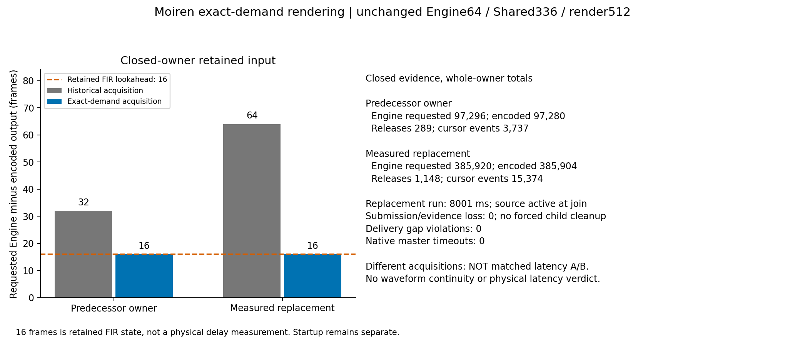

# Exact Master Demand, Without Rounded Engine Tails

## Scope

This increment advances S1-S3 implementation rather than repeating an unchanged
stability soak. Native app/source/OBS operations run only on the remote
`LAPTOP-NP49RG6H` through `moiren-lan`. Host execution is compilation and
pure/headless tests only. First-packet investigation remains deferred; missing
physical equipment does not block independent development.

Baseline is `5c14bca04b9010be421f3fdffef6ef39d5fab1a5`. The clean evidence
archive adds only the four intended code overlays; 27 preexisting dirty/cache
files remain excluded. Evidence root:
`D:\coding\moiren-evidence\20261101-clean-comb-probe-1320\s1-demand-tail-20261103-1343`.

## Production Change

The master Pump previously called `engine.render(max_block_frames)` whenever
native output needed another SRC refill. The Engine block limit is a ceiling,
not a required quantum. At equal rates, initial demand32 needs48 input frames
including FIR lookahead, while an Engine64 block rendered64. That speculative
tail was retained outside the native render queue.

The Pump now asks the existing FIR's `input_frames_needed` for the remaining
native demand and renders `min(missing, max_block_frames)`. Timeline and consumer
accounting use the actual rendered count. The native demand, pending-write
behavior, follower path, conservative whole-wake admission envelope, capacities,
targets, startup policy and defaults remain unchanged. This removes unnecessary
prefetch; it is not a measured end-to-end latency improvement.

## Software Verification

The regression fixture compiles the actual IndexedSource -> unity Bus ->
RingSink -> Pump path. Both f32 and f64 run all four supported Engine rates
against all four native rates, eight Engine ceilings (32 through4096), and
native demands `[32, 0, 512, 1, 336, 7, 64, 738]`. It checks exact Engine timeline
and output equality against an independently fed instance of the same FIR,
with no leftover sink-ring frames or drops. This is not an independent FIR
correctness proof.

Zero/partial native writes must drain the original pending payload without
rendering another demand; an oversized demand must fail without advancement.
The standalone allocator harness also checks exact cumulative Engine input
across both precisions. Its Process whole-wake test now counts a short final
Engine segment and its existing256-frame source subsegments explicitly, while
retaining the full-wake sum and admission assertions.

- RED: both exact-demand precision tests fail with the old Pump,64 rendered
  versus48 required. The failure log is retained.
- GREEN: five demand tests pass, including four new regressions.
- Windows audio library:848 passed,5 ignored,0 failed.
- Standalone RT harness:253 passed,0 failed; allocation/deallocation checks
  remain active. The first run's stale full-block expectation fails448 versus496
  and is retained separately, not relabelled as success.
- Feature-on all-target workspace check, strict all-target audio Clippy,
  workspace/RT rustfmt checks and release build all exit0.

The clean feature-workspace run closes at14:08:04 with2430passed,10ignored,
0failed across71harness summaries, including documentation tests. Command:
`cargo test --locked --workspace --features moiren-app/gpui-test -j1`, with
`RUST_TEST_THREADS=1`. This includes five zero-refill tests,20measured-UI tests,
and marker/rate/qualification harnesses19/8/24passed. Native-window tests remain
ignored. Final feature-on all-target workspace Clippy also exits0 with
`-D warnings`. No Linux, Miri or remote CI result is implied.

## Bounded Changed-Code Native Question

Remote root: `D:\MoirenTest\20261103-demand-tail-1343`.
The new app is34308608 bytes, SHA-256
`EBB7355050609CC324A7ED1F54868126A9740B09569817E1A22EF55BBBC939DA`.
The deployment ZIP is12689777 bytes, SHA-256
`29357B646F320A7C9DFAD96868F1C9D28E48CC30714CDE5464986639F1714334`.
Payload pins, source-overlay hashes and final intent are retained in the host
evidence root. Independent bounded read-only review finds no concrete launch
blocker. Shared runner files differ from the predecessor only by declared
fresh-root/task substitutions; the app and payload pins are finalized after
the successful release build. Local device-free Python46 and PS5/PS7 wrapper29
checks pass. Deployment verifies all payloads and the isolated33-file Python
environment; the final remote selfcheck closes Ready/result0 before native launch.

The single acquisition asks whether production Engine requests retain only
the FIR lookahead, rather than block-rounded input tails, for each immutable
owner. It keeps the preceding fixed configuration: deterministic20-second
indexed-v2 source on isolated Voicemeeter In2, Process -> unity Bus -> DAWN,
48k/f32/Engine64, Shared336/capacity738/render512/wake64/callback64. A two-second
Compatible measurement precedes an eight-second confirmed measured replacement
at1536/16384/96. Each owner has65536-frame PCM/render evidence storage.
Isolated portable OBS records DAWN output as stereo48k PCM24 MKV. Source
submission remains active through app join. Deadlines, held-child cleanup,
protected OBS/QQMusic identities, endpoint settings and loaded driver are
unchanged. Neither recorder coordinates nor FIR lookahead are physical latency.

Native results and final audit are recorded only from closed receipts. No
unchanged audio retry, refit of the previous inconclusive waveform association,
weakened quality gate or default promotion is authorized by this test.

## Closed Native Result

The one acquisition closes from13:58:52.832 to13:59:33.021 +08:00 on
2026-11-03. The scheduled task finishes Ready/result0. App, deterministic
source and isolated OBS all exit0 without forced cleanup. The replacement
runs8001ms, and the source is still submitting when the app joins. Both
immutable owner archives are complete:

| Owner | Engine requested | Native encoded | Difference | Releases | Cursor events |
| --- | ---: | ---: | ---: | ---: | ---: |
| Predecessor | 97296 | 97280 | 16 | 289 | 3737 |
| Measured replacement | 385920 | 385904 | 16 | 1148 | 15374 |

The16-frame difference is exactly the equal-rate FIR's retained lookahead.
Both complete cursor histories, packet sequence/frontiers and persisted byte
counts independently agree with their closed totals. Actual old-code owner
differences were32 and64frames in the preceding acquisition; these separate
runs are descriptive accounting, not a matched timing A/B or a measured delay
improvement. Accepted, stored and persisted render counts agree; rejected,
dropped, overflow, abandoned, invalid, unobserved, saturated and exhausted
evidence fields are zero/false. No native submit failure is reported.

Input PCM remains a different boundary:95520 and384480 frames. Requested
nonemitted source spans are4224 and3216frames. For the replacement the full
emitted382704 plus startup priming3216 equals requested385920. Startup
prime-discard384 is recorded separately, not counted as steady-state loss.
No waveform replay/OBS association is attempted for this accounting question.

The replacement's retained final counters report zero drops, silent frames,
nonfinite samples, discontinuities, timestamp errors, underruns, resets,
backlog/age/ingress recovery and low-water guard frames. All801delivery packets
fit the480-frame packet bound;800gap samples have maximum108753*100ns
(10.8753ms), below this run's admitted525-frame gap bound (10.9375ms), with
zero packet/gap violations or unavailable/regressed clocks. Master wait
timeouts are0. These finite software counters do not prove full-waveform
continuity, sustained reliability or physical latency, and do not erase older
runs' faults.

Remote-only closed-file analysis checks221input pins before and after,
including raw MKV, native input PCM, cursor chunks and encoded output. The final
audit additionally rechecks the analysis software and two outputs,224pins in
total. Its inspected figure is retained here:

The compact ZIP is271303bytes, SHA-256
`B2551674473033F216AB6590A0CA59923E3CBF334B669FB3EDE140A2372A4D2E`.
All six payloads are length/hash verified after transfer; raw audio stays remote.
The figure deliberately labels historical/new runs as unmatched and the16frames
as retained FIR state, not a physical delay measurement.

Final read-only audit at14:05:35 confirms all224pins and the new app binary
unchanged, no owned app/source/OBS/Python process or running Moiren task, and
the task Ready/0. Original protected OBS/QQMusic creation identities, default
endpoints, all12render endpoints' volume/mute/mix formats, running driver hash
and boot, and bare Moiren root bus remain unchanged. No cleanup is needed and
no background audio run remains. Qualification flags remainfalse; physical
latency remainsnull. This closes the bounded production-prefetch question,
not full S1-S3 acceptance.

## Integration And Preservation

Independent bounded read-only final review finds no concrete correctness/RT
blocker in the four-file code/test delta and confirms the boundary accounting
and evidence pins. All27preexisting dirty/cache file hashes remain unchanged;
unrelated main-worktree `docs/audit/2026-11-03/` remains untouched. Only the
four code/test paths, this receipt, the existing S1-S3 ledger and inspected PNG
belong to this increment. No push is performed.
