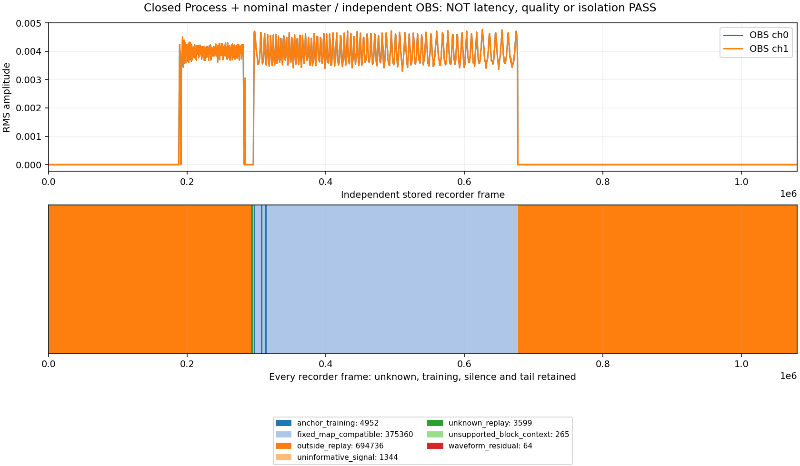

# Measured Process replacement with closed PCM and OBS evidence

Recorded 2026-11-03, Asia/Shanghai; committed source baseline `9a8aeba`.
This finite remote experiment uses the actual application. Independent scope
review and offline-tool development run alongside native acquisition. It adds
evidence, with no production/default change. First-packet work stays deferred.
Native audio/UI/OBS work runs only on `LAPTOP-NP49RG6H` via `moiren-lan`.

## Question and executed configuration

Does the application's measured Process configuration become the actual new
owner while changing excitation continues, and can its closed native PCM/SRC
archive be associated with independent OBS output?

- App: existing `D:\MoirenTest\20261103-app-e4de0d7\bin\moiren-app.exe`,
  34150400bytes, SHA256
  `1217C07CAB24BAFF8B57E6E7BC5536C82B4F9A7F913892389B0B50F922D0B128`.
  It includes zero-refill and whole-wake fixes; no app rebuild in this slice.
- Source probe: 7629312bytes, SHA256
  `853EF19F21D9184D0C97BEDC4E6505549E272F6E2B3650C2AD0555152450EA5D`;
  prior pinned four-overlay build, identical to `9a8aeba` probe code.
- Source: owned Process PID24520, creation FileTime134381482580921129,
  Shared480/48k stereo Float32/capacity1056 on Voicemeeter In2. Indexed-v2,
  40continuous24000-frame codes, amplitude0.005, total960000frames/20s.
- Graph: Process input -> unity Bus -> DAWN physical render; Engine64/F32.
  DAWN Shared requested/actual/engine period336, capacity738, render target512,
  wake margin64, callback budget64; no auto-conversion or fallback.
- App: measure2s then8000ms confirmed replacement. Requested/active
  Target1536/capacity16384/jitter96 match. Empirical max packet480/gap523frames,
  prepared demand704, published modeled input floor1325. Capacity is storage.
- Recorder: separate portable OBS/configuration/websocket, one DAWN WASAPI
  output track, no monitoring, zero sync offset, unity volume. This is software
  output capture, without a DAC/physical reference or source isolation control.

Source Ready/Running precedes app measurement. The runner observes service
generation2 and owner ordinal0002 with exact source identity, joins the app and
checks that the source submitted receipt is still absent. It then waits for
full submission, Stop/join source, recording inactive and OBS join. These
receipts constrain lifecycle order; they do not prove continuous delivery.
Native generation1 in both hosts is legitimate: ordinal and service generation
identify replacement, while replay labels come from actual archived spans.

## Original refusal and corrected source plan

The1030 attempt refuses before source Ready: `source codebook byte cap exceeded`,
source exit2. No app launches; OBS exits0 without force. The30s plan requires
1440000 f32 samples/5760000bytes, above the existing4MiB codebook cap. This is
our test-plan error, not a product audio fault.

Original directory/failure remain intact. The new1100 directory uses20s,
960000samples/3840000bytes. Its pure preflight checks exact schedule and the
existing Rust cap before OBS, including refusal of the original30s plan. No cap
or quality gate is enlarged. The app-join-before-complete-submission guard stays.

Corrected acquisition runs10:57:17.410-10:58:02.492. App/source/OBS all exit0
normally, without force. Run/cleanup receipts complete; both cursor owners
persist with native PCM enabled and archive error null. Source acknowledges
and submits960000nonzero frames, event timeouts0, successful Stop/worker join.
Its `latency-sensitive`/`jitter_tolerance_ms=3000` metadata is not an acceptance
threshold or permitted production latency. No unchanged audio retry follows.

## Native evidence and limits

| Closed archive | Original owner0001 | Replacement owner0002 |
| --- | ---: | ---: |
| Native packets | 199 | 800 |
| Offered/accepted/stored frames | 95520 | 384000 |
| Actual SRC events | 2920 | 11938 |
| Requested output frames | 97344 | 385600 |
| Reconstructed known frames | 93440 | 382016 |
| UNKNOWN/priming frames | 3904 | 3584 |

Both independent PCM audits are structurally complete with no refusals. Native
drop-tail, nonfinite normalization, silent-offered, discontinuity and timestamp
errors are zero in both. Unknown/priming remains validity0, not successful audio.
Ordinary bounded histories still overwrite; the independent persisted archives
provide reconstruction rather than pretending those histories are complete.

Replacement reports zero dropped/silent/nonfinite frames, underruns, resets and
backlog/age/ingress discards/recoveries. Startup priming3584 and prime discard384
stay separate. Captured/written384000 versus output382016 is not loss or latency.

**There are10 delivery gap-bound violations.** The799 gap samples retain maximum
111666 in100ns units/11.1666ms, exceeding admitted523frames. Packet-bound
violations, unavailable/regressed clocks are zero. Normal lifecycle and zero
reported audio-fault counters do not erase this result; delivery qualification
remains false.

## Closed waveform analysis

The unchanged PCM auditor reconstructs both owners. Owner0002 generation labels
come from validated actual spans with exact validity coverage; a refused owner
cannot supply an accepted partial prefix. Pinned Rust master projection applies
the unchanged same-rate FIR/Float32 codec:385584nominal frames,381985known.
It has no native master submission witness or prepared-route authority.

OBS has1080320stereo frames/22.5066667s. Earliest unique frozen anchor is window18;
shift-291960frames and per-channel gain/DC stay fixed for held-out checks. This
aligns stored file origins, not source-to-output latency. Gates are unchanged.

| Full recorder classification | Frames |
| --- | ---: |
| Fixed-map compatible | 375360 |
| Outside selected owner replay | 694736 |
| UNKNOWN replay | 3599 |
| Uninformative signal | 1344 |
| Anchor training | 4952 |
| Waveform residual | 64 |
| Unsupported block context | 265 |
| Total | 1080320 |

Generation mismatch, nonfinite, clipping and partial-block-tail categories are
zero. Every frame is accounted for; no crop or discarded tail. The64residual
frames at recorder[677120,677184) are retained without assigning product fault,
startup/shutdown phase or physical cause from file alignment alone.

The PNG is actually viewed: initial changing interval, short silent gap, longer
owner0002-compatible interval, silent tail. Initial interval/gap lie outside the
selected replacement replay; their cause and an isolation PASS are unproven.
Different duration/timing from VAD6s also prevents an exact matched comparison.
Waveform/quality/isolation/physical qualifications stay false; latency null.

## Verification, transfer and cleanup

Native wrapper39pure tests pass locally/remotely; final selfcheck Ready0 precedes
native. Analysis15pure tests pass locally/remotely. Original remote14-test attempt
fails because a test stub refuses Python3.10's cold Windows `platform` query.
Revised tests mock platform facts without allowing a child. Original tests,
logs/intent and scratch directory stay under `analysis-original-attempt`.
The next entry refuses an already-existing scratch directory before starting;
that directory is moved, with absolute source/destination boundaries checked,
into the original attempt. No computation or native acquisition is rerun.

Closed analysis runs once: eight bounded children exit0, all217input/tool pins
match before/after. Declared limits: recorder3840000frames, input128MiB,
4096files; over-limit decode refuses rather than accepting a crop.

Compact export initially refuses its2MiB transfer cap because full summary is
2213852bytes, duplicating native case/monitor receipts. Full summary stays remote,
SHA256 `94FDC490264974CD93215CD23F63790A9BA2BABF2517BA3EC0EB2F21783D311B`.
Separate compact projection omits only duplicated `original`, retaining its
identity/length/hash and every analysis category/run. No existing cap changes.

- Original1030 ZIP31875bytes/20payloads:
  `266723CC0FFF87846978116B4410073F785AE1BAFD971BBC4E4C9D0B38C4FF19`.
- Corrected1100 ZIP454361bytes/66payloads:
  `04F32156D205798060FBE7C18B09779808160F54DC2356A6ED7755806705D74E`.
- Both ZIPs and every entry are independently length/SHA256-verified after
  download. PCM, decoded/reconstructed arrays and full cursor chunks stay remote.
- Final11:06:20 audit: no test owner/task; protected OBS/QQMusic creation
  identities, defaults, render volume/mute/format, driver hash/boot and healthy
  bare `ROOT\MEDIA\0001` remain unchanged. No uninterrupted-audio claim follows.

Remote roots: `D:\MoirenTest\20261103-measured-waveform-{1030,1100}`. Host roots:
`D:\coding\moiren-evidence\20261101-clean-comb-probe-1320\s3-measured-waveform-20261103-{1030,1100}`.
All27original dirty/cache hashes match. No push, production change or background
soak is left. Prior2360/9ignored Cargo workspace receipt belongs to the preceding
sampler commit; no fresh Cargo result is claimed for this evidence-only slice.

Original bounded S1-S3 software mechanisms are present under declared conditions.
This advances measured replacement/waveform observability. Smaller-setting
delivery, successful retained native Evaluate/Apply, relevant desktop acceptance,
sustained/matched route evidence and calibrated physical qualification stay
separately open in the [ledger](2026-10-29-s1-s3-software-ledger.md).
