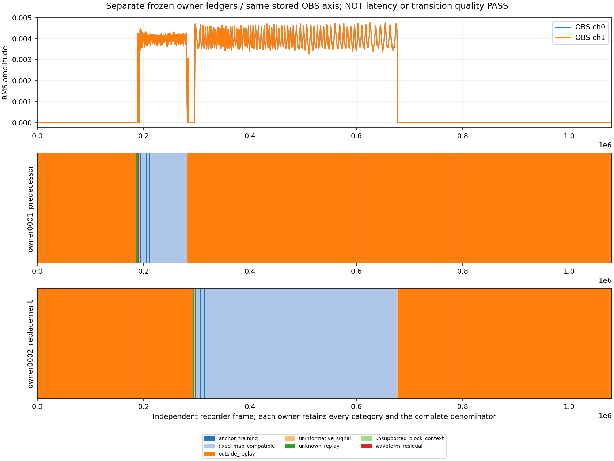

# Separate frozen owner ledgers on the same OBS recording

Recorded 2026-11-03, Asia/Shanghai; baseline `fd9dc71`.
This advances S1's existing changing-waveform evidence using closed files from
the [measured Process acquisition](2026-11-03-measured-process-waveform.md).
No audio clients, OBS, app, driver or device streams are opened again. First
packet work remains deferred. The previous10delivery-gap violations and64frame
replacement residual stay unchanged; this is not a new qualifying audio run.

## Distinct closed-data question

The prior analysis selects owner0002 only, leaving the initial OBS changing
interval outside that replay. Both original native owners already have
structurally complete PCM/cursor audits. This follow-up asks whether a separate
fixed map from the predecessor's actual SRC output is compatible with that
initial interval, without searching again for a better replacement result.

The pinned existing native PCM reconstruction, actual cursor generations and
unchanged Rust nominal master FIR/Float32 helper supply owner0001's projection.
Its97344requested SRC frames become97328nominal master frames,93409known.
Unknown/priming and FIR support stay invalid; native submission remains unproven.
Both owners report native generation1, distinguished by ordinal and service
origin. Process PID24520/creation134381482580921129 match both archived origins.

Owner0001 gets one earliest unique frozen anchor across the same64unlabelled
uniform8192-frame recorder windows. Owner0002's original anchor and full-frame
audit are reused without modification. Each owner retains its own complete
1080320-frame denominator; no local owner selection, crop, refit, rate search,
gate adjustment or conversion of unknown/training/silence into a pass occurs.

## Result and boundaries

Remote offline task `Moiren-OwnerTransition-20261103-1120` closes Ready0. Its
seven bounded child commands exit0. The predecessor anchor is window12,
file shift-185080frames, generation1; both channel gains are about1.000000064,
DC about-5.92e-8. Original replacement shift stays-291960. These independent
stored-file maps are not source-time latency, a common clock or boundary phases.

| Full recorder category | Predecessor0001 | Original replacement0002 |
| --- | ---: | ---: |
| Fixed-map compatible | 83712 | 375360 |
| Outside selected owner replay | 982992 | 694736 |
| UNKNOWN replay | 3919 | 3599 |
| Uninformative signal | 2432 | 1344 |
| Anchor training | 6144 | 4952 |
| Waveform residual | 832 | 64 |
| Unsupported block context | 289 | 265 |
| Total | 1080320 | 1080320 |

Generation mismatch, nonfinite, clipping and partial-block-tail categories are
zero. Predecessor residual intervals on the stored recorder axis are
[190080,190784),[191744,191808),[281856,281920). Original replacement residual
[677120,677184) is preserved. Their cause is not established by this analysis.

The two categorical ledgers overlay into42runs/13category pairs. Every pair
retains both original labels; neither compatible category overrides the other
owner's outside/unknown/residual label. The pair totals sum to1080320, including
597408frames outside both maps. The predecessor's nominal stored extent is
[185080,282408), replacement [291960,677544); their9552-frame coordinate gap is
unattributed, not a measured interruption/latency or proof of causal replacement.



The PNG is actually viewed. The initial changing interval contains predecessor
compatible samples, while the later interval contains replacement compatible
samples. Both residual/unknown/training regions and the gap remain visible.
This narrows the initial interval's waveform association without establishing
isolation, transition continuity, native master submission or physical delay.
All quality/identity/physical qualification remains false, physical latency null.

## Reusable bounded categorical tool

[`scripts/process-owner-ledger.py`](../../scripts/process-owner-ledger.py) exposes
the pure category overlay and a closed-JSON CLI:

```text
python scripts/process-owner-ledger.py --frames 1080320 \
  --owner predecessor predecessor.json --owner replacement replacement-audit.json \
  --output NEWFILE.json
```

Supply each owner's actual full-recording audit, not a report with only accepted
windows. The helper validates exactly two unique owner names, exact count/run
agreement, complete contiguous partitions, integer lengths,3840000frame cap,
4096runs per owner and at most8191joint runs. Duplicate JSON keys, oversized
input/output, missing tails and existing output refuse. It preserves labels and
never reads audio, chooses an owner or infers latency/phase. Standard-library
tests cover malformed/overlapping partitions, UNKNOWN/residual retention,
immutability, numeric/run bounds and CLI parsing/no-overwrite.

The integrated tool's19tests pass independently on the host, along with105tests
across the six existing offline VAD suites. Running the CLI on both actual
full-recording audits reproduces the sealed remote42-run/13-pair overlay exactly;
a second write to the same output refuses without changing it. The workflow's
always-run format job now includes the new suite. This is local verification,
not a newly run GitHub CI or Cargo result.

## Provenance and cleanup

Original217input/tool pins are checked against their prior before/after receipt.
The complete232-input inventory additionally covers consumed reconstructed PCM,
validity, original nominal master, decoded recording, reports and wrapper tools.
All232 match before/after. Five newly generated projection files are pinned
before and after association; generation labels also match across the master
projection. Analysis failure would still trigger a bounded final hash audit.

The overlay's10pure tests and parser/hash3tests pass locally and on remote
Python3.10; duplicate-key rejection has actual RED then GREEN. Remote lifecycle
is task,270s outer, finite held-child waits/reap, no native launch. One status
read accidentally serializes PowerShell provider metadata attached to log lines;
that verbose output is kept separately and is not analysis evidence. The compact
task/result/hash receipt is derived without repeating the computation.

Compact ZIP184143bytes,14payloads, SHA256
`593A9FD41B0333429A2799B86E81E8405ACB0843F0BBB1A9C1829D01BDF49930`.
Archive and every entry are length/SHA256-verified after download; PNG is viewed.
Raw/reconstructed PCM, masks and cursor chunks remain remote. Final11:27:08
read-only audit records no test owners/running tasks, unchanged protected
OBS/QQMusic identities/default/render controls/driver/boot and healthy bare bus.
The final audit file is written under the original acquisition root, as declared
by the reused audit; it does not change any pinned acquisition file.

Remote output: `D:\MoirenTest\20261103-owner-transition-1120`.
Host evidence: `D:\coding\moiren-evidence\20261101-clean-comb-probe-1320\s1-owner-transition-20261103-1120`.
Original27dirty/cache files remain preserved. This Python/evidence slice changes
no product RT, owner lifecycle, buffer/default, admission or quality threshold.
S1-S3 native/physical acceptance remains open; no push or audio soak is left.
